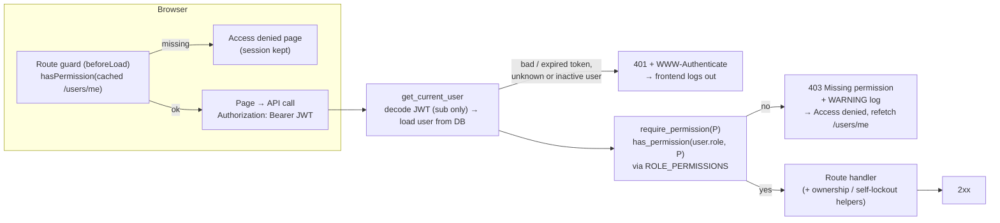

# Role-based access control for the Full Stack FastAPI Template

[](../../actions/workflows/test-backend.yml)
[](../../actions/workflows/test-frontend.yml)
[](../../actions/workflows/playwright.yml)
[](../../actions/workflows/security.yml)

This is my solution to a [full-stack test assignment](docs/ASSIGNMENT.md): add RBAC to the
[Full Stack FastAPI Template](https://github.com/fastapi/full-stack-fastapi-template).
There are three roles, **admin**, **manager** and **member**. One policy file decides what each
role may do. The API enforces it on every route, and the UI renders from the permissions the API
returns.

| Admin: full user management | Manager: read-only users | Member: direct navigation is refused |
|---|---|---|
|  |  |  |

More screenshots: [manager metrics](docs/screenshots/manager-metrics.png),
[users at 390px](docs/screenshots/mobile-users.png),
[access denied at 390px](docs/screenshots/mobile-access-denied.png).

## Quick start

You need Docker with Compose v2.

```bash
docker compose up -d --build
```

The backend container applies migrations and seeds the users before it starts. After about a
minute, open **<http://localhost:8000>**.

These accounts are **local demo credentials only**. They come from the committed `.env` and are
created only by the local Compose setup:

| Role | Email | Password |
|---|---|---|
| admin | `admin@example.com` | `changethis` |
| manager | `manager@example.com` | `changethis` |
| member | `member@example.com` | `changethis` |

Other local URLs: Swagger UI <http://localhost:8000/docs>, Adminer <http://localhost:8080>,
Mailpit <http://localhost:8025>.

## Two-minute walkthrough

1. **Admin.** Log in as `admin@example.com`. The sidebar shows Users, Metrics and System. On
   **Users**, add a user and pick a role, or edit someone's role.
2. **Manager.** Log out and log in as `manager@example.com`. **Users** is now read-only: no Add
   User button and no row actions. **Metrics** still works, and System is gone from the sidebar.
   Open <http://localhost:8000/system> directly: you get **Access denied**, and you stay logged in.
3. **Member.** Log in as `member@example.com`. Only Dashboard and Items remain. Open
   <http://localhost:8000/admin> directly: Access denied again, with a way back.

To see that roles are not cached in the token, stay logged in as the manager in one browser and
demote that account as admin in another. The manager's next request is refused.

## Who can do what

| Action | Permission | admin | manager | member |
|---|---|:-:|:-:|:-:|
| View own profile | `profile:read` | ✓ | ✓ | ✓ |
| Update own profile and password | `profile:update` | ✓ | ✓ | ✓ |
| Delete own account | `profile:delete` | ✗¹ | ✓ | ✓ |
| Create, read, update and delete own items | `items:use` | ✓ | ✓ | ✓ |
| Access other people's items | `items:manage_all` | ✓ | ✗ | ✗ |
| List users and view a user | `users:list` | ✓ | ✓ | ✗ |
| Create a user, including their role | `users:create` | ✓ | ✗ | ✗ |
| Edit a user, including role and active status | `users:update` | ✓ | ✗ | ✗ |
| Delete a user | `users:delete` | ✓ | ✗ | ✗ |
| View metrics | `metrics:view` | ✓ | ✓ | ✗ |
| Manage global settings (System page) | `settings:manage` | ✓ | ✗ | ✗ |

¹ So that the system can't lose its last admin: admins can't delete their own account, nobody can
change their own role, deactivate or delete themselves through `/users/{id}` (403), and removing
the last active user who can manage users is refused (409).

`PERMISSION_MATRIX` in [`test_authorization.py`](backend/tests/api/test_authorization.py) is the
executable form of this table, endpoint by endpoint. The only public endpoints are login, signup,
password recovery and reset, the health check, and the development-only `/private` router.

**Status codes:** `401` means the token is missing, invalid or expired, or the user is deleted or
inactive, so the UI logs out. `403` means you are authenticated but not allowed, so the UI keeps
your session. `422` means `role` was sent to signup or `PATCH /users/me`, which reject unknown
fields.

## How it works

**Storage.** `user.role` is a `VARCHAR(32)` validated by the `UserRole` enum, defaulting to
`member`. I chose a plain string over a Postgres enum so that a new role needs no migration. The
JWT carries only the user id. The role is read from the database on every request, so a demotion
applies on the next request with the same token.

**Backend enforcement.** [`app/core/permissions.py`](backend/app/core/permissions.py) is the single
policy: a `Permission` enum and a `ROLE_PERMISSIONS` map. Routes declare what they need with
`dependencies=[Depends(require_permission(Permission.USERS_LIST))]`, and no route compares role
names. Rules that depend on data (item ownership, self-lockout) are small named helpers. Every
refused action is logged at WARNING with user id, role, reason, method and path template. A test
walks all routes and fails if a non-public endpoint has no permission check.

**Frontend capabilities.** `GET /users/me` returns the user's `role` and computed `permissions`.
The UI calls one helper, `hasPermission(user, Permission.X)`, to filter the sidebar, show controls
and guard routes, and the guards read the cached user. There is no role-to-permission map in the
frontend. Hiding UI is only a convenience; the API enforces every rule.

**Adding a role** takes two edits in `permissions.py`: a `UserRole` member and a `ROLE_PERMISSIONS`
entry. No migration or route changes are needed. Then regenerate the client
(`bash scripts/generate-client.sh`) so the role appears in the role picker, and add the role to the
matrix test and the table above.

## Tests and migrations

Backend tests are safe to run at any time. They use a dedicated `<database>_test` database, created
and migrated automatically, and refuse to run against anything else, so your demo data stays intact.
They need the `db` service.

```bash
cd backend
uv sync
uv run bash scripts/tests-start.sh   # unit + integration tests, with coverage
uv run bash scripts/lint.sh          # mypy (strict), ty, ruff
```

```bash
cd frontend
bun install
bun run lint                         # read-only; `bun run lint:fix` applies fixes
bun run typecheck
bun run test:unit                    # bun test: permission helpers and API error policy
```

End-to-end tests run against the built app served by the backend, the same way CI runs them:

```bash
docker compose run --rm playwright bunx playwright test
```

To run them from your machine instead, use `bunx playwright install chromium` once, then
`PLAYWRIGHT_BASE_URL=http://localhost:8000 bunx playwright test` from `frontend/`.

Migrations are managed by Alembic. Run these inside `backend/`, or prefix them with
`docker compose exec backend`:

```bash
uv run alembic upgrade head                                   # apply
uv run alembic downgrade -1                                   # roll back one revision
uv run alembic revision --autogenerate -m "describe change"   # after editing app/models.py
```

The RBAC migration maps `is_superuser = true` to `admin` and everyone else to `member`, then drops
`is_superuser`. Its downgrade is lossy: managers become regular users.

To develop without the backend container, run `docker compose stop backend`, then
`cd backend && SEED_DEMO_USERS=true uv run bash scripts/prestart.sh && uv run fastapi dev`, and
`bun run dev` from the repo root for the Vite server on <http://localhost:5173>.

## Design notes and limitations

- [ADR 001](docs/adr/001-permission-map-and-dependency-factory.md): why a permission map and a
  dependency factory, rather than inline checks, middleware or a policy engine.
- [ADR 002](docs/adr/002-backend-supplied-capabilities.md): why the backend supplies capabilities
  and the role comes from the database, not the JWT.
- [NOTES.md](NOTES.md): decisions, trade-offs, time spent and what I'd do next.



Main limitations, all inherited from the template: the token lives in `localStorage`, there are no
refresh tokens or revocation, and login has no rate limit. Roles are fixed in code by design.

## Attribution and license

Built on the [Full Stack FastAPI Template](https://github.com/fastapi/full-stack-fastapi-template)
by Sebastián Ramírez, under the MIT license (see [LICENSE](LICENSE)). The template's own guides are
kept in [development.md](development.md), [deployment.md](deployment.md),
[backend/README.md](backend/README.md) and [frontend/README.md](frontend/README.md).
