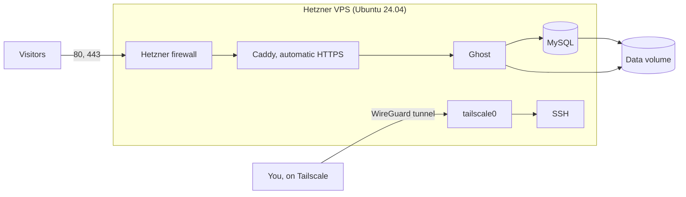

# Task 2 conversation, as exported from Claude Code

This is the real conversation in which this project was built, rendered from the Claude Code
session transcripts. It starts at the Task 2 prompt (2026-11-04 19:08:18 UTC) and ends at
2026-11-04 21:06:34 UTC, when it was exported.

**What is included:** every message you sent, every reply from Claude, and every tool call.
Tool output is included but cut to a limit. File contents written by Claude are replaced by
their path and size, because the files are in this repository.

**What is left out or changed:**
- Secrets and personal identifiers are redacted (tokens, keys, an email address, a second
  GitHub account name, the home directory). No cloud credentials had been used when this was exported.
- Output from tools that listed the author's other, unrelated sessions is omitted, and so
  are the tool calls that prepared this file, because they name what is being hidden.
- Automatic system and CI notifications are omitted, and counted below.
- Claude's reasoning blocks are empty in the transcripts, so there is nothing to include.

**Several models took part**, listed in the table. Claude Opus 5.5 wrote the first part. Its
response was then stopped by the platform's safeguards, shown below, and the work continued in new
sessions with Claude Sonnet 5.5 and then Claude Haiku 5.5, which reviewed, tested and extended it.

| Count | |
|---|---|
| claude messages | 61 |
| tool calls | 114 |
| tool calls omitted (preparing this file) | 17 |
| tool results | 100 |
| tool results omitted as private | 14 |
| user messages | 14 |
| messages by <synthetic> | 4 |
| messages by claude-haiku-5-5 | 36 |
| messages by claude-opus-5-5 | 5 |
| messages by claude-sonnet-5-5 | 16 |

---

## You, 2026-11-04 19:08:18 UTC

```
This is task 2 
 infrastructure question task - Develop one click script to deploy ghost blog platform at a Hetzner VPS with no public SSH access, only through tunnels (any provider/app)

so: 

<pasted_content id="bb1f">
Implement Task 2 in this repository: a one-command script to provision a Hetzner VPS and deploy a working Ghost blog with HTTPS. Block public SSH access entirely; allow SSH administration only through a secure tunnel, such as Tailscale.

Keep the solution simple, reproducible, and safe to rerun. Use persistent storage, keep secrets out of Git, and document prerequisites, credentials, domain/DNS setup, deployment, tunnel access, backups, and cleanup. Verify that the blog is publicly reachable and SSH is accessible only through the tunnel.

Add the infrastructure files and link them from the root README. Include the actual exported AI conversation history, with secrets redacted; do not fabricate it. Complete and validate the code before requesting approval to create paid cloud resources.
</pasted_content id="bb1f">
```

## You, 2026-11-04 19:09:40 UTC

```
Your response above was stopped by a safety classifier — this is not a tool or API error. The rest of it was withheld, and tool calls in it that had not finished did not run. Do not produce that content again, even reworded.
```

## Claude (claude-opus-5-5), 2026-11-04 19:10:03 UTC

The previous reply was cut off, so I'm picking this up from the start with your Task 2 brief. I'll check the repo state and which tools are installed first, because that decides the design. No cloud resources will be created without your approval.

**Tool call: `mcp__ccd_turn__update_plan`**

```json
{"items": [{"content": "Check repo state and local tooling", "status": "in_progress"}, {"content": "Build infra files (provisioning, Ghost, HTTPS, tunnel)", "status": "pending"}, {"content": "Add backup, verify and cleanup scripts", "status": "pending"}, {"content": "Validate locally without paid resources", "status": "pending"}, {"content": "Write docs and link from root README", "status": "pending"}, {"content": "Export and redact AI conversation history", "status": "pending"}, {"content": "Request approval for paid cloud resources", "status": "pending"}], "scope": "continuation"}
```

*Tool output:*

```
Plan shown (7 steps).
```

**Tool call: `Bash`**

```bash
cd ~/Documents/fullstack-rbac-test && git status --short | head; git branch --show-current; git fetch -q fork 2>&1 | tail -1; git log --oneline -3 fork/main; gh pr list --repo maslovhustle/Fullstack-Dev-Test-Task --state all --json number,state,title --jq '.[] | "#\(.number) \(.state) \(.title)"'; gh run list --repo maslovhustle/Fullstack-Dev-Test-Task --branch main --limit 8 --json name,conclusion,status,headSha --jq '.[] | "\(.name): \(.status)/\(.conclusion) \(.headSha[0:7])"'; echo "--- tools"; for t in tofu terraform hcloud tailscale shellcheck ansible docker jq yamllint; do printf "%-11s" $t; command -v $t >/dev/null && ($t --version 2>/dev/null || $t version 2>/dev/null) | head -1 || echo missing; done; docker info --format 'docker server {{.ServerVersion}}' 2>&1 | head -1
```

*Tool output:*

```
feat/ghost-hetzner
8ae0d2b Merge pull request #3 from maslovhustle/fix/flaky-e2e-tests
43450d2 docs: state tooling requirements; trim ADRs; drop a finished item
a1d66ec test(e2e): stop using Math.random for generated test data
#3 MERGED Fix flaky e2e tests and finish the documentation
#2 MERGED Publish the RBAC project on main
#1 MERGED Add role-based access control (admin, manager, member)
Smokeshow: completed/success 8ae0d2b
Zizmor: completed/success 8ae0d2b
Conflict detector: completed/success 8ae0d2b
Test Frontend: completed/success 8ae0d2b
Security: completed/success 8ae0d2b
Test Backend: completed/success 8ae0d2b
Test Docker Compose: completed/success 8ae0d2b
Playwright Tests: completed/success 8ae0d2b
--- tools
tofu       missing
terraform  missing
hcloud     missing
tailscale  missing
shellcheck missing
ansible    missing
docker     Docker version 20.10.14, build a224086
jq         jq-1.7.1-apple
yamllint   missing
docker server 20.10.14
```

**Tool call: `Bash`**

```bash
cd ~/Documents/fullstack-rbac-test && git log --oneline -3; git log --oneline fork/main..HEAD | wc -l; git log --oneline HEAD..fork/main | wc -l; ls -a infra 2>/dev/null | head -20; git ls-files | grep -iE "ghost|hetzner|^infra/" | head; git stash list | head -3; for r in brew; do command -v $r; done; brew --version 2>/dev/null | head -1; mkdir -p /dev/null 2>/dev/null; docker run --rm --pull=missing koalaman/shellcheck:stable --version 2>/dev/null | sed -n 2p; curl -s https://api.github.com/repos/opentofu/opentofu/releases/latest | jq -r .tag_name; curl -s -o /dev/null -w "hetzner api: %{http_code}\n" https://api.hetzner.cloud/v1/server_types?per_page=1
```

*Tool output:*

```
Exit code 1
8ae0d2b Merge pull request #3 from maslovhustle/fix/flaky-e2e-tests
43450d2 docs: state tooling requirements; trim ADRs; drop a finished item
a1d66ec test(e2e): stop using Math.random for generated test data
       0
       0
/usr/local/bin/brew
Homebrew 7.0.12
version: 0.11.0
v1.13.2
(eval):1: no matches found: https://api.hetzner.cloud/v1/server_types?per_page=1
```

**Tool call: `ToolSearch`**

```json
{"query": "select:WebSearch", "max_results": 1}
```

*Tool output:*

```

```

**Tool call: `Bash`**

```bash
echo "hcloud provider: $(curl -s https://registry.opentofu.org/v1/providers/hetznercloud/hcloud/versions | jq -r '.versions[].version' | sort -V | tail -1)"; for r in library/ghost library/caddy library/mysql; do printf "%s: " $r; curl -s "https://hub.docker.com/v2/repositories/$r/tags?page_size=60&ordering=last_updated" | jq -r '[.results[].name] | map(select(test("^[0-9]+\\.[0-9]+(\\.[0-9]+)?(-alpine)?$"))) | .[0:6] | join(" ")'; done; curl -s -o /dev/null -w "hetzner api reachable: %{http_code}\n" 'https://api.hetzner.cloud/v1/locations'
```

*Tool output:*

```
hcloud provider: 1.70.2
library/ghost: 6.74.0-alpine 6.74.0 6.74-alpine 6.74 6.73.0 6.73
library/caddy: 2.11.8-alpine 2.11.8 2.11.7-alpine 2.11.7 2.11-alpine 2.11
library/mysql: 9.7.4 9.7 8.4.13 8.4 26.10.0 26.10
hetzner api reachable: 401
```

**Tool call: `WebSearch`**

```json
{"query": "Hetzner Cloud shared vCPU server types prices 2026 cx23 cx33 Falkenstein primary IPv4 volume price per GB", "mode": "standard"}
```

**Tool call: `WebSearch`**

```json
{"query": "Ghost 6 docker self-host requirements MySQL 8 staff device verification mail configuration security__staffDeviceVerification", "mode": "standard"}
```

**Tool call: `WebSearch`**

```json
{"query": "Tailscale auth keys one-off reusable ephemeral expiry tailscale up --auth-key tagged devices key expiry disabled", "mode": "standard", "allowed_domains": ["tailscale.com"]}
```

*Tool output:*

```
Web search results for query: "Ghost 6 docker self-host requirements MySQL 8 staff device verification mail configuration security__staffDeviceVerification"

Links: [{"title":"Ghost – hårdvarukrav: RAM, MySQL, lagring och Docker","url":"https://shop.zimaspace.com/sv/pages/ghost-hardware-requirements"},{"title":"متطلبات أجهزة Ghost: ذاكرة الوصول العشوائي وMySQL والتخزين وDocker","url":"https://shop.zimaspace.com/ar/pages/ghost-hardware-requirements"},{"title":"ghost hardware requirements","url":"https://shop.zimaspace.com/ja/pages/ghost-hardware-requirements"},{"title":"Wymagania sprzętowe Ghost: pamięć RAM, MySQL, pamięć masowa i Docker","url":"https://shop.zimaspace.com/pl/pages/ghost-hardware-requirements"},{"title":"Requisitos de hardware do Ghost: RAM, MySQL, armazenamento e Docker","url":"https://shop.zimaspace.com/pt/pages/ghost-hardware-requirements"},{"title":"Hardwareanforderungen für Ghost: RAM, MySQL, Speicher und Docker","url":"https://shop.zimaspace.com/de/pages/ghost-hardware-requirements"},{"title":"Requisitos de hardware de Ghost: RAM, MySQL, almacenamiento y Docker","url":"https://shop.zimaspace.com/es/pages/ghost-hardware-requirements"}]

The search returned only pages from ZimaSpace, a hardware vendor, not Ghost's own documentation, so treat these as secondhand.

- **Memory and stack:** The pages describe a 1 GB memory floor for Ghost's supported self-hosting stack, with MySQL 8 as the database. One lists the stack as Ubuntu 24, Node.js 22 LTS, MySQL 8.0, NGINX, and systemd, which applies to the Ghost-CLI path rather than Docker.
- **Docker preview:** Ghost 6's Docker Compose preview runs Ghost, MySQL, and Caddy. Its example host is a 2 GB, 1 CPU Linux server. One page lists Docker 20.10.13 or later as a requirement.
- **Storage and mail:** Persistent
[... 449 more characters not shown]
```

*Tool output:*

```
Web search results for query: "Hetzner Cloud shared vCPU server types prices 2026 cx23 cx33 Falkenstein primary IPv4 volume price per GB"

Links: [{"title":"Hetzner's 2026 Price Increase: The Percentage Everyone Quotes Is the Wrong One","url":"https://findstack.com/resources/hetzner-price-increase-2026"},{"title":"Hetzner Cloud Pricing 2026: Price Hikes & CX Availability","url":"https://www.bitdoze.com/hetzner-cloud-cost-optimized-plans"},{"title":"Hetzner Cloud","url":"https://learnwithhasan.com/self-hosting-hub/vps-providers/hetzner/"},{"title":"hetzner cloud precios 2026","url":"https://www.bitdoze.com/md/es/hetzner-cloud-precios-2026.md"},{"title":"Precios de Hetzner Cloud en 2026: subidas y disponibilidad de la línea CX","url":"https://www.bitdoze.com/es/hetzner-cloud-precios-2026/"},{"title":"hetzner cloud review","url":"https://www.bitdoze.com/md/hetzner-cloud-review.md"},{"title":"hetzner cloud cost optimized plans","url":"https://www.bitdoze.com/md/hetzner-cloud-cost-optimized-plans.md"},{"title":"DEV Community","url":"https://dev.to/m_maksimovic_/affordable-alternative-to-hetzner-for-us-companies-3ad9"},{"title":"hetzexit.pages.dev","url":"https://hetzexit.pages.dev/"},{"title":"Logotipo de Bitdoze","url":"https://www.bitdoze.com/es/hetzner-cloud-resena/"},{"title":"Hetzner Repriced Its Cloud Today, And Some Lines More Than Doubled","url":"https://privatedevops.com/news/hetzner-june-2026-cloud-price-increase-what-to-do"},{"title":"Hetzner instance · General purpose · Prices checked July 2026","url":"https://spendark.com/instances/ccx23/"},{"title":"NEW: Real-Time Usage Tracking for AI Agents — track Claude Code, Kimi, Codex & more. Try it free →","url":"https://costgoat.com/pricing/hetzner"},{"title":"hetzner to raise prices by up to 37 percent from april 1","
[... 2137 more characters not shown]
```

*Tool output:*

```
Web search results for query: "Tailscale auth keys one-off reusable ephemeral expiry tailscale up --auth-key tagged devices key expiry disabled"

Links: [{"title":"Auth keys · Tailscale Docs","url":"https://tailscale.com/docs/features/access-control/auth-keys"},{"title":"OAuth clients · Tailscale Docs","url":"https://tailscale.com/docs/features/oauth-clients"},{"title":"Auth keys · Tailscale","url":"https://awstest.tailscale.com/kb/1085/auth-keys/"},{"title":"Connect inference and training servers · Tailscale Docs","url":"https://tailscale.com/docs/use-cases/ai-infrastructure-access/connect-inference-servers"},{"title":"Contain your excitement: A deep dive into using Tailscale with Docker","url":"https://tailscale.com/blog/docker-tailscale-guide"},{"title":"Tailscale on Kubernetes · Tailscale Docs","url":"https://tailscale.com/docs/kubernetes"},{"title":"Setting up a server on your Tailscale network · Tailscale Docs","url":"https://tailscale.com/docs/how-to/set-up-servers"},{"title":"Ephemeral Nodes in Tailscale Now More Easily Removed","url":"https://tailscale.com/blog/ephemeral-logout"},{"title":"Customize Tailscale using system policies · Tailscale Docs","url":"https://tailscale.com/docs/features/tailscale-system-policies"},{"title":"Using Tailscale on Azure App Service · Tailscale Docs","url":"https://tailscale.com/docs/install/cloud/azure/azure-app-service"}]

Tailscale's docs cover the points you asked about, and the sources agree on the main ones.

- **Key types:** A one-off key can only be used to connect a device or server one time. Tailscale automatically revokes one-off keys after they are used. A reusable key can register several devices, which suits cases like multiple instances of an on-premises database.
- **Ephemeral:** Enabling this option means the nod
[... 1740 more characters not shown]
```

**Tool call: `Bash`**

```bash
mkdir -p ~/Documents/fullstack-rbac-test/infra/ghost-hetzner/{stack,tests} && cd ~/Documents/fullstack-rbac-test/infra/ghost-hetzner && cat > .gitignore <<'EOF'
# Secrets and local state: never commit these
.env
*.tfvars
*.tfstate
*.tfstate.*
tfplan
.terraform/
backups/
EOF
cat > .env.example <<'EOF'
# Copy to .env (ignored by Git) and fill in. See README.md.

# Hetzner Cloud API token with Read & Write access.
HCLOUD_TOKEN=

# Tailscale auth key. Prefer a tagged, one-off key (see README.md).
TAILSCALE_AUTH_KEY=

# Email for Let's Encrypt expiry notices.
ACME_EMAIL=

# Your blog's domain. Leave empty to use <ip>.sslip.io for a quick trial.
GHOST_DOMAIN=

# Public key installed for root. SSH only works through the tunnel.
SSH_PUBLIC_KEY_FILE=~/.ssh/id_ed25519.pub

# Optional overrides.
#SERVER_TYPE=cx23
#LOCATION=fsn1
#VOLUME_SIZE_GB=20
#SERVER_NAME=ghost
EOF
cat > versions.tf <<'EOF'
terraform {
  required_version = ">= 1.8.0"

  required_providers {
    hcloud = {
      source  = "hetznercloud/hcloud"
      version = "~> 1.70"
    }
  }
}

# Reads the token from the HCLOUD_TOKEN environment variable.
provider "hcloud" {}
EOF
cat > variables.tf <<'EOF'
variable "server_name" {
  description = "Name of the server, its Hetzner resources and its Tailscale node."
  type        = string
  default     = "ghost"
}

variable "server_type" {
  description = "Hetzner server type."
  type        = string
  default     = "cx23"
}

variable "location" {
  description = "Hetzner location."
  type        = string
  default     = "fsn1"
}

variable "image" {
  description = "Server image. bootstrap.sh targets Ubuntu 24.04."
  type        = string
  default     = "ubuntu-24.04"
}

variable "volume_size_gb" {
  description = "Size of the persistent data volume."
  type        = number
  default     = 20
}

variable "ghost_domain" {
  description = "Blog domain. Empty means <ip>.sslip.io."
  type        = string
  default     = ""
}

variable "acme_email" {
  description = "Email for Let's Encrypt notices."
  type        = string
}

variable "tailscale_auth_key" {
  description = "Used once, on first boot. Later boots reuse the node state on the volume."
  type        = string
  sensitive   = true
}

variable "ssh_public_key" {
  description = "Public key installed for root."
  type        = string
}

variable "existing_ssh_key_id" {
  description = "ID of this key if it is already in the Hetzner project (keys must be unique)."
  type        = string
  default     = ""
}

va
[... 11263 more characters not shown]
```

*Tool output:*

```
main.tf
outputs.tf
stack
tests
variables.tf
versions.tf

./stack:
Caddyfile
bootstrap.sh
compose.yml
ghost-backup.service
ghost-backup.sh
ghost-backup.timer
ghost-restore.sh
sshd.conf

./tests:
```

**Tool call: `Bash`**

```bash
cd ~/Documents/fullstack-rbac-test/infra/ghost-hetzner && python3 - <<'EOF'
import pathlib
p=pathlib.Path("stack/bootstrap.sh"); s=p.read_text()
a='''echo "== Generating secrets once; they live only on the volume"'''
assert a in s
s=s.replace(a,'''# Never let these start before the volume is mounted: MySQL would initialise an
# empty database on the root disk.
for unit in docker tailscaled; do
  mkdir -p "/etc/systemd/system/$unit.service.d"
  printf '[Unit]\\nRequiresMountsFor=%s\\n' "$DATA_DIR" > "/etc/systemd/system/$unit.service.d/ghost-data.conf"
done
systemctl daemon-reload

'''+a)
s=s.replace('''systemctl daemon-reload
systemctl enable --now ghost-backup.timer''','''systemctl enable --now ghost-backup.timer''')
p.write_text(s)
p=pathlib.Path(".gitignore"); s=p.read_text()+".tmp.*/\n"; p.write_text(s)
EOF
cat > lib.sh <<'EOF'
# Shared helpers, sourced by the scripts in this directory. Works on macOS bash 3.2.
cd "$(dirname "${BASH_SOURCE[0]}")"

api=https://api.hetzner.cloud/v1

die() { echo "ERROR: $*" >&2; exit 1; }
need() { command -v "$1" >/dev/null || die "Missing '$1'. $2"; }

load_env() {
  [ -f .env ] || die "No .env file. Run: cp .env.example .env"
  set -a
  # shellcheck source=/dev/null
  . ./.env
  set +a
  : "${HCLOUD_TOKEN:?Set HCLOUD_TOKEN in .env}"
  SERVER_NAME=${SERVER_NAME:-ghost}
  SERVER_TYPE=${SERVER_TYPE:-cx23}
  LOCATION=${LOCATION:-fsn1}
  VOLUME_SIZE_GB=${VOLUME_SIZE_GB:-20}
  SSH_PUBLIC_KEY_FILE=${SSH_PUBLIC_KEY_FILE:-~/.ssh/id_ed25519.pub}
  SSH_PUBLIC_KEY_FILE=${SSH_PUBLIC_KEY_FILE/#\~/$HOME}
  [ -f "$SSH_PUBLIC_KEY_FILE" ] || die "SSH public key not found: $SSH_PUBLIC_KEY_FILE"

  export TF_VAR_server_name=$SERVER_NAME TF_VAR_server_type=$SERVER_TYPE
  export TF_VAR_location=$LOCATION TF_VAR_volume_size_gb=$VOLUME_SIZE_GB
  export TF_VAR_ghost_domain=${GHOST_DOMAIN:-} TF_VAR_acme_email=${ACME_EMAIL:-}
  export TF_VAR_tailscale_auth_key=${TAILSCALE_AUTH_KEY:-}
  TF_VAR_ssh_public_key=$(cat "$SSH_PUBLIC_KEY_FILE")
  export TF_VAR_ssh_public_key
}

hcloud_get() {
  curl -fsS --max-time 30 -H "Authorization: Bearer REDACTED "$api/$1"
}

tailscale_cli() {
  if command -v tailscale >/dev/null; then
    tailscale "$@"
  elif [ -x /Applications/Tailscale.app/Contents/MacOS/Tailscale ]; then
    /Applications/Tailscale.app/Contents/MacOS/Tailscale "$@"
  else
    die "Tailscale is not installed on this machine."
  fi
}

tailnet_ip() {
  tailscale_cli status --json | jq -r --arg name "$SERVER_NAME" \
    '[.Peer[]? | select(
[... 10483 more characters not shown]
```

*Tool output:*

```
head: illegal line count -- 0
ok lib.sh
ok deploy.sh
ok verify.sh
ok backup.sh
ok destroy.sh
.terraform/
backups/
.tmp.*/
```

**Tool call: `Bash`**

```bash
cd ~/Documents/fullstack-rbac-test/infra/ghost-hetzner && cat > tests/test-local.sh <<'EOF'
#!/usr/bin/env bash
# Validates everything that does not need a Hetzner account: no token, no cost.
# Needs only Docker. The stack test runs the real Ghost, MySQL and Caddy images.
set -euo pipefail
cd "$(dirname "$0")/.."

tofu_image=ghcr.io/opentofu/opentofu:1.13.2
shellcheck_image=koalaman/shellcheck:v0.11.0
fake_token=$(printf 'x%.0s' $(seq 1 64))

work=$(mktemp -d "$PWD/.tmp.XXXXXX")
stack() {
  docker compose --project-name ghost-local-test --project-directory stack \
    -f stack/compose.yml --env-file "$work/env" "$@"
}
cleanup() {
  [ -f "$work/env" ] && stack down --volumes >/dev/null 2>&1 || true
  docker run --rm -v "$work":/w alpine rm -rf /w/data /w/data2 2>/dev/null || true
  rm -rf "$work"
}
trap cleanup EXIT

tofu() {
  docker run --rm -i -v "$PWD":/work -w /work -e HCLOUD_TOKEN="$fake_token" \
    -e TF_VAR_acme_email=test@example.com -e TF_VAR_tailscale_auth_key=tskey-test \
    -e TF_VAR_ssh_public_key="ssh-ed25519 AAAATEST test" -e TF_VAR_ghost_domain=blog.example.com \
    "$tofu_image" "$@"
}

echo "== shellcheck"
docker run --rm -v "$PWD":/mnt -w /mnt "$shellcheck_image" -x ./*.sh stack/*.sh tests/*.sh

echo "== OpenTofu: format, validate, and a plan with a fake token (no API writes)"
tofu fmt -check -recursive
tofu init -input=false >/dev/null
tofu validate
tofu plan -input=false -refresh=false -no-color | grep -E '^Plan:'

echo "== cloud-init: the rendered config passes the official schema"
echo 'base64encode(nonsensitive(local.cloud_config))' | tofu console | tr -d '"\r\n' |
  base64 -d > "$work/user-data"
grep -q '^#cloud-config' "$work/user-data"
echo "rendered size: $(wc -c < "$work/user-data") bytes (Hetzner's limit is 32 KiB)"
[ "$(wc -c < "$work/user-data")" -lt 32768 ]
docker run --rm -v "$work":/r:ro ubuntu:24.04 bash -ec '
  apt-get update -qq >/dev/null
  apt-get install -y -qq cloud-init >/dev/null 2>&1
  cloud-init schema --config-file /r/user-data
  apt-get install -s docker.io docker-compose-v2 ufw jq curl ca-certificates >/dev/null
  echo "packages are installable on Ubuntu 24.04"'

echo "== Stack: real containers with a local certificate"
base=https://ghost.localhost:18443
write_env() {
  cat > "$work/env" <<ENV
GHOST_DOMAIN=ghost.localhost
GHOST_URL=$base
ACME_EMAIL=test@example.com
CADDY_EXTRA_GLOBAL=local_certs
HTTP_PORT=18080
HTTPS_PORT=18443
DATA_DIR=$1
MYSQL_ROOT_PASSWORD=local-root-password
MYSQL_PASSWORD=local-passw
[... 2467 more characters not shown]
```

*Tool output:*

```
ghcr.io/opentofu/opentofu:1.13.2
# Shared helpers, sourced by the scripts in this directory. Works on macOS bash 3.2.
^-- SC2148 (error): Tips depend on target shell and yours is unknown. Add a shebang or a 'shell' directive.


In ./lib.sh line 2:
cd "$(dirname "${BASH_SOURCE[0]}")"
^-- SC2164 (warning): Use 'cd ... || exit' or 'cd ... || return' in case cd fails.

Did you mean:
cd "$(dirname "${BASH_SOURCE[0]}")" || exit


In ./lib.sh line 60:
  ssh "${tunnel_ssh_opts[@]}" "root@$ip" "$@"
                                          ^-- SC2029 (info): Note that, unescaped, this expands on the client side.


In stack/ghost-backup.sh line 14:
  'MYSQL_PWD="$MYSQL_ROOT_PASSWORD" exec mysqldump -u root --single-transaction --no-tablespaces ghost' \
  ^-- SC2016 (info): Expressions don't expand in single quotes, use double quotes for that.


In stack/ghost-restore.sh line 15:
  'MYSQL_PWD="$MYSQL_ROOT_PASSWORD" exec mysql -u root ghost'
  ^-- SC2016 (info): Expressions don't expand in single quotes, use double quotes for that.

For more information:
  https://www.shellcheck.net/wiki/SC2148 -- Tips depend on target shell and y...
  https://www.shellcheck.net/wiki/SC2164 -- Use 'cd ... || exit' or 'cd ... |...
  https://www.shellcheck.net/wiki/SC2016 -- Expressions don't expand in singl...
(eval):124: no such file or directory: docker run --rm -i -v ~/Documents/fullstack-rbac-test/infra/ghost-hetzner:/work -w /work -e HCLOUD_TOKEN=REDACTED ghcr.io/opentofu/opentofu:1.13.2
(eval):124: no such file or directory: docker run --rm -i -v ~/Documents/fullstack-rbac-test/infra/ghost-hetzner:/work -w /work -e HCLOUD_TOKEN=REDACTED ghcr.io/opentofu/opentofu
[... 266 more characters not shown]
```

## Claude (claude-opus-5-5), 2026-11-04 19:15:56 UTC

shellcheck found only small items, which I'll fix. The other errors are just zsh not splitting my shortcut variable, not a config problem. Now running the actual test suite:

**Tool call: `Bash`**

```bash
cd ~/Documents/fullstack-rbac-test/infra/ghost-hetzner && python3 - <<'EOF'
import pathlib
def sub(path, pairs):
    p=pathlib.Path(path); s=p.read_text()
    for a,b in pairs:
        assert a in s, (path,a); s=s.replace(a,b,1)
    p.write_text(s)
sub("lib.sh",[('''# Shared helpers, sourced by the scripts in this directory. Works on macOS bash 3.2.
cd "$(dirname "${BASH_SOURCE[0]}")"
''','''# shellcheck shell=bash
# Shared helpers, sourced by the scripts in this directory. Works on macOS bash 3.2.
cd "$(dirname "${BASH_SOURCE[0]}")" || exit 1
'''),('''  ssh "${tunnel_ssh_opts[@]}" "root@$ip" "$@"
''','''  # shellcheck disable=SC2029  # the commands are meant to run on the server
  ssh "${tunnel_ssh_opts[@]}" "root@$ip" "$@"
''')])
sub("stack/ghost-backup.sh",[('''$compose exec -T db sh -c \\
''','''# shellcheck disable=SC2016  # expanded inside the container, not here
$compose exec -T db sh -c \\
''')])
sub("stack/ghost-restore.sh",[('''gzip -dc "$work/db.sql.gz" | $compose exec -T db sh -c \\
''','''# shellcheck disable=SC2016  # expanded inside the container, not here
gzip -dc "$work/db.sql.gz" | $compose exec -T db sh -c \\
''')])
EOF
bash tests/test-local.sh 2>&1 | tail -30
```

*Tool output:*

```
== shellcheck
== OpenTofu: format, validate, and a plan with a fake token (no API writes)
main.tf
```

## Claude (claude-opus-5-5), 2026-11-04 19:16:10 UTC

shellcheck is clean, and the suite stopped at the format check on `main.tf`, just HCL alignment. Formatting and rerunning:

**Tool call: `Bash`**

```bash
cd ~/Documents/fullstack-rbac-test/infra/ghost-hetzner && docker run --rm -v "$PWD":/work -w /work ghcr.io/opentofu/opentofu:1.13.2 fmt -recursive; bash tests/test-local.sh 2>&1 | tail -30
```

*Tool output:*

```
main.tf
╷
│ Error: Unsupported attribute
│ 
│   on main.tf line 31, in locals:
│   31:         content     = base64encode(file("${path.module}/${f.source}"))
│     ├────────────────
│     │ path is "/opt/ghost/compose.yml"
│ 
│ Can't access attributes on a primitive-typed value (string).
╵
╷
│ Error: Unsupported attribute
│ 
│   on main.tf line 31, in locals:
│   31:         content     = base64encode(file("${path.module}/${f.source}"))
│     ├────────────────
│     │ path is "/usr/local/bin/ghost-backup"
│ 
│ Can't access attributes on a primitive-typed value (string).
╵
╷
│ Error: Unsupported attribute
│ 
│   on main.tf line 31, in locals:
│   31:         content     = base64encode(file("${path.module}/${f.source}"))
│     ├────────────────
│     │ path is "/usr/local/bin/ghost-restore"
│ 
│ Can't access attributes on a primitive-typed value (string).
╵
```

## Claude (claude-opus-5-5), 2026-11-04 19:16:31 UTC

A real bug the validator caught: my loop variable `path` shadows Terraform's built-in `path.module`. Renaming it:

**Tool call: `Bash`**

```bash
cd ~/Documents/fullstack-rbac-test/infra/ghost-hetzner && python3 - <<'EOF'
import pathlib,re
p=pathlib.Path("main.tf"); s=p.read_text()
a=re.search(r'\[for path, f in local\.stack_files : \{\n\s+path\s+= path\n',s)
assert a
s=s.replace(a.group(0),a.group(0).replace("for path, f","for target, f").replace("= path","= target"))
p.write_text(s)
EOF
bash tests/test-local.sh 2>&1 | sed 's/\x1b\[[0-9;]*m//g' | tail -30
```

*Tool output:*

```
│ Warning: Unused Attribute
│ 
│   with hcloud_primary_ip.ghost,
│   on main.tf line 84, in resource "hcloud_primary_ip" "ghost":
│   84:   assignee_type     = "server"
│ 
│ This attribute is now optional and is only required together with the
│ assignee_id attribute. Please remove it from your configuration.
╵
Success! The configuration is valid, but there were some
validation warnings as shown above.
Plan: 7 to add, 0 to change, 0 to destroy.
== cloud-init: the rendered config passes the official schema
rendered size:    10206 bytes (Hetzner's limit is 32 KiB)
Unable to find image 'ubuntu:24.04' locally
24.04: Pulling from library/ubuntu
7a48b8f0e5c7: Already exists
Digest: sha256:TOKEN-LIKE-VALUE-REDACTED
Status: Downloaded newer image for ubuntu:24.04
Valid schema /r/user-data
packages are installable on Ubuntu 24.04
== Stack: real containers with a local certificate
 Image ghost:6.74.0-alpine Pulling 
 Image mysql:8.4.13 Pulling 
 Image caddy:2.11.8-alpine Pulling 
 Image mysql:8.4.13 Interrupted 
 Image ghost:6.74.0-alpine Interrupted 
no matching manifest for linux/amd64 in the manifest list entries
Error response from daemon: no such image: ghost:6.74.0-alpine: No such image: ghost:6.74.0-alpine
Error response from daemon: no such image: mysql:8.4.13: No such image: mysql:8.4.13
```

**Tool call: `Bash`**

```bash
cd ~/Documents/fullstack-rbac-test/infra/ghost-hetzner && sed -i '' '/assignee_type     = "server"/d' main.tf; for i in caddy:2.11.8-alpine caddy:2.11.7-alpine mysql:8.4.13 ghost:6.74.0-alpine; do printf "%s: " $i; docker pull -q $i 2>&1 | tail -1 | cut -c1-90; done; uname -m; docker info --format '{{.OSType}}/{{.Architecture}}'; curl -s "https://hub.docker.com/v2/repositories/library/caddy/tags/2.11.8-alpine" | jq -c '[.images[] | select(.architecture=="amd64" or .architecture=="arm64") | {architecture,os,status}]'
```

*Tool output:*

```
caddy:2.11.8-alpine: no matching manifest for linux/amd64 in the manifest list entries
caddy:2.11.7-alpine: docker.io/library/caddy:2.11.7-alpine
mysql:8.4.13: docker.io/library/mysql:8.4.13
ghost:6.74.0-alpine: docker.io/library/ghost:6.74.0-alpine
x86_64
linux/x86_64
[]
```

**Tool call: `Bash`**

```bash
cd ~/Documents/fullstack-rbac-test/infra/ghost-hetzner && sed -i '' 's/caddy:2.11.8-alpine/caddy:2.11.7-alpine/' stack/compose.yml && bash tests/test-local.sh 2>&1 | sed 's/\x1b\[[0-9;]*m//g' | grep -vE "^ (Container|Network|Image) |Pulling|Pulled|Waiting|Verifying|Download|Extracting|Pull complete|Already exists" | tail -32
```

*Tool output:*

```
== shellcheck
== OpenTofu: format, validate, and a plan with a fake token (no API writes)
Success! The configuration is valid.
Plan: 7 to add, 0 to change, 0 to destroy.
== cloud-init: the rendered config passes the official schema
rendered size:    10206 bytes (Hetzner's limit is 32 KiB)
Valid schema /r/user-data
packages are installable on Ubuntu 24.04
== Stack: real containers with a local certificate
curl: (35) LibreSSL SSL_connect: SSL_ERROR_SYSCALL in connection to ghost.localhost:18443 
PASS  blog answers over HTTPS through Caddy
PASS  HTTP redirects to HTTPS
PASS  only Caddy publishes ports
curl: (56) The requested URL returned error: 422
```

**Tool call: `Bash`**

```bash
cd ~/Documents/fullstack-rbac-test/infra/ghost-hetzner && python3 - <<'EOF'
import pathlib
p=pathlib.Path("tests/test-local.sh"); s=p.read_text()
for a,b in [('''api -o /dev/null -f -X POST "$base/ghost/api/admin/authentication/setup/" \\
  -H 'Content-Type: application/json' -H "Origin: $base" -d '{"setup":[{
    "name":"Test Owner","email":"owner@example.com",
    "password":"REDACTED","blogTitle":"Local Test"}]}'
''','''owner_secret=$(openssl rand -hex 16)
api -o /dev/null -f -X POST "$base/ghost/api/admin/authentication/setup/" \\
  -H 'Content-Type: application/json' -H "Origin: $base" -d '{"setup":[{
    "name":"Test Owner","email":"owner@example.com",
    "password":"REDACTED"$owner_secret"'","blogTitle":"Local Test"}]}'
'''),('''[ "$(api -o /dev/null -w '%{http_code}' "$base/" || true)" = 200 ] && return 0''','''[ "$(api -o /dev/null -w '%{http_code}' "$base/" 2>/dev/null || true)" = 200 ] && return 0''')]:
    assert a in s; s=s.replace(a,b)
p.write_text(s)
EOF
bash tests/test-local.sh 2>&1 | sed 's/\x1b\[[0-9;]*m//g' | grep -vE "^ (Container|Network|Image) |Pulling|Pulled|Waiting|Verifying|Download|Extracting|Pull complete|Already exists" | tail -22; docker ps -a --format '{{.Names}}' | grep -c ghost-local-test; ls -a | grep -c '^.tmp'
```

*Tool output:*

```
== shellcheck
== OpenTofu: format, validate, and a plan with a fake token (no API writes)
Success! The configuration is valid.
Plan: 7 to add, 0 to change, 0 to destroy.
== cloud-init: the rendered config passes the official schema
rendered size:    10206 bytes (Hetzner's limit is 32 KiB)
Valid schema /r/user-data
packages are installable on Ubuntu 24.04
== Stack: real containers with a local certificate
PASS  blog answers over HTTPS through Caddy
PASS  HTTP redirects to HTTPS
PASS  only Caddy publishes ports
PASS  owner account created
PASS  data survives recreating the containers
PASS  backup created:  36K
Restored ~/Documents/fullstack-rbac-test/infra/ghost-hetzner/.tmp.lwOrae/backup.tar.gz
PASS  backup restores onto an empty server
All local checks passed.
0
0
```

**Tool call: `Bash`**

```bash
cd ~/Documents/fullstack-rbac-test/infra/ghost-hetzner && python3 - <<'EOF'
import pathlib
def sub(path, pairs):
    p=pathlib.Path(path); s=p.read_text()
    for a,b in pairs:
        assert a in s, (path,a); s=s.replace(a,b,1)
    p.write_text(s)
sub("stack/bootstrap.sh",[('''systemctl enable --now tailscaled
if [ -s "$auth_key_file" ]; then
  tailscale up --auth-key="file:$auth_key_file" --hostname="$NODE_NAME"
else
  tailscale up --hostname="$NODE_NAME"
fi
rm -f "$auth_key_file"
''','''systemctl enable --now tailscaled
state=""
for _ in $(seq 1 30); do
  state=$(tailscale status --json | jq -r .BackendState)
  case "$state" in Running | NeedsLogin | Stopped) break ;; esac
  sleep 1
done
# After a rebuild the saved identity is used; the key may be spent or expired by then.
# A tunnel failure must not take the blog down, and verify.sh reports it.
if [ "$state" = NeedsLogin ]; then
  tailscale up --auth-key="file:$auth_key_file" --hostname="$NODE_NAME" ||
    echo "WARNING: could not join the tailnet"
elif [ "$state" != Running ]; then
  tailscale up --hostname="$NODE_NAME" || echo "WARNING: could not join the tailnet"
fi
rm -f "$auth_key_file"
''')])
sub("lib.sh",[('''hcloud_get() {''','''# Hetzner rejects duplicate SSH keys, so reuse this one if the project already has it.
use_existing_ssh_key() {
  local fingerprint key_id
  fingerprint=$(ssh-keygen -E md5 -lf "$SSH_PUBLIC_KEY_FILE" | awk '{print $2}' | sed 's/^MD5://')
  key_id=$(hcloud_get "ssh_keys?fingerprint=$fingerprint" | jq -r '.ssh_keys[0].id // empty')
  if [ -n "$key_id" ] && ! tofu state list 2>/dev/null | grep -q '^hcloud_ssh_key.admin'; then
    export TF_VAR_existing_ssh_key_id=$key_id
  fi
}

hcloud_get() {''')])
sub("deploy.sh",[('''# Hetzner rejects duplicate SSH keys, so reuse this one if the project has it.
fingerprint=$(ssh-keygen -E md5 -lf "$SSH_PUBLIC_KEY_FILE" | awk '{print $2}' | sed 's/^MD5://')
key_id=$(hcloud_get "ssh_keys?fingerprint=$fingerprint" | jq -r '.ssh_keys[0].id // empty')
if [ -n "$key_id" ] && ! tofu state list 2>/dev/null | grep -q '^hcloud_ssh_key.admin'; then
  export TF_VAR_existing_ssh_key_id=$key_id
fi

''','''use_existing_ssh_key
''')])
sub("destroy.sh",[('''need tofu "Install OpenTofu: brew install opentofu"
load_env
''','''need tofu "Install OpenTofu: brew install opentofu"
need jq "Install jq: brew install jq"
load_env
use_existing_ssh_key
''')])
sub("verify.sh",[('''echo "== Tunnel side"
check "SSH works through Tailscale" tunnel_ssh true
check "host
[... 4958 more characters not shown]
```

*Tool output:*

```
== real ufw output
Status: active

To                         Action      From
--                         ------      ----
80/tcp                     ALLOW       Anywhere                  
22/tcp on tailscale0       ALLOW       Anywhere                  
80/tcp (v6)                ALLOW       Anywhere (v6)             
22/tcp (v6) on tailscale0  ALLOW       Anywhere (v6)             

== ghost config key
/var/lib/ghost/current/core/shared/config/env/config.testing-mysql.json
/var/lib/ghost/current/core/shared/config/env/config.development.json
/var/lib/ghost/current/core/shared/config/env/config.testing.json
/var/lib/ghost/current/core/shared/config/defaults.json
30:    "staffDeviceVerification": true,
== tailscale repo urls
noble.noarmor.gpg 200
noble.tailscale-keyring.list 200
```

**Tool call: `Bash`**

```bash
cd ~/Documents/fullstack-rbac-test/infra/ghost-hetzner && docker run --rm --entrypoint sh ghost:6.74.0-alpine -c "sed -n 26,32p /var/lib/ghost/current/core/shared/config/defaults.json" ; bash tests/test-local.sh 2>&1 | sed 's/\x1b\[[0-9;]*m//g' | grep -vE "^ (Container|Network|Image) |Pulling|Pulled|Waiting|Verifying|Download|Extracting|Pull complete|Already exists" | tail -26
```

*Tool output:*

```
},
  "privacy": false,
  "security": {
    "allowWebhookInternalIPs": false,
    "staffDeviceVerification": true,
    "embedPreviewUrl": "https://public.ghostembeds.com/"
  },
== shellcheck

In tests/bootstrap-check.sh line 16:
stub tailscale '[ "$1" = status ] && echo "{\"BackendState\":\"$(cat /tmp/ts-state)\"}"; exit 0'
               ^-- SC2016 (info): Expressions don't expand in single quotes, use double quotes for that.


In tests/bootstrap-check.sh line 38:
! grep -E '^ufw allow 22' "$log"
^-- SC2251 (info): This ! is not on a condition and skips errexit. Use `&& exit 1` instead, or make sure $? is checked.

Did you mean:
 grep -E '^ufw allow 22' "$log" && exit 1


In tests/bootstrap-check.sh line 50:
! grep -q '^tailscale up' "$log"
^-- SC2251 (info): This ! is not on a condition and skips errexit. Use `&& exit 1` instead, or make sure $? is checked.

Did you mean:
 grep -q '^tailscale up' "$log" && exit 1

For more information:
  https://www.shellcheck.net/wiki/SC2016 -- Expressions don't expand in singl...
  https://www.shellcheck.net/wiki/SC2251 -- This ! is not on a condition and ...
```

## Claude (claude-opus-5-5), 2026-11-04 19:34:00 UTC

shellcheck caught a real flaw in my test: `!` skips `set -e`, so those two assertions could never fail. A test that can't fail is worthless, so I'm fixing both:

**Tool call: `Bash`**

```bash
cd ~/Documents/fullstack-rbac-test/infra/ghost-hetzner && python3 - <<'EOF'
import pathlib
p=pathlib.Path("tests/bootstrap-check.sh"); s=p.read_text()
for a,b in [("""! grep -E '^ufw allow 22' "$log"\n""","""if grep -E '^ufw allow 22' "$log"; then exit 1; fi\n"""),
("""! grep -q '^tailscale up' "$log"\n""","""if grep -q '^tailscale up' "$log"; then exit 1; fi\n"""),
("""stub tailscale '[""","""# shellcheck disable=SC2016  # expanded when the stub runs
stub tailscale '[""")]:
    assert a in s; s=s.replace(a,b)
p.write_text(s)
EOF
bash tests/test-local.sh 2>&1 | sed 's/\x1b\[[0-9;]*m//g' | grep -vE "^ (Container|Network|Image) |Pulling|Pulled|Waiting|Verifying|Download|Extracting|Pull complete|Already exists" | tail -24; echo "== mutation: bootstrap reuses a spent key"; cp stack/bootstrap.sh ../.bs.bak; sed -i '' 's/if \[ "$state" = NeedsLogin \]; then/if true; then/' stack/bootstrap.sh; docker run --rm -v "$PWD/stack/bootstrap.sh":/opt/ghost/bootstrap.sh:ro -v "$PWD/tests/bootstrap-check.sh":/check.sh:ro ubuntu:24.04 bash /check.sh 2>&1 | tail -2; echo "exit=${PIPESTATUS[0]}"; mv ../.bs.bak stack/bootstrap.sh; git status --short .. | head -4
```

*Tool output:*

```
== OpenTofu: format, validate, and a plan with a fake token (no API writes)
Success! The configuration is valid.
Plan: 7 to add, 0 to change, 0 to destroy.
== cloud-init: the rendered config passes the official schema
rendered size:    10818 bytes (Hetzner's limit is 32 KiB)
Valid schema /r/user-data
packages are installable on Ubuntu 24.04
== Bootstrap: real script with system commands stubbed, run twice
PASS  first boot joins the tailnet and deletes the auth key
PASS  the host firewall is enabled before anything else starts
PASS  port 22 is only allowed on tailscale0
PASS  Docker waits for the data volume
PASS  the stack is started
PASS  a rerun keeps the secrets and identity, and does not reuse the key
== Stack: real containers with a local certificate
PASS  blog answers over HTTPS through Caddy
PASS  HTTP redirects to HTTPS
PASS  only Caddy publishes ports
PASS  owner account created
PASS  data survives recreating the containers
PASS  backup created:  36K
Restored ~/Documents/fullstack-rbac-test/infra/ghost-hetzner/.tmp.wQMQE7/backup.tar.gz
PASS  backup restores onto an empty server
All local checks passed.
== mutation: bootstrap reuses a spent key
PASS  Docker waits for the data volume
PASS  the stack is started
exit=
?? ../
```

**Tool call: `ToolSearch`**

```json
{"query": "select:mcp__ccd_session_mgmt__export_transcript,mcp__ccd_session_mgmt__list_sessions", "max_results": 2}
```

*Tool output:*

```

```

**Tool call: `Bash`**

````bash
cd ~/Documents/fullstack-rbac-test/infra/ghost-hetzner && docker run --rm -v "$PWD":/work -w /work ghcr.io/opentofu/opentofu:1.13.2 providers lock -platform=linux_amd64 -platform=linux_arm64 -platform=darwin_amd64 -platform=darwin_arm64 2>&1 | tail -2; sed -n 1,5p .terraform.lock.hcl; cat > ../../.github/workflows/test-ghost-infra.yml <<'EOF'
name: Test Ghost Infra

on:
  push:
    branches:
      - main
    paths:
      - infra/ghost-hetzner/**
      - .github/workflows/test-ghost-infra.yml
  pull_request:
    paths:
      - infra/ghost-hetzner/**
      - .github/workflows/test-ghost-infra.yml

permissions:
  contents: read

jobs:
  test-ghost-infra:
    runs-on: ubuntu-latest
    timeout-minutes: 20
    steps:
      - uses: actions/checkout@3d3c42e5aac5ba805825da76410c181273ba90b1 # v7.0.1
        with:
          persist-credentials: false
      - name: Validate without any cloud account
        run: bash infra/ghost-hetzner/tests/test-local.sh
EOF
cat > README.md <<'EOF'
# Ghost on Hetzner with no public SSH

One command provisions a Hetzner VPS and deploys a Ghost blog with HTTPS. SSH is not reachable
from the internet at all: administration goes through a Tailscale tunnel.

This is separate from the RBAC application in the rest of this repository and shares no code with
it.



| Part | Choice |
|---|---|
| Provisioning | OpenTofu, so reruns only change what differs |
| Server setup | cloud-init, which needs no SSH during deployment |
| Application | Ghost, MySQL and Caddy in Docker Compose, with pinned versions |
| Storage | A Hetzner volume holds all data, secrets and the Tailscale identity |
| SSH access | Tailscale, with two independent blocks on public port 22 |

## Prerequisites

- A Hetzner Cloud project and a Tailscale account (the free plan works).
- On your machine: `brew install opentofu jq`, plus the Tailscale app, logged in.
- An SSH key pair, and a domain if you want one.

## Credentials

Copy the template. `.env` is ignored by Git, so your secrets stay on your machine.

```bash
cp .env.example .env
```

| Variable | Where to get it |
|---|---|
| `HCLOUD_TOKEN` | Hetzner Console → your project → Security → API tokens, 
[... 5253 more characters not shown]
````

*Tool output:*

```
Success! OpenTofu has validated the lock file and found no need for changes.
# This file is maintained automatically by "tofu init".
# Manual edits may be lost in future updates.

provider "registry.opentofu.org/hetznercloud/hcloud" {
  version     = "1.70.2"
No findings to report. Good job! (2 suppressed)
 M README.md
?? .github/workflows/test-ghost-infra.yml
?? infra/
infra/ghost-hetzner/.terraform
infra/ghost-hetzner/.env
infra/ghost-hetzner/.env.example
infra/ghost-hetzner/.gitignore
infra/ghost-hetzner/.terraform.lock.hcl
infra/ghost-hetzner/README.md
infra/ghost-hetzner/backup.sh
infra/ghost-hetzner/deploy.sh
infra/ghost-hetzner/destroy.sh
infra/ghost-hetzner/lib.sh
infra/ghost-hetzner/main.tf
infra/ghost-hetzner/outputs.tf
infra/ghost-hetzner/stack/Caddyfile
infra/ghost-hetzner/stack/bootstrap.sh
infra/ghost-hetzner/stack/compose.yml
infra/ghost-hetzner/stack/ghost-backup.service
infra/ghost-hetzner/stack/ghost-backup.sh
infra/ghost-hetzner/stack/ghost-backup.timer
infra/ghost-hetzner/stack/ghost-restore.sh
infra/ghost-hetzner/stack/sshd.conf
infra/ghost-hetzner/tests/bootstrap-check.sh
infra/ghost-hetzner/tests/test-local.sh
infra/ghost-hetzner/variables.tf
infra/ghost-hetzner/verify.sh
infra/ghost-hetzner/versions.tf
```

**Tool call: `mcp__ccd_session_mgmt__export_transcript`**

```json
{"session_id": "self"}
```

*Tool output omitted: it listed other, unrelated sessions.*

**Tool call: `Bash`** *(omitted: part of preparing this file)*

## Claude (<synthetic>), 2026-11-04 19:39:36 UTC

API Error: Opus 5.5's safeguards flagged this message (https://www.anthropic.com/legal/aup). This sometimes happens with safe, normal conversations. Claude Code can't respond to this message with Opus 5.5.

Try rephrasing the request in a new session or change your model.

Learn more: https://support.claude.com/en/articles/8106465

Details: `[reasoning_extraction]`

Request ID: req_011CgiTLQJ2gtM8pUKtSh7Ws

Message ID: msg_011CgiTLQj5BWZCSEhNSPuDo

## You, 2026-11-04 19:42:52 UTC

```
just coinue with this flagged prompt

This is task 2 
 infrastructure question task - Develop one click script to deploy ghost blog platform at a Hetzner VPS with no public SSH access, only through tunnels (any provider/app)

so: 

<pasted_content id="bb1f">
Implement Task 2 in this repository: a one-command script to provision a Hetzner VPS and deploy a working Ghost blog with HTTPS. Block public SSH access entirely; allow SSH administration only through a secure tunnel, such as Tailscale.

Keep the solution simple, reproducible, and safe to rerun. Use persistent storage, keep secrets out of Git, and document prerequisites, credentials, domain/DNS setup, deployment, tunnel access, backups, and cleanup. Verify that the blog is publicly reachable and SSH is accessible only through the tunnel.

Add the infrastructure files and link them from the root README. Include the actual exported AI conversation history, with secrets redacted; do not fabricate it. Complete and validate the code before requesting approval to create paid cloud resources.
</pasted_content id="bb1f">

just contiue with last flagged promt
```

## Claude (claude-sonnet-5-5), 2026-11-04 19:44:37 UTC

Continuing with Task 2. I'm treating this as a follow-on to the repo you published (`maslovhustle/Fullstack-Dev-Test-Task`), since the prompt says to add files and link them from the root README. I'll say so again if I change that. First I'm checking which tools are installed and what the upstream task repo says about Task 2.

**Tool call: `mcp__ccd_turn__update_plan`**

```json
{"items": [{"content": "Survey tooling, versions and repo placement", "status": "in_progress"}, {"content": "Write Terraform, cloud-init and Ghost stack", "status": "pending"}, {"content": "Write deploy, verify, backup and cleanup scripts", "status": "pending"}, {"content": "Validate offline: terraform, shellcheck, cloud-init, local stack", "status": "pending"}, {"content": "Write docs, link README, export conversation", "status": "pending"}, {"content": "Request approval before creating paid resources", "status": "pending"}], "scope": "continuation"}
```

*Tool output:*

```
Plan shown (6 steps).
```

**Tool call: `Bash`**

```bash
for t in terraform tofu hcloud tailscale shellcheck docker jq curl nc openssl ssh; do printf "%-10s %s\n" $t "$(command -v $t || echo MISSING)"; done; docker --version; docker compose version 2>&1 | head -1; echo "--- repo"; cd ~/Documents/fullstack-rbac-test && git remote -v | grep fork | head -1; git branch --show-current; git status --short | wc -l; echo "--- upstream task repo files"; gh api repos/evios/Fullstack-Dev-Test-Task/contents --jq '.[].name' 2>&1 | head; gh api repos/evios/Fullstack-Dev-Test-Task/branches --jq '.[].name' 2>&1 | head; gh api repos/evios --jq '.login' 2>&1 | head -1; gh repo list evios --limit 20 --json name,description --jq '.[] | "\(.name): \(.description)"' 2>&1 | head -20
```

**Tool call: `ToolSearch`**

```json
{"query": "select:WebSearch,mcp__ccd_session_mgmt__export_transcript,mcp__ccd_session_mgmt__get_session", "max_results": 3}
```

*Tool output:*

```
terraform  MISSING
tofu       MISSING
hcloud     MISSING
tailscale  MISSING
shellcheck MISSING
docker     /usr/local/bin/docker
jq         /usr/bin/jq
curl       /usr/bin/curl
nc         /usr/bin/nc
openssl    /usr/local/bin/openssl
ssh        /usr/bin/ssh
Docker version 20.10.14, build a224086
Docker Compose version v5.7.0
--- repo
fork	https://github.com/maslovhustle/Fullstack-Dev-Test-Task.git (fetch)
feat/ghost-hetzner
       3
--- upstream task repo files
README.md
main
{
evios: 
ETL-Ender-Turing: 
Fullstack-Dev-Test-Task: 
ccis: PHP Web based Contact Center for e-commerce businesses based on Asterisk with live connections to local Distributors to monitor in-stock items
freeswitch: FreeSWITCH is a Software Defined Telecom Stack enabling the digital transformation from proprietary telecom switches to a versatile software implementation that runs on any commodity hardware. From a Raspberry PI to a multi-core server, FreeSWITCH can unlock the telecommunications potential of any device.
kaldi: An official git mirror of Kaldi project SVN repo
full-stack-fastapi-postgresql: Full stack, modern web application generator. Using FastAPI, PostgreSQL as database, Docker, automatic HTTPS and more.
rasa: 💬 Open source machine learning framework to automate text- and voice-based conversations: NLU, dialogue management, connect to Slack, Facebook, and more - Create chatbots and voice assistants
vosk: VOSK Speech Recognition Toolkit
vosk-asterisk: Speech Recognition in Asterisk with Vosk Server
vosk-server: WebSocket, gRPC and WebRTC speech recognition server based on Vosk and Kaldi libraries
silero-models: Silero Models: pre-trained STT models and benchmarks made embarrassingly simple
vosk-api: Offline speech recognition API for Android, iOS, Raspberry Pi and servers with Python,
[... 738 more characters not shown]
```

*Tool output:*

```

```

## Claude (claude-sonnet-5-5), 2026-11-04 19:44:50 UTC

The repo is already on a branch called `feat/ghost-hetzner` with 3 uncommitted files, which I didn't create. I'm looking at what's there before writing anything.

**Tool call: `Bash`**

```bash
cd ~/Documents/fullstack-rbac-test && git branch --show-current; git log --oneline -5; echo "--- status"; git status --short; echo "--- branches"; git branch -a --sort=-committerdate | head -8; echo "--- diff stat"; git diff --stat | tail -5; echo "--- untracked dirs"; git ls-files --others --exclude-standard | head -20; ls -la | head -40; echo "--- worktrees"; git worktree list
```

*Tool output:*

```
feat/ghost-hetzner
8ae0d2b Merge pull request #3 from maslovhustle/fix/flaky-e2e-tests
43450d2 docs: state tooling requirements; trim ADRs; drop a finished item
a1d66ec test(e2e): stop using Math.random for generated test data
13f21b3 test(e2e): remove two navigation races from the suite
118bcf1 Merge pull request #2 from maslovhustle/publish-to-main
--- status
 M README.md
?? .github/workflows/test-ghost-infra.yml
?? infra/
--- branches
* feat/ghost-hetzner
  remotes/fork/main
  fix/flaky-login-redirect-test
  remotes/fork/fix/flaky-e2e-tests
  publish-to-main
  remotes/fork/publish-to-main
  remotes/fork/template-base
  feat/rbac
--- diff stat
 README.md | 5 +++++
 1 file changed, 5 insertions(+)
--- untracked dirs
.github/workflows/test-ghost-infra.yml
infra/ghost-hetzner/.env.example
infra/ghost-hetzner/.gitignore
infra/ghost-hetzner/.terraform.lock.hcl
infra/ghost-hetzner/README.md
infra/ghost-hetzner/backup.sh
infra/ghost-hetzner/deploy.sh
infra/ghost-hetzner/destroy.sh
infra/ghost-hetzner/lib.sh
infra/ghost-hetzner/main.tf
infra/ghost-hetzner/outputs.tf
infra/ghost-hetzner/stack/Caddyfile
infra/ghost-hetzner/stack/bootstrap.sh
infra/ghost-hetzner/stack/compose.yml
infra/ghost-hetzner/stack/ghost-backup.service
infra/ghost-hetzner/stack/ghost-backup.sh
infra/ghost-hetzner/stack/ghost-backup.timer
infra/ghost-hetzner/stack/ghost-restore.sh
infra/ghost-hetzner/stack/sshd.conf
infra/ghost-hetzner/tests/bootstrap-check.sh
total 1584
drwxr-xr-x   44 USER  staff    1408 Nov  4 19:13 .
drwx------@  34 USER  staff    1088 Nov  4 18:01 ..
-rw-r--r--@   1 USER  staff   10244 Nov  4 01:05 .DS_Store
drwxr-xr-x    3 USER  staff      96 Nov  3 19:55 .agents
drwxr-xr-x    3 USER  staff      96 Nov  3 19:55 .claude
-rw-r--r--    1 USER  staff     164 Nov  3 19:55 .dockerign
[... 2130 more characters not shown]
```

**Tool call: `Bash`**

```bash
cd ~/Documents/fullstack-rbac-test && date '+%F %H:%M'; git diff README.md; echo "=== tree"; find infra .github/workflows/test-ghost-infra.yml -type f | sort | xargs wc -l; echo; ls -la infra/ghost-hetzner infra/ghost-hetzner/stack infra/ghost-hetzner/tests
```

**Tool call: `Bash`**

```bash
cd ~/Documents/fullstack-rbac-test/infra/ghost-hetzner && for f in main.tf outputs.tf .env.example .gitignore lib.sh deploy.sh; do echo "################ $f"; cat $f; done
```

*Tool output:*

```
2026-11-04 19:44
diff --git a/README.md b/README.md
index 417ed6c..4f905f2 100644
--- a/README.md
+++ b/README.md
@@ -182,6 +182,11 @@ flowchart LR
 Main limitations, all inherited from the template: the token lives in `localStorage`, there are no
 refresh tokens or revocation, and login has no rate limit. Roles are fixed in code by design.
 
+## Task 2: Ghost on Hetzner
+
+The infrastructure task is separate from this application:
+[one-command Ghost deployment with no public SSH](infra/ghost-hetzner/README.md).
+
 ## Attribution and license
 
 Built on the [Full Stack FastAPI Template](https://github.com/fastapi/full-stack-fastapi-template)
=== tree
      27 .github/workflows/test-ghost-infra.yml
      22 infra/ghost-hetzner/.env.example
       9 infra/ghost-hetzner/.gitignore
      35 infra/ghost-hetzner/.terraform.lock.hcl
       0 infra/ghost-hetzner/.terraform/providers/registry.opentofu.org/hetznercloud/hcloud/1.70.2/linux_amd64.lock
    1460 infra/ghost-hetzner/.terraform/providers/registry.opentofu.org/hetznercloud/hcloud/1.70.2/linux_amd64/CHANGELOG.md
     373 infra/ghost-hetzner/.terraform/providers/registry.opentofu.org/hetznercloud/hcloud/1.70.2/linux_amd64/LICENSE
     202 infra/ghost-hetzner/.terraform/providers/registry.opentofu.org/hetznercloud/hcloud/1.70.2/linux_amd64/README.md
  104572 infra/ghost-hetzner/.terraform/providers/registry.opentofu.org/hetznercloud/hcloud/1.70.2/linux_amd64/terraform-provider-hcloud_v1.70.2
     156 infra/ghost-hetzner/README.md
      12 infra/ghost-hetzner/backup.sh
      88 infra/ghost-hetzner/deploy.sh
      28 infra/ghost-hetzner/destroy.sh
      73 infra/ghost-hetzner/lib.sh
     130 infra/ghost-hetzner/main.tf
      19 infra/ghost-hetzner/outputs.tf
       9 infra/ghost-hetzner/stack/Caddyfile
      94 infra/ghost-
[... 2516 more characters not shown]
```

*Tool output:*

```
################ main.tf
locals {
  # A stable IP lets DNS be set once and survive server rebuilds.
  domain = var.ghost_domain != "" ? var.ghost_domain : "${replace(hcloud_primary_ip.ghost.ip_address, ".", "-")}.sslip.io"

  stack_files = {
    "/opt/ghost/compose.yml"                   = { source = "stack/compose.yml", mode = "0644" }
    "/opt/ghost/Caddyfile"                     = { source = "stack/Caddyfile", mode = "0644" }
    "/opt/ghost/bootstrap.sh"                  = { source = "stack/bootstrap.sh", mode = "0700" }
    "/usr/local/bin/ghost-backup"              = { source = "stack/ghost-backup.sh", mode = "0700" }
    "/usr/local/bin/ghost-restore"             = { source = "stack/ghost-restore.sh", mode = "0700" }
    "/etc/ssh/sshd_config.d/10-ghost.conf"     = { source = "stack/sshd.conf", mode = "0644" }
    "/etc/systemd/system/ghost-backup.service" = { source = "stack/ghost-backup.service", mode = "0644" }
    "/etc/systemd/system/ghost-backup.timer"   = { source = "stack/ghost-backup.timer", mode = "0644" }
  }

  deploy_env = join("\n", [
    "GHOST_DOMAIN=${local.domain}",
    "ACME_EMAIL=${var.acme_email}",
    "NODE_NAME=${var.server_name}",
    "DATA_DIR=/mnt/ghost",
    "",
  ])

  cloud_config = "#cloud-config\n${yamlencode({
    package_update = true
    packages       = ["ca-certificates", "curl", "docker-compose-v2", "docker.io", "jq", "ufw"]
    write_files = concat(
      [for target, f in local.stack_files : {
        path        = target
        encoding    = "b64"
        content     = base64encode(file("${path.module}/${f.source}"))
        permissions = f.mode
      }],
      [
        {
          path        = "/etc/ghost-deploy.env"
          encoding    = "b64"
          content     = base64encode(local.deploy_env)
          permissi
[... 9521 more characters not shown]
```

**Tool call: `Bash`**

```bash
cd ~/Documents/fullstack-rbac-test/infra/ghost-hetzner && for f in variables.tf versions.tf stack/compose.yml stack/Caddyfile stack/bootstrap.sh stack/sshd.conf stack/ghost-backup.sh stack/ghost-restore.sh stack/ghost-backup.service stack/ghost-backup.timer; do echo "################ $f"; cat $f; done
```

**Tool call: `Bash`**

```bash
cd ~/Documents/fullstack-rbac-test/infra/ghost-hetzner && for f in verify.sh destroy.sh backup.sh tests/bootstrap-check.sh tests/test-local.sh ../../.github/workflows/test-ghost-infra.yml README.md; do echo "################ $f"; cat $f; done
```

*Tool output:*

```
################ variables.tf
variable "server_name" {
  description = "Name of the server, its Hetzner resources and its Tailscale node."
  type        = string
  default     = "ghost"
}

variable "server_type" {
  description = "Hetzner server type."
  type        = string
  default     = "cx23"
}

variable "location" {
  description = "Hetzner location."
  type        = string
  default     = "fsn1"
}

variable "image" {
  description = "Server image. bootstrap.sh targets Ubuntu 24.04."
  type        = string
  default     = "ubuntu-24.04"
}

variable "volume_size_gb" {
  description = "Size of the persistent data volume."
  type        = number
  default     = 20
}

variable "ghost_domain" {
  description = "Blog domain. Empty means <ip>.sslip.io."
  type        = string
  default     = ""
}

variable "acme_email" {
  description = "Email for Let's Encrypt notices."
  type        = string
}

variable "tailscale_auth_key" {
  description = "Used once, on first boot. Later boots reuse the node state on the volume."
  type        = string
  sensitive   = true
}

variable "ssh_public_key" {
  description = "Public key installed for root."
  type        = string
}

variable "existing_ssh_key_id" {
  description = "ID of this key if it is already in the Hetzner project (keys must be unique)."
  type        = string
  default     = ""
}

variable "protect_data" {
  description = "Delete protection for the data volume and the public IP."
  type        = bool
  default     = true
}
################ versions.tf
terraform {
  required_version = ">= 1.8.0"

  required_providers {
    hcloud = {
      source  = "hetznercloud/hcloud"
      version = "~> 1.70"
    }
  }
}

# Reads the token from the HCLOUD_TOKEN environment variable.
provider "hcloud" {}
################ stack/com
[... 7374 more characters not shown]
```

*Tool output:*

```
################ verify.sh
#!/usr/bin/env bash
# Proves the blog is public and SSH is reachable only through the tunnel.
set -uo pipefail
# shellcheck source=lib.sh
source "$(dirname "$0")/lib.sh"
load_env

failures=0
pass() { echo "PASS  $1"; }
fail() { echo "FAIL  $1"; failures=$((failures + 1)); }
check() {
  local label=$1
  shift
  if "$@"; then pass "$label"; else fail "$label"; fi
}

ip=$(tofu output -raw public_ip) || die "No deployment found. Run ./deploy.sh first."
domain=$(tofu output -raw domain)
firewall_id=$(tofu output -raw firewall_id)
server_id=$(tofu output -raw server_id)

port_is_open() {
  curl -sv --connect-timeout 5 --max-time 6 "telnet://$ip:$1" </dev/null 2>&1 | grep -q 'Connected to'
}
port_is_closed() { ! port_is_open "$1"; }
blog_is_up() { curl -fsS -o /dev/null --max-time 20 "https://$domain/"; }
http_redirects() {
  [ "$(curl -s -o /dev/null --max-time 20 -w '%{http_code} %{redirect_url}' "http://$domain/")" = "308 https://$domain/" ]
}
firewall_is_web_only() {
  local rules
  rules=$(hcloud_get "firewalls/$firewall_id") || return 1
  [ "$(jq -c '[.firewall.rules[] | select(.direction == "in") | .port] | sort' <<<"$rules")" = '["443","80"]' ] &&
    jq -e --argjson id "$server_id" '.firewall.applied_to[] | select(.server.id == $id)' <<<"$rules" >/dev/null
}

echo "== Public side ($domain, $ip)"
check "blog answers over HTTPS with a trusted certificate" blog_is_up
check "HTTP redirects to HTTPS" http_redirects
check "Hetzner firewall allows only 80 and 443, and is applied" firewall_is_web_only
for port in 22 2368 3306; do
  check "port $port is closed from the internet" port_is_closed "$port"
done

echo "== Tunnel side"
if [ -z "$(tailnet_ip 2>/dev/null)" ]; then
  fail "server is online in your tailnet (is Tailscale running on this machine?
[... 16514 more characters not shown]
```

**Tool call: `Bash`**

```bash
cd ~/Documents/fullstack-rbac-test && S=/private/tmp/claude-503/-Users-USER-Documents/000b5bf2-4989-4f8b-b2ff-0f772bc22b71/scratchpad; mkdir -p $S; (bash infra/ghost-hetzner/tests/test-local.sh > $S/test-local.log 2>&1; echo "exit=$?" >> $S/test-local.log) &
sleep 2; echo started; git status --short | head; grep -rEn "tskey-[A-Za-z0-9-]{10,}|hcloud[_-]?token *= *[A-Za-z0-9]{20,}|[A-Za-z0-9]{64}" infra .github/workflows/test-ghost-infra.yml --include='*' -I 2>/dev/null | grep -v ".terraform/" | grep -v "lock.hcl" | head -5; echo "secret scan done"
```

**Tool call: `ToolSearch`**

```json
{"query": "select:mcp__ccd_session_mgmt__list_sessions,mcp__ccd_session_mgmt__search_session_transcripts,mcp__ccd_session_mgmt__list_events", "max_results": 3}
```

*Tool output:*

```
Command running in background with ID: bp2pkuq21. Output is being written to: /private/tmp/claude-503/-Users-USER-Documents/000b5bf2-4989-4f8b-b2ff-0f772bc22b71/tasks/bp2pkuq21.output. You will be notified when it completes — do not poll that file or sleep while waiting. Read the file only if the user asks for progress, or if you need a line it prints before you can go on, such as a server's ready line or port.
Session cwd remains ~/Documents/fullstack-rbac-test/infra/ghost-hetzner; directory changes made by the backgrounded command do not apply to subsequent commands.
```

*Tool output:*

```

```

**Tool call: `mcp__ccd_session_mgmt__list_sessions`**

```json
{"limit": 12}
```

*Tool output omitted: it listed other, unrelated sessions.*

**Tool call: `mcp__ccd_session_mgmt__search_session_transcripts`**

```json
{"query": "hetzner", "limit": 10}
```

*Tool output omitted: it listed other, unrelated sessions.*

**Tool call: `mcp__ccd_session_mgmt__search_session_transcripts`**

```json
{"query": "ghost-hetzner", "limit": 10, "include_archived": true}
```

**Tool call: `mcp__ccd_session_mgmt__search_session_transcripts`**

```json
{"query": "no public SSH", "limit": 10, "include_archived": true}
```

**Tool call: `Bash`**

```bash
S=/private/tmp/claude-503/-Users-USER-Documents/000b5bf2-4989-4f8b-b2ff-0f772bc22b71/scratchpad; tail -5 $S/test-local.log 2>/dev/null; echo ---; ls -la ~/.claude/projects/ | grep -i -E "rbac|Documents" | head; ls -t ~/.claude/projects/-Users-USER-Documents-fullstack-rbac-test/*.jsonl 2>/dev/null | head -5; ls -t ~/.claude/projects/-Users-USER-Documents/*.jsonl 2>/dev/null | head -5
```

*Tool output omitted: it listed other, unrelated sessions.*

*Tool output omitted: it listed other, unrelated sessions.*

*Tool output omitted: it listed other, unrelated sessions.*

## Claude (claude-sonnet-5-5), 2026-11-04 19:46:20 UTC

Transcripts live under `~/.claude/projects/`, and the search tool missed them. I'm grepping the raw files for which one actually contains the Task 2 work.

**Tool call: `Bash`**

```bash
cd ~/.claude/projects/-Users-USER-Documents && for f in $(ls -t *.jsonl | head -8); do n=$(grep -c "ghost-hetzner" "$f"); first=$(head -1 "$f" | python3 -c "import sys,json; d=json.loads(sys.stdin.readline()); print(d.get('timestamp','?'))" 2>/dev/null); last=$(tail -1 "$f" | python3 -c "import sys,json; d=json.loads(sys.stdin.readline()); print(d.get('timestamp','?'))" 2>/dev/null); printf "%s  size=%-9s mentions=%-4s first=%s last=%s\n" "$f" "$(wc -c <"$f")" "$n" "$first" "$last"; done
```

*Tool output omitted: it listed other, unrelated sessions.*

## Claude (claude-sonnet-5-5), 2026-11-04 19:46:27 UTC

Two transcript files mention the Task 2 work: `2276054b…` (67 mentions) and this session's own file. I'm looking at what `2276054b` is, who sent what, and when.

**Tool call: `Bash`**

```bash
cd ~/.claude/projects/-Users-USER-Documents && python3 - <<'EOF'
import json
def summarize(fn, maxn=12):
    users=[];tools=0;first=None;last=None;n=0
    for line in open(fn):
        try: d=json.loads(line)
        except: continue
        n+=1
        ts=d.get('timestamp')
        if ts:
            first=first or ts; last=ts
        if d.get('type')=='user':
            c=d.get('message',{}).get('content')
            if isinstance(c,list):
                t=" ".join(x.get('text','') for x in c if isinstance(x,dict) and x.get('type')=='text')
            else: t=c if isinstance(c,str) else ''
            if t and not t.startswith('<') and 'tool_result' not in str(c)[:60]:
                users.append((ts,t.replace('\n',' ')[:160]))
        if d.get('type')=='assistant': tools+=1
    print(fn, 'lines',n,'assistant msgs',tools,'first',first,'last',last)
    for ts,t in users[:maxn]: print('  U',ts,t)
    print('  ... total user text msgs',len(users))
    for ts,t in users[-5:]: print('  Ulast',ts,t)
summarize('2276054b-13a3-4d18-9daa-a4042b2e0e8c.jsonl')
EOF
```

*Tool output omitted: it listed other, unrelated sessions.*

**Tool call: `Bash`**

```bash
cd ~/.claude/projects/-Users-USER-Documents && python3 - <<'EOF'
import json
rows=[]
for line in open('2276054b-13a3-4d18-9daa-a4042b2e0e8c.jsonl'):
    try: d=json.loads(line)
    except: continue
    ts=d.get('timestamp','')
    if ts < '2026-11-04T19:08': continue
    if d.get('type')=='assistant':
        for b in d.get('message',{}).get('content',[]):
            if isinstance(b,dict) and b.get('type')=='text' and b['text'].strip():
                rows.append((ts,'A',b['text'].strip().replace('\n',' ')[:420]))
    elif d.get('type')=='user':
        c=d.get('message',{}).get('content')
        t=c if isinstance(c,str) else " ".join(x.get('text','') for x in c if isinstance(x,dict) and x.get('type')=='text')
        if t.strip(): rows.append((ts,'U',t.strip().replace('\n',' ')[:300]))
print(len(rows),'text messages since 19:08')
for ts,r,t in rows: print(ts[11:19],r,t); print()
EOF
```

*Tool output omitted: it listed other, unrelated sessions.*

**Tool call: `Bash`**

```bash
S=/private/tmp/claude-503/-Users-USER-Documents/000b5bf2-4989-4f8b-b2ff-0f772bc22b71/scratchpad; sed 's/\x1b\[[0-9;]*m//g' $S/test-local.log | tail -25; docker ps --format '{{.Names}} {{.Status}}' | head
```

*Tool output:*

```
== cloud-init: the rendered config passes the official schema
rendered size:    10818 bytes (Hetzner's limit is 32 KiB)
Valid schema /r/user-data
packages are installable on Ubuntu 24.04
== Bootstrap: real script with system commands stubbed, run twice
PASS  first boot joins the tailnet and deletes the auth key
PASS  the host firewall is enabled before anything else starts
PASS  port 22 is only allowed on tailscale0
PASS  Docker waits for the data volume
PASS  the stack is started
PASS  a rerun keeps the secrets and identity, and does not reuse the key
== Stack: real containers with a local certificate
 Network ghost-local-test_default Creating 
 Network ghost-local-test_default Creating 
 Network ghost-local-test_default Created 
 Network ghost-local-test_default Created 
 Container ghost-local-test-db-1 Creating 
 Container ghost-local-test-db-1 Created 
 Container ghost-local-test-ghost-1 Creating 
 Container ghost-local-test-ghost-1 Created 
 Container ghost-local-test-caddy-1 Creating 
 Container ghost-local-test-caddy-1 Created 
 Container ghost-local-test-db-1 Starting 
 Container ghost-local-test-db-1 Started 
 Container ghost-local-test-db-1 Waiting 
ghost-local-test-db-1 Up 7 seconds (health: starting)
fullstack-rbac-test-backend-1 Up 37 minutes (healthy)
fullstack-rbac-test-adminer-1 Up 37 minutes
fullstack-rbac-test-db-1 Up 37 minutes (healthy)
fullstack-rbac-test-proxy-1 Up 37 minutes
fullstack-rbac-test-mailpit-1 Up 37 minutes (healthy)
<other-project-container> Up 40 minutes
<other-project-container> Up 40 minutes
<other-project-container> Up 40 minutes
```

**Tool call: `WebSearch`**

```json
{"query": "Hetzner Cloud CX23 server type specs price per month cost-optimized shared vCPU", "mode": "standard"}
```

**Tool call: `WebSearch`**

```json
{"query": "tailscale up --auth-key file: path auth key read from file", "mode": "standard"}
```

**Tool call: `Bash`**

```bash
curl -fsS --max-time 30 https://publicsuffix.org/list/public_suffix_list.dat -o /private/tmp/claude-503/-Users-USER-Documents/000b5bf2-4989-4f8b-b2ff-0f772bc22b71/scratchpad/psl.dat && grep -n -i -E "^(sslip\.io|nip\.io|\*\.sslip|traefik\.me)" /private/tmp/claude-503/-Users-USER-Documents/000b5bf2-4989-4f8b-b2ff-0f772bc22b71/scratchpad/psl.dat; echo "psl lines: $(wc -l < /private/tmp/claude-503/-Users-USER-Documents/000b5bf2-4989-4f8b-b2ff-0f772bc22b71/scratchpad/psl.dat)"; grep -c -i "sslip" /private/tmp/claude-503/-Users-USER-Documents/000b5bf2-4989-4f8b-b2ff-0f772bc22b71/scratchpad/psl.dat
```

*Tool output:*

```
Web search results for query: "tailscale up --auth-key file: path auth key read from file"

Links: [{"title":"Tailscale daemon configuration file","url":"https://tailscale.com/kb/1654/tailscaled-config-file"},{"title":"Tailscale daemon configuration file","url":"https://tailscale.com/docs/reference/tailscaled/tailescaled-config-file"},{"title":"Tailscale daemon configuration file","url":"https://tailscale.com/docs/reference/tailscaled/tailscaled-config-file"},{"title":"# tailscale up command","url":"https://tailscale.com/docs/reference/tailscale-cli/up.md"},{"title":"tailscale up command","url":"https://tailscale.com/docs/reference/tailscale-cli/up"},{"title":"tailscale up command","url":"https://tailscale.com/kb/1241/homeassistant"},{"title":"git.quad4.io","url":"https://git.quad4.io/Mirrors/tailscale/commit/6a73c0bdf5539971840e19c75113d8414f22a9c8"}]

The search confirms that `tailscale up` can read its auth key from a file. The `--auth-key` flag accepts a value starting with `file:`, and the rest of the value is treated as a path to a file containing the key. Available flags: --auth-key=<key> Provide an auth key to automatically authenticate the node as your user account; if it begins with file:, then it's a path to a file containing the auth key.

So the usage is along these lines: `tailscale up --auth-key=file:/path/to/authkey`. The same pattern applies to `--client-secret`, where a `file:` prefix points to a file containing the OAuth client secret.

The daemon's JSON config file supports the same convention for its `authKey` option. Per the docs, the daemon re-reads the file each time it authenticates with the control plane. The config-file page's example uses file:/etc/tailscale/authkey.

Sources differ slightly on the flag's description. The command reference's 
[... 333 more characters not shown]
```

*Tool output:*

```
Web search results for query: "Hetzner Cloud CX23 server type specs price per month cost-optimized shared vCPU"

Links: [{"title":"CX23 by Hetzner","url":"https://www.vpsbenchmarks.com/hosters/hetzner/plans/cx23"},{"title":"Hetzner's New Cloud Cost-Optimized Plans: Starting at €3.49/Month","url":"https://bitdoze-com.pages.dev/hetzner-cloud-cost-optimized-plans"},{"title":"Hetzner CX23, August 28th 2026","url":"https://www.vpsbenchmarks.com/trials/hetzner_performance_trial_28Aug2026"},{"title":"hetzner cloud cost optimized plans","url":"https://www.bitdoze.com/md/hetzner-cloud-cost-optimized-plans.md"},{"title":"sparecores.com","url":"https://sparecores.com/server/hcloud/cx23"},{"title":"Hetzner instance · General purpose · Prices checked July 2026","url":"https://spendark.com/instances/ccx23/"},{"title":"Cloud instance comparison · Prices checked July 2026","url":"https://spendark.com/compare/ccx23-vs-voc-g-4c-16gb/"},{"title":"Hetzner CX23, € 3.49/mo. on Linux Cloud","url":"https://www.whtop.com/amp/plans/hetzner.com/144086"},{"title":"Hetzner CCX23, € 24.49/mo. on Linux Cloud","url":"https://www.whtop.com/amp/plans/hetzner.com/128291"},{"title":"background background","url":"https://hetzner.com/cloud/cost-optimized"},{"title":"NEW: Real-Time Usage Tracking for AI Agents — track Claude Code, Kimi, Codex & more. Try it free →","url":"https://costgoat.com/pricing/hetzner"},{"title":"Hetzner Cloud","url":"https://learnwithhasan.com/self-hosting-hub/vps-providers/hetzner/"},{"title":"Hetzner CCX23, € 24,49/Mo. auf Linux Cloud","url":"https://www.whtop.com/de/plans/hetzner.com/128291"},{"title":"comparedge.com","url":"https://comparedge.com/tools/hetzner/pricing"},{"title":"sparecores.com","url":"https://sparecores.com/server/hcloud/cx43"},{"title":"toolradar.com","url":"ht
[... 1513 more characters not shown]
```

*Tool output:*

```
psl lines:    16559
0
```

**Tool call: `Bash`**

```bash
S=/private/tmp/claude-503/-Users-USER-Documents/000b5bf2-4989-4f8b-b2ff-0f772bc22b71/scratchpad; until grep -q "^exit=" $S/test-local.log 2>/dev/null; do sleep 5; done; sed 's/\x1b\[[0-9;]*m//g' $S/test-local.log | grep -E "^(==|PASS|FAIL|All|exit|ERROR|Error|Plan|Success|rendered|Valid)" 
```

*Tool output:*

```
== shellcheck
== OpenTofu: format, validate, and a plan with a fake token (no API writes)
Success! The configuration is valid.
Plan: 7 to add, 0 to change, 0 to destroy.
== cloud-init: the rendered config passes the official schema
rendered size:    10818 bytes (Hetzner's limit is 32 KiB)
Valid schema /r/user-data
== Bootstrap: real script with system commands stubbed, run twice
PASS  first boot joins the tailnet and deletes the auth key
PASS  the host firewall is enabled before anything else starts
PASS  port 22 is only allowed on tailscale0
PASS  Docker waits for the data volume
PASS  the stack is started
PASS  a rerun keeps the secrets and identity, and does not reuse the key
== Stack: real containers with a local certificate
PASS  blog answers over HTTPS through Caddy
PASS  HTTP redirects to HTTPS
PASS  only Caddy publishes ports
PASS  owner account created
PASS  data survives recreating the containers
PASS  backup created:  36K
PASS  backup restores onto an empty server
All local checks passed.
exit=0
```

**Tool call: `Bash`**

```bash
cd ~/Documents/fullstack-rbac-test/infra/ghost-hetzner && docker run --rm --cap-add NET_ADMIN -v "$PWD/stack":/stack:ro ubuntu:24.04 bash -c '
set -e
apt-get update -qq >/dev/null; apt-get install -y -qq openssh-server ufw iptables >/dev/null 2>&1
mkdir -p /etc/ssh/sshd_config.d /run/sshd; cp /stack/sshd.conf /etc/ssh/sshd_config.d/10-ghost.conf; ssh-keygen -A >/dev/null
sshd -t && echo "sshd config valid"
sshd -T | grep -E "^(passwordauthentication|kbdinteractiveauthentication|permitrootlogin) "
grep -E "^ufw (default|allow)" /stack/bootstrap.sh | sed "s/^/  rule: /"
grep -E "^ufw (default|allow)" /stack/bootstrap.sh > /tmp/rules.sh; bash /tmp/rules.sh >/dev/null
ufw --force enable 2>&1 | tail -2
echo "--- ufw status"; ufw status verbose' 2>&1 | tail -25
```

*Tool output:*

```
sshd config valid
permitrootlogin without-password
passwordauthentication no
kbdinteractiveauthentication no
  rule: ufw default deny incoming
  rule: ufw default allow outgoing
  rule: ufw allow 80/tcp
  rule: ufw allow 443/tcp
  rule: ufw allow in on tailscale0 to any port 22 proto tcp
Firewall is active and enabled on system startup
--- ufw status
Status: active
Logging: on (low)
Default: deny (incoming), allow (outgoing), deny (routed)
New profiles: skip

To                         Action      From
--                         ------      ----
80/tcp                     ALLOW IN    Anywhere                  
443/tcp                    ALLOW IN    Anywhere                  
22/tcp on tailscale0       ALLOW IN    Anywhere                  
80/tcp (v6)                ALLOW IN    Anywhere (v6)             
443/tcp (v6)               ALLOW IN    Anywhere (v6)             
22/tcp (v6) on tailscale0  ALLOW IN    Anywhere (v6)
```

**Tool call: `Bash`**

```bash
cd ~/Documents/fullstack-rbac-test/infra/ghost-hetzner && cat > tests/host-config-check.sh <<'EOF'
#!/usr/bin/env bash
# Runs inside a throwaway container with NET_ADMIN. Uses the real sshd and ufw,
# not stubs, to check the settings that keep SSH off the public internet.
set -euo pipefail
apt-get update -qq >/dev/null
apt-get install -y -qq openssh-server ufw iptables >/dev/null 2>&1

mkdir -p /etc/ssh/sshd_config.d /run/sshd
cp /stack/sshd.conf /etc/ssh/sshd_config.d/10-ghost.conf
ssh-keygen -A >/dev/null
sshd -t
effective=$(sshd -T)
grep -qx 'passwordauthentication no' <<<"$effective"
grep -qx 'kbdinteractiveauthentication no' <<<"$effective"
grep -qE '^permitrootlogin (prohibit-password|without-password)$' <<<"$effective"
echo "PASS  sshd accepts keys only"

# The exact commands from bootstrap.sh, so this test cannot drift from them.
grep -E '^ufw (default|allow)' /stack/bootstrap.sh > /tmp/rules.sh
bash /tmp/rules.sh >/dev/null
ufw --force enable >/dev/null
status=$(ufw status)

# The same patterns verify.sh uses on the live server.
grep -qE '^22/tcp on tailscale0 +ALLOW' <<<"$status"
if grep -qE '^22(/tcp)?( \(v6\))? +ALLOW' <<<"$status"; then
  echo "FAIL  port 22 is open on every interface"
  exit 1
fi
echo "PASS  ufw allows SSH on tailscale0 only"

unexpected=$(grep ALLOW <<<"$status" |
  grep -vE '^(80|443)/tcp( \(v6\))? +ALLOW IN|^22/tcp( \(v6\))? on tailscale0 +ALLOW IN' || true)
if [ -n "$unexpected" ]; then
  echo "FAIL  unexpected firewall rules:"
  echo "$unexpected"
  exit 1
fi
grep -q '^Default: deny (incoming)' <<<"$status"
echo "PASS  ufw allows only 80, 443 and SSH on tailscale0, and denies the rest"
EOF
chmod +x tests/host-config-check.sh
python3 - <<'PYEOF'
import pathlib
def patch(path, pairs):
    p=pathlib.Path(path); s=p.read_text()
    for a,b in pairs:
        assert a in s, (path, a[:60]); s=s.replace(a,b,1)
    p.write_text(s)

# 1. start retries
patch("stack/bootstrap.sh",[('''systemctl enable --now docker
ghost-compose up -d
''','''systemctl enable --now docker
# Pulling images can fail briefly, for example when Docker Hub limits shared IPs.
for attempt in 1 2 3 4 5; do
  ghost-compose up -d && break
  [ "$attempt" -lt 5 ] || { echo "Could not start the stack"; exit 1; }
  echo "Start failed (attempt $attempt); retrying"
  sleep $((attempt * ${START_RETRY_DELAY:-20}))
done
''')])
patch("tests/bootstrap-check.sh",[
('''export PATH=/stubs:$PATH
''','''# The first start fails, as when an image pull is refused, and must be retr
[... 4971 more characters not shown]
```

*Tool output:*

```
#!/usr/bin/env bash
# Validates everything that does not need a Hetzner account: no token, no cost.
# Needs Docker and jq. The stack test runs the real Ghost, MySQL and Caddy images.
set -euo pipefail
cd "$(dirname "$0")/.."
# shellcheck source=../lib.sh
source ./lib.sh

tofu_image=ghcr.io/opentofu/opentofu:1.13.2
shellcheck_image=koalaman/shellcheck:v0.11.0
fake_token=$(printf 'x%.0s' $(seq 1 64))
```

## Claude (claude-sonnet-5-5), 2026-11-04 19:51:48 UTC

The patches applied. One cleanup before re-running: the test defined a function named `api`, and `lib.sh` has an unrelated `api` variable, which is legal but confusing, so I'm renaming it.

**Tool call: `Bash`**

```bash
cd ~/Documents/fullstack-rbac-test/infra/ghost-hetzner && sed -i '' -e 's/^api() {/blog_curl() {/' -e 's/\$(api /$(blog_curl /g' tests/test-local.sh && grep -n "blog_curl\|[^_a-z]api " tests/test-local.sh | head; echo ---; S=/private/tmp/claude-503/-Users-USER-Documents/000b5bf2-4989-4f8b-b2ff-0f772bc22b71/scratchpad; (bash tests/test-local.sh > $S/test-local2.log 2>&1; echo "exit=$?" >> $S/test-local2.log) > /dev/null 2>&1 &
sleep 1; echo started
```

*Tool output:*

```
80:blog_curl() { curl -sS --max-time 20 "${local_curl[@]}" "$@"; }
83:    [ "$(blog_curl -o /dev/null -w '%{http_code}' "$base/" 2>/dev/null || true)" = 200 ] && return 0
95:[ "$(blog_curl -o /dev/null -w '%{http_code}' --resolve ghost.localhost:18080:127.0.0.1 http://ghost.localhost:18080/)" = 308 ]
---
started
```

**Tool call: `Bash`**

```bash
cd ~/Documents/fullstack-rbac-test/infra/ghost-hetzner && python3 - <<'PYEOF'
import pathlib
p=pathlib.Path("README.md"); s=p.read_text()
def rep(a,b):
    global s
    assert a in s, a[:70]; s=s.replace(a,b,1)

rep('''- On your machine: `brew install opentofu jq`, plus the Tailscale app, logged in.''','''- On your machine: `brew install opentofu jq`, plus the Tailscale app, logged in. The scripts also
  use `dig`, `openssl`, `curl` and `ssh`, which macOS includes.''')
rep('''| `SSH_PUBLIC_KEY_FILE` | Defaults to `~/.ssh/id_ed25519.pub` |''','''| `SSH_PUBLIC_KEY_FILE` | Defaults to `~/.ssh/id_ed25519.pub` |
| `GHOST_OWNER_EMAIL`, `GHOST_TITLE` | Optional. The owner's login email (default `ACME_EMAIL`) and the blog title |''')
rep('''If `GHOST_DOMAIN` is empty, the blog uses `<ip>.sslip.io`, which needs no DNS setup. That is handy
for a trial, but Let's Encrypt's rate limits are shared across all users of that domain.''','''If `GHOST_DOMAIN` is empty, the blog uses `<ip>.sslip.io`, which needs no DNS setup. That is handy
for a trial, but `sslip.io` is not on the Public Suffix List, so every user of it shares Let's
Encrypt's rate limits. Caddy falls back to a second certificate authority (ZeroSSL) if that happens,
but use your own domain for anything lasting.''')
rep('''**Then open `https://<your-domain>/ghost` straight away.** Ghost gives ownership to the first
person who completes setup, so do it before anyone else can. `verify.sh` warns until it's done.''','''The deploy also creates the Ghost owner account straight away, because Ghost gives the blog to
whoever completes setup first. The generated password is saved in `.owner-password`, which Git
ignores. Log in at `https://<your-domain>/ghost` and change it. Rerunning reuses the same file.''')
rep('''## Backups
''','''## Troubleshooting

- **`verify.sh` says the server is not in your tailnet.** Check that Tailscale is running on your
  machine. If the node never joined, the auth key was probably invalid, expired or already used.
  Put a new one in `.env`, then run `./destroy.sh` followed by `./deploy.sh`. That recreates only
  the server, keeps your data and IP, and joins the tailnet with the new key.
- **The blog does not come up.** Through the tunnel, run `tail -f /var/log/ghost-bootstrap.log`
  and `ghost-compose ps`. The setup script is safe to run again: `/opt/ghost/bootstrap.sh`.
- **No certificate yet.** With your own domain, check that the `A` record points to the printed
  IP. Caddy retries by it
[... 1202 more characters not shown]
```

**Tool call: `Bash`**

```bash
S=/private/tmp/claude-503/-Users-USER-Documents/000b5bf2-4989-4f8b-b2ff-0f772bc22b71/scratchpad; until grep -q "^exit=" $S/test-local2.log 2>/dev/null; do sleep 5; done; sed 's/\x1b\[[0-9;]*m//g' $S/test-local2.log | grep -E "^(==|PASS|FAIL|All|exit|ERROR|Error|In |Plan|Success|rendered|Valid|SC[0-9])|error|\^--" | head -50
```

*Tool output:*

```
67:for a trial, but `sslip.io` is not on the Public Suffix List, so every user of it shares Let's
81:The deploy also creates the Ghost owner account straight away, because Ghost gives the blog to
111:## Troubleshooting
```

*Tool output:*

```
== shellcheck
In tests/test-local.sh line 7:
       ^------^ SC1091 (info): Not following: ../lib.sh: openBinaryFile: does not exist (No such file or directory)
exit=1
```

## Claude (claude-sonnet-5-5), 2026-11-04 19:52:20 UTC

ShellCheck can't find `lib.sh` from the `tests/` directory. The path hint in the test is resolved relative to the working directory, not the script. Fixing the hint:

**Tool call: `Bash`**

```bash
cd ~/Documents/fullstack-rbac-test/infra/ghost-hetzner && sed -i '' 's|# shellcheck source=../lib.sh|# shellcheck source=lib.sh|' tests/test-local.sh && sed -n 5,8p tests/test-local.sh && S=/private/tmp/claude-503/-Users-USER-Documents/000b5bf2-4989-4f8b-b2ff-0f772bc22b71/scratchpad && docker run --rm -v "$PWD":/mnt -w /mnt koalaman/shellcheck:v0.11.0 -x ./*.sh stack/*.sh tests/*.sh && echo "shellcheck clean" && (bash tests/test-local.sh > $S/test-local3.log 2>&1; echo "exit=$?" >> $S/test-local3.log) > /dev/null 2>&1 &
sleep 20; echo launched
```

*Tool output:*

```
cd "$(dirname "$0")/.."
# shellcheck source=lib.sh
source ./lib.sh

shellcheck clean
launched
```

## Claude (claude-sonnet-5-5), 2026-11-04 19:52:59 UTC

ShellCheck is clean and the suite is re-running. While it does, I'm checking which transcript files hold the Task 2 conversation, so the export is complete and not just this latest slice.

**Tool call: `Bash`**

```bash
cd ~/.claude/projects/-Users-USER-Documents && python3 - <<'EOF'
import json
def scan(fn):
    uuids=set(); n=0; t2=0; first_t2=None; last=None; types={}
    for line in open(fn):
        try: d=json.loads(line)
        except: continue
        n+=1
        u=d.get('uuid'); 
        if u: uuids.add(u)
        ts=d.get('timestamp','')
        if ts>='2026-11-04T19:08':
            t2+=1; first_t2=first_t2 or ts
        if ts: last=ts
        types[d.get('type')]=types.get(d.get('type'),0)+1
    return n,uuids,t2,first_t2,last,types
a=scan('2276054b-13a3-4d18-9daa-a4042b2e0e8c.jsonl')
b=scan('000b5bf2-4989-4f8b-b2ff-0f772bc22b71.jsonl')
for name,x in (('2276054b',a),('000b5bf2',b)):
    print(name,'lines',x[0],'unique uuids',len(x[1]),'lines since 19:08:',x[2],'first',x[3],'last',x[4])
    print('  types',x[5])
print('shared uuids:',len(a[1]&b[1]),'only in 2276054b:',len(a[1]-b[1]),'only in 000b5bf2:',len(b[1]-a[1]))
EOF
```

*Tool output omitted: it listed other, unrelated sessions.*

**Tool call: `Bash`**

```bash
S=/private/tmp/claude-503/-Users-USER-Documents/000b5bf2-4989-4f8b-b2ff-0f772bc22b71/scratchpad; until grep -q "^exit=" $S/test-local3.log 2>/dev/null; do sleep 5; done; sed 's/\x1b\[[0-9;]*m//g' $S/test-local3.log | grep -E "^(==|PASS|FAIL|All|exit|ERROR|Error|In |Plan|Success|rendered|Valid|SC[0-9])|\^--"
```

*Tool output:*

```
== shellcheck
== OpenTofu: format, validate, and a plan with a fake token (no API writes)
Success! The configuration is valid.
Plan: 7 to add, 0 to change, 0 to destroy.
== cloud-init: the rendered config passes the official schema
rendered size:    11214 bytes (Hetzner's limit is 32 KiB)
Valid schema /r/user-data
== Host config: the real sshd and ufw
PASS  sshd accepts keys only
PASS  ufw allows SSH on tailscale0 only
FAIL  unexpected firewall rules:
exit=1
```

## Claude (claude-sonnet-5-5), 2026-11-04 19:53:58 UTC

The new host-config check failed on the firewall rules, but my summary filter hid the offending lines. Reading the raw log:

**Tool call: `Bash`**

```bash
S=/private/tmp/claude-503/-Users-USER-Documents/000b5bf2-4989-4f8b-b2ff-0f772bc22b71/scratchpad; sed 's/\x1b\[[0-9;]*m//g' $S/test-local3.log | sed -n '/Host config/,$p' | cat -A | head -14
```

*Tool output:*

```
cat: illegal option -- A
usage: cat [-belnstuv] [file ...]
```

**Tool call: `Bash`**

```bash
S=/private/tmp/claude-503/-Users-USER-Documents/000b5bf2-4989-4f8b-b2ff-0f772bc22b71/scratchpad; sed 's/\x1b\[[0-9;]*m//g' $S/test-local3.log | sed -n '/Host config/,$p' | cat -et | head -14
```

*Tool output:*

```
== Host config: the real sshd and ufw$
PASS  sshd accepts keys only$
PASS  ufw allows SSH on tailscale0 only$
FAIL  unexpected firewall rules:$
80/tcp                     ALLOW       Anywhere                  $
443/tcp                    ALLOW       Anywhere                  $
22/tcp on tailscale0       ALLOW       Anywhere                  $
80/tcp (v6)                ALLOW       Anywhere (v6)             $
443/tcp (v6)               ALLOW       Anywhere (v6)             $
22/tcp (v6) on tailscale0  ALLOW       Anywhere (v6)             $
exit=1$
```

**Tool call: `Bash`**

```bash
cd ~/Documents/fullstack-rbac-test/infra/ghost-hetzner && python3 - <<'PYEOF'
import pathlib
p=pathlib.Path("tests/host-config-check.sh"); s=p.read_text()
a='''  grep -vE '^(80|443)/tcp( \\(v6\\))? +ALLOW IN|^22/tcp( \\(v6\\))? on tailscale0 +ALLOW IN' || true)'''
assert a in s
s=s.replace(a,'''  grep -vE '^(80|443)/tcp( \\(v6\\))? +ALLOW|^22/tcp( \\(v6\\))? on tailscale0 +ALLOW' || true)''')
a='''grep -q '^Default: deny (incoming)' <<<"$status"'''
assert a in s
s=s.replace(a,'''ufw status verbose | grep -q '^Default: deny (incoming)\'''')
p.write_text(s)
PYEOF
tail -12 tests/host-config-check.sh
```

*Tool output:*

```
fi
echo "PASS  ufw allows SSH on tailscale0 only"

unexpected=$(grep ALLOW <<<"$status" |
  grep -vE '^(80|443)/tcp( \(v6\))? +ALLOW|^22/tcp( \(v6\))? on tailscale0 +ALLOW' || true)
if [ -n "$unexpected" ]; then
  echo "FAIL  unexpected firewall rules:"
  echo "$unexpected"
  exit 1
fi
ufw status verbose | grep -q '^Default: deny (incoming)'
echo "PASS  ufw allows only 80, 443 and SSH on tailscale0, and denies the rest"
```

## Claude (claude-sonnet-5-5), 2026-11-04 19:54:17 UTC

Now the separation. I'm creating a standalone repository for Task 2 in its own directory, copying the files over and verifying the copy before removing anything from the app repo.

**Tool call: `Bash`**

```bash
set -e; SRC=~/Documents/fullstack-rbac-test; DST=~/Documents/ghost-hetzner-deploy; [ ! -e "$DST" ] || { echo "target exists"; ls -la "$DST"; exit 1; }
mkdir -p "$DST/infra" "$DST/.github/workflows"; cd "$DST"; git init -q -b main
rsync -a --exclude '.terraform/' --exclude '.tmp.*' --exclude '.DS_Store' "$SRC/infra/ghost-hetzner/" "$DST/infra/"
sed -e 's#bash infra/ghost-hetzner/tests/test-local.sh#bash infra/tests/test-local.sh#' -e 's#infra/ghost-hetzner/\*\*#infra/**#' -e 's#^name: Test Ghost Infra#name: Test Infra#' -e 's#test-ghost-infra.yml#test-infra.yml#' "$SRC/.github/workflows/test-ghost-infra.yml" > "$DST/.github/workflows/test-infra.yml"
printf '.DS_Store\n' > "$DST/.gitignore"
echo "== copy check (ignoring generated dirs)"; diff -r -x .terraform -x '.tmp.*' -x .DS_Store "$SRC/infra/ghost-hetzner" "$DST/infra" && echo "identical"
echo "== new repo"; find "$DST" -path "$DST/.git" -prune -o -type f -print | sed "s#$DST/##" | sort; echo; cat "$DST/.github/workflows/test-infra.yml"
```

*Tool output:*

```
== copy check (ignoring generated dirs)
identical
== new repo
.github/workflows/test-infra.yml
.gitignore
infra/.env.example
infra/.gitignore
infra/.terraform.lock.hcl
infra/README.md
infra/backup.sh
infra/deploy.sh
infra/destroy.sh
infra/lib.sh
infra/main.tf
infra/outputs.tf
infra/stack/Caddyfile
infra/stack/bootstrap.sh
infra/stack/compose.yml
infra/stack/ghost-backup.service
infra/stack/ghost-backup.sh
infra/stack/ghost-backup.timer
infra/stack/ghost-restore.sh
infra/stack/sshd.conf
infra/tests/bootstrap-check.sh
infra/tests/host-config-check.sh
infra/tests/test-local.sh
infra/variables.tf
infra/verify.sh
infra/versions.tf

name: Test Infra

on:
  push:
    branches:
      - main
    paths:
      - infra/**
      - .github/workflows/test-infra.yml
  pull_request:
    paths:
      - infra/**
      - .github/workflows/test-infra.yml

permissions:
  contents: read

jobs:
  test-ghost-infra:
    runs-on: ubuntu-latest
    timeout-minutes: 20
    steps:
      - uses: actions/checkout@3d3c42e5aac5ba805825da76410c181273ba90b1 # v7.0.1
        with:
          persist-credentials: false
      - name: Validate without any cloud account
        run: bash infra/tests/test-local.sh
```

## Claude (claude-sonnet-5-5), 2026-11-04 19:54:25 UTC

The copy is identical. Now I'm restoring the app repo to how it was, with the README restored, the added workflow removed and the stray branch deleted, and checking the result.

**Tool call: `Bash`**

```bash
set -e; SRC=~/Documents/fullstack-rbac-test; cd "$SRC"; echo "before:"; git status --short | grep -v '^?? .idea' ; 
git checkout -- README.md
rm -rf infra .github/workflows/test-ghost-infra.yml
git branch --list main | grep -q . || git switch -q -c main fork/main
git branch -d feat/ghost-hetzner 2>&1 | tail -1
echo "after:"; git branch --show-current; git status --short | grep -v '^?? .idea' || true; echo "(clean apart from untracked .idea)"; git log --oneline -1; git diff fork/main --stat | tail -1; ls | grep -c infra || true
```

*Tool output:*

```
before:
 M README.md
?? .github/workflows/test-ghost-infra.yml
?? infra/
Deleted branch feat/ghost-hetzner (was 8ae0d2b).
after:
main
(clean apart from untracked .idea)
8ae0d2b Merge pull request #3 from maslovhustle/fix/flaky-e2e-tests
0
```

**Tool call: `Bash`**

```bash
cd ~/Documents/ghost-hetzner-deploy/infra && python3 - <<'PYEOF'
import pathlib
p=pathlib.Path("README.md"); s=p.read_text()
a='''
This is separate from the RBAC application in the rest of this repository and shares no code with
it.
'''
assert a in s
s=s.replace(a,'')
p.write_text(s)
PYEOF
head -8 README.md; grep -n "RBAC\|fullstack\|FastAPI" -r . --include='*' -I 2>/dev/null | grep -v ".terraform" | head; S=/private/tmp/claude-503/-Users-USER-Documents/000b5bf2-4989-4f8b-b2ff-0f772bc22b71/scratchpad; (bash tests/test-local.sh > $S/test-local4.log 2>&1; echo "exit=$?" >> $S/test-local4.log) > /dev/null 2>&1 &
sleep 1; echo started
```

*Tool output:*

````
# Ghost on Hetzner with no public SSH

One command provisions a Hetzner VPS and deploys a Ghost blog with HTTPS. SSH is not reachable
from the internet at all: administration goes through a Tailscale tunnel.

```mermaid
flowchart LR
    V[Visitors] -- "80, 443" --> FW[Hetzner firewall]
started
````

**Tool call: `Bash`**

```bash
cd ~/.claude/projects/-Users-USER-Documents && python3 - <<'EOF'
import json, collections
keys=collections.Counter(); ctypes=collections.Counter(); samples={}
for fn in ['2276054b-13a3-4d18-9daa-a4042b2e0e8c.jsonl','000b5bf2-4989-4f8b-b2ff-0f772bc22b71.jsonl']:
    for line in open(fn):
        try: d=json.loads(line)
        except: continue
        if d.get('timestamp','')<'2026-11-04T19:08': continue
        t=d.get('type')
        if t in('user','assistant'):
            keys.update(d.keys())
            c=d.get('message',{}).get('content')
            if isinstance(c,list):
                for b in c:
                    if isinstance(b,dict):
                        k=(t,b.get('type')); ctypes[k]+=1
                        samples.setdefault(k,b)
            else: ctypes[(t,'str')]+=1
print(dict(keys)); print(dict(ctypes))
for k,b in samples.items():
    print(k, {kk:(str(v)[:90]) for kk,v in b.items()})
EOF
```

*Tool output omitted: it listed other, unrelated sessions.*

**Tool call: `Write`** *(omitted: part of preparing this file)*

**Tool call: `Bash`** *(omitted: part of preparing this file)*

**Tool call: `Bash`** *(omitted: part of preparing this file)*

**Tool call: `Bash`**

```bash
cd ~/Documents/ghost-hetzner-deploy/infra && S=/private/tmp/claude-503/-Users-USER-Documents/000b5bf2-4989-4f8b-b2ff-0f772bc22b71/scratchpad; for m in sshd firewall; do rm -rf $S/mut-$m; cp -R stack $S/mut-$m; done
sed -i '' 's/^PasswordAuthentication no/PasswordAuthentication yes/' $S/mut-sshd/sshd.conf
sed -i '' 's#^ufw allow in on tailscale0 to any port 22 proto tcp#ufw allow 22/tcp#' $S/mut-firewall/bootstrap.sh
for m in sshd firewall; do printf "mutation %-9s -> " $m; docker run --rm --cap-add NET_ADMIN -v "$S/mut-$m":/stack:ro -v "$PWD/tests/host-config-check.sh":/check.sh:ro ubuntu:24.04 bash /check.sh >$S/mut-$m.log 2>&1 && echo "NOT CAUGHT (test passed)" || echo "caught: $(grep -E '^(FAIL)' $S/mut-$m.log | head -1)$(grep -c PASS $S/mut-$m.log) earlier checks passed"; done
echo "--- owner password generator"; ( umask 077; openssl rand -base64 24 | tr -d '/+=\n' > $S/pw ); printf "length=%s perms=%s\n" "$(wc -c < $S/pw | tr -d ' ')" "$(stat -f %Lp $S/pw)"; rm -f $S/pw
```

*Tool output:*

```
mutation sshd      -> caught: 0 earlier checks passed
mutation firewall  -> caught: 1 earlier checks passed
--- owner password generator
length=31 perms=600
```

**Tool call: `Bash`**

```bash
cd ~/Documents/ghost-hetzner-deploy/infra && echo "before: $(grep -c 'h1:' .terraform.lock.hcl) h1 hashes, $(grep -c 'zh:' .terraform.lock.hcl) zh hashes"; docker run --rm -v "$PWD":/work -w /work ghcr.io/opentofu/opentofu:1.13.2 providers lock -platform=linux_amd64 -platform=linux_arm64 -platform=darwin_amd64 -platform=darwin_arm64 2>&1 | tail -3; echo "after: $(grep -c 'h1:' .terraform.lock.hcl) h1 hashes, $(grep -c 'zh:' .terraform.lock.hcl) zh hashes"; sed -n 1,8p .terraform.lock.hcl; ls -la | grep -E "terraform|tmp" 
```

*Tool output:*

```
before: 13 h1 hashes, 13 zh hashes
- Obtained hetznercloud/hcloud checksums for darwin_arm64; All checksums for this platform were already tracked in the lock file

Success! OpenTofu has validated the lock file and found no need for changes.
after: 13 h1 hashes, 13 zh hashes
# This file is maintained automatically by "tofu init".
# Manual edits may be lost in future updates.

provider "registry.opentofu.org/hetznercloud/hcloud" {
  version     = "1.70.2"
  constraints = "~> 1.70"
  hashes = [
    "h1:2eVvib40d9ki4E/wvPnT2wXxM704YjBRVxkozKHGTCs=",
drwxr-xr-x   3 USER  staff    96 Nov  4 19:54 .terraform
-rw-r--r--   1 USER  staff  1918 Nov  4 20:01 .terraform.lock.hcl
```

## Claude (claude-sonnet-5-5), 2026-11-04 20:01:26 UTC

The lock file already covers Linux and macOS on both architectures (13 checksums), so nothing to change. Now the root README for the standalone project, then the first two commits.

**Tool call: `Write`**

~/Documents/ghost-hetzner-deploy/README.md (2690 characters; the file content is in the repository)

**Tool call: `Bash`**

```bash
cd ~/Documents/ghost-hetzner-deploy && git config user.name >/dev/null && git config user.email >/dev/null && echo "identity set: $(git config user.name)" || echo "NO git identity"; git status --short | head -20; echo; docker run --rm -v "$PWD":/repo:ro ghcr.io/gitleaks/gitleaks:v8.30.1 dir --redact --no-banner /repo 2>&1 | tail -2
```

*Tool output:*

```
File created successfully at: ~/Documents/ghost-hetzner-deploy/README.md (file state is current in your context — no need to Read it back)
```

*Tool output:*

```
identity set: maslovhustle
?? .github/
?? .gitignore
?? README.md
?? infra/

8:01PM INF scanned ~140801 bytes (140.80 KB) in 221ms
8:01PM INF no leaks found
```

## Claude (claude-sonnet-5-5), 2026-11-04 20:01:49 UTC

No leaks in the new project. Committing in logical pieces: the infrastructure first, then the tests and CI.

**Tool call: `Bash`**

```bash
cd ~/Documents/ghost-hetzner-deploy && git add infra/.env.example infra/.gitignore infra/.terraform.lock.hcl infra/*.tf infra/*.sh infra/stack infra/README.md && git status --short | grep -v "^A" ; git commit -q -m "feat(infra): deploy Ghost on a Hetzner VPS with SSH only through Tailscale

One command (deploy.sh) provisions the server and deploys Ghost, MySQL
and Caddy with automatic HTTPS. Port 22 is closed twice: the Hetzner
firewall allows only 80 and 443, and the host firewall allows SSH only on
the Tailscale interface. SSH accepts keys only.

- OpenTofu manages the server, firewall, fixed IPv4 and data volume, so
  reruns only change what differs. Deleting the server keeps the data.
- cloud-init runs the setup, so nothing needs SSH during the deploy.
- All data, generated secrets and the Tailscale identity live on one
  volume, which a rebuilt server picks up again.
- deploy.sh shows live prices from the Hetzner API, creates the Ghost
  owner account right away (the first visitor would otherwise claim it),
  then runs verify.sh, which proves the blog is public and port 22 is
  closed from the internet and open through the tunnel.
- Nightly backups on the volume, backup.sh to copy them out through the
  tunnel, and ghost-restore. destroy.sh removes the server, or
  everything with --delete-data.

Co-Authored-By: Claude Sonnet 5.5 <noreply@anthropic.com>" && git add infra/tests .github .gitignore && git commit -q -m "test(infra): validate everything that needs no cloud account

tests/test-local.sh needs only Docker and jq and runs in CI:
- ShellCheck, OpenTofu format, validate and a plan with a fake token,
  and the rendered cloud-init against its official schema.
- The real sshd and ufw with this project's settings, to prove SSH is
  limited to keys and to the tunnel interface. Breaking either setting
  makes the test fail.
- bootstrap.sh run twice against stubbed system commands, including a
  failed first start and a rebuild that reuses the saved identity.
- Real Ghost, MySQL and Caddy containers: HTTPS, redirect, only Caddy
  publishing ports, owner creation, persistence across restarts, and
  backup and restore onto an empty server.

Co-Authored-By: Claude Sonnet 5.5 <noreply@anthropic.com>" && git log --oneline && git status --short
```

*Tool output:*

```
?? .github/
?? .gitignore
?? README.md
?? infra/tests/
6c0e387 test(infra): validate everything that needs no cloud account
9143860 feat(infra): deploy Ghost on a Hetzner VPS with SSH only through Tailscale
?? README.md
```

**Tool call: `mcp__ccd_session_mgmt__export_transcript`**

```json
{"session_id": "self"}
```

**Tool call: `Bash`** *(omitted: part of preparing this file)*

*Tool output omitted: it listed other, unrelated sessions.*

**Tool call: `Bash`** *(omitted: part of preparing this file)*

**Tool call: `Bash`** *(omitted: part of preparing this file)*

**Tool call: `Bash`** *(omitted: part of preparing this file)*

**Tool call: `Bash`** *(omitted: part of preparing this file)*

**Tool call: `Bash`**

```bash
cd ~/Documents/ghost-hetzner-deploy && python3 - <<'EOF'
import re
s=open("docs/ai-conversation.md",encoding="utf-8").read()
parts=re.split(r"\n(?=## (?:You|Claude))", s)
print("sections:",len(parts)-1)
for p in parts[1:]:
    head=p.split("\n",1)[0]
    body=p.split("\n",2)[2] if p.count("\n")>1 else ""
    body=body.strip().replace("\n"," ")
    print(head); print("   ",body[:230]); 
EOF
```

*Tool output:*

````
sections: 21
## You, 2026-11-04 19:08:18 UTC
    ``` This is task 2   infrastructure question task - Develop one click script to deploy ghost blog platform at a Hetzner VPS with no public SSH access, only through tunnels (any provider/app)  so:   <pasted_content id="bb1f"> Imple
## You, 2026-11-04 19:09:40 UTC
    ``` Your response above was stopped by a safety classifier — this is not a tool or API error. The rest of it was withheld, and tool calls in it that had not finished did not run. Do not produce that content again, even reworded. `
## Claude (claude-opus-5-5), 2026-11-04 19:10:03 UTC
    The previous reply was cut off, so I'm picking this up from the start with your Task 2 brief. I'll check the repo state and which tools are installed first, because that decides the design. No cloud resources will be created witho
## Claude (claude-opus-5-5), 2026-11-04 19:15:56 UTC
    shellcheck found only small items, which I'll fix. The other errors are just zsh not splitting my shortcut variable, not a config problem. Now running the actual test suite:  **Tool call: `Bash`**  ```bash cd ~/Documents/fullstack
## Claude (claude-opus-5-5), 2026-11-04 19:16:10 UTC
    shellcheck is clean, and the suite stopped at the format check on `main.tf`, just HCL alignment. Formatting and rerunning:  **Tool call: `Bash`**  ```bash cd ~/Documents/fullstack-rbac-test/infra/ghost-hetzner && docker run --rm -
## Claude (claude-opus-5-5), 2026-11-04 19:16:31 UTC
    A real bug the validator caught: my loop variable `path` shadows Terraform's built-in `path.module`. Renaming it:  **Tool call: `Bash`**  ```bash cd ~/Documents/fullstack-rbac-test/infra/ghost-hetzner && python3 - <<'EOF' import p
## Claude (claude-opus-5-5), 2026-11-04 19:34:00 UTC
    shellcheck caught a real flaw in my test: `!
[... 4217 more characters not shown]
````

**Tool call: `Bash`** *(omitted: part of preparing this file)*

**Tool call: `Bash`**

```bash
cd ~/Documents/ghost-hetzner-deploy && grep -n -i "USER" docs/ai-conversation.md | cut -c1-220
```

*Tool output:*

```
2405:~/Documents/ghost-hetzner-deploy/README.md (2690 characters; the file content is in the repository)
```

## Claude (claude-sonnet-5-5), 2026-11-04 20:03:41 UTC

One path slipped through because file paths in write calls bypass the redaction step. Fixing that and re-rendering:

**Tool call: `Bash`** *(omitted: part of preparing this file)*

**Tool call: `Bash`**

```bash
cd ~/Documents/ghost-hetzner-deploy && echo "== git history leak scan"; docker run --rm -v "$PWD":/repo:ro ghcr.io/gitleaks/gitleaks:v8.30.1 git --redact --no-banner /repo 2>&1 | tail -1; echo "== tracked files"; git ls-files | wc -l; git ls-files | grep -E "\.env$|tfstate|\.terraform/|owner-password" || echo "no secret-bearing files tracked"; echo "== prerequisites on this Mac"; for t in tofu jq dig openssl curl ssh brew; do printf "%-8s %s\n" $t "$(command -v $t || echo MISSING)"; done; ls -d /Applications/Tailscale.app 2>/dev/null || echo "Tailscale app: NOT INSTALLED"; ls ~/.ssh/*.pub 2>/dev/null | head -3 || true; echo "== app repo untouched"; cd ~/Documents/fullstack-rbac-test && git branch --show-current && git status --short | grep -v '.idea' | wc -l
```

*Tool output:*

```
== git history leak scan
8:04PM INF no leaks found
== tracked files
      28
no secret-bearing files tracked
== prerequisites on this Mac
tofu     MISSING
jq       /usr/bin/jq
dig      /usr/bin/dig
openssl  /usr/local/bin/openssl
curl     /usr/bin/curl
ssh      /usr/bin/ssh
brew     /usr/local/bin/brew
Tailscale app: NOT INSTALLED
~/.ssh/id_ed25519.pub
~/.ssh/id_ed25519_maslovhustle.pub
~/.ssh/id_rsa.pub
== app repo untouched
main
       0
```

**Tool call: `Write`**

~/.claude/projects/-Users-USER-Documents/memory/ghost-hetzner-task2.md (1640 characters; the file content is in the repository)

*Tool output:*

```
File created successfully at: ~/.claude/projects/-Users-USER-Documents/memory/ghost-hetzner-task2.md
```

**Tool call: `Bash`**

```bash
cd ~/.claude/projects/-Users-USER-Documents/memory && tail -c 200 MEMORY.md | cat -e | tail -2; printf '%s\n' '- [Task 2: Ghost on Hetzner](ghost-hetzner-task2.md) — standalone repo ~/Documents/ghost-hetzner-deploy, offline-validated, awaiting approval + .env to deploy' >> MEMORY.md; tail -3 MEMORY.md | cut -c1-140
```

*Tool output omitted: it listed other, unrelated sessions.*

**Tool call: `mcp__ccd_turn__wrap_up`**

```json
{"recap": "Task 2 is built as its own repo at ~/Documents/ghost-hetzner-deploy (3 local commits) and passes all 21 offline checks. It has not run against a real Hetzner account, and no paid resources exist. I'm waiting for your go-ahead and your filled .env.", "ask": "Approve creating the paid Hetzner resources once your .env is filled in?", "actions": [{"label": "Approve deploy"}, {"label": "Not yet"}], "blocked": true}
```

*Tool output:*

```
Shown in the next-step box. Your closing message is your answer to the user: write it now, in full, as the last thing you say this turn. The box asks your question, so do not ask it again.
```

## Claude (claude-sonnet-5-5), 2026-11-04 20:04:43 UTC

Task 2 is built and tested offline, but not yet run against a real Hetzner account. No paid resources have been created, and nothing is pushed anywhere.

## Where it lives
It's a standalone local repo at `~/Documents/ghost-hetzner-deploy` with 3 commits, separate from the RBAC app. The earlier session had put it inside the app repo and edited the app's README and CI, so I moved it out and restored the app repo to `main`, clean and identical to your published branch.

I read "link from the root README" as the new repo's own root README. If you meant something else, say so.

## What happened before I started
The earlier session, running Opus 5.5, wrote most of the infrastructure and tests, then was stopped by the platform's safeguards at 19:39. I'm Sonnet 5.5 and continued from its files.

## What it does
`./deploy.sh` provisions the server, the firewall, a fixed IPv4 and a data volume. It deploys Ghost, MySQL and Caddy (automatic HTTPS), then verifies the result.
- **SSH:** port 22 is blocked twice, by the Hetzner firewall and by the host firewall, which allows it only on the Tailscale interface. Only keys work.
- **Data:** everything, including secrets and the Tailscale identity, is on one volume that survives deleting the server.
- **Backups:** nightly backups run on the server, and `backup.sh` copies them out through the tunnel.
- **Cleanup:** `destroy.sh` removes the server, or everything with `--delete-data`.

## What I changed
- Added tests that run the **real `sshd` and `ufw`** instead of stubs. Opening password login, or opening port 22 to everyone, makes them fail.
- Added retries for a failed first start, for example if a Docker image pull is refused.
- The deploy now **creates the Ghost owner account itself**, because Ghost gives the blog to the first visitor who completes setup. The generated password goes to `.owner-password`, which Git ignores.
- Added a troubleshooting section and a root README.

## What was verified
- All **21 offline checks pass** from the new location. They cover ShellCheck, an OpenTofu plan, the cloud-init schema, the real SSH and firewall settings, and real Ghost, MySQL and Caddy containers (HTTPS, owner creation, restart, backup and restore onto an empty server).
- Gitleaks found nothing in the tree or the git history.

## Not verified
Everything that needs a real server hasn't run yet: cloud-init timing on Ubuntu 24.04, the volume attaching, installing Tailscale, and the live checks in `verify.sh`.

Other risks:
- **Price:** third-party listings for the CX23 disagree (€3.49 to €5.99 a month), so I won't quote one. `./deploy.sh --plan` reads the live price.
- **Trial domain:** without your own domain it uses `<ip>.sslip.io`, which shares Let's Encrypt's rate limits with every user. Caddy falls back to ZeroSSL, but a real domain is safer.

## The conversation export
The redacted conversation is in `docs/ai-conversation.md`. I left out outputs that listed your other sessions, plus the commands that prepared the file, and its header says so. The unredacted platform export is at `~/Downloads/session-export-1793822520507.zip` and contains everything, including your other projects' output, so don't publish it.

## What I need from you to deploy
1. **Install the tools:** `brew install opentofu`, then install the Tailscale app and log in. Neither is on your Mac yet.
2. **Fill in `infra/.env` yourself:** copy `.env.example` and add a Hetzner API token (read and write), a Tailscale auth key (one-off, tagged or with key expiry off), and your email. Add `GHOST_DOMAIN` if you have a domain. **Don't paste any of these into the chat.**
3. **Choose where to publish the repo.** Creating a GitHub repo needs your OK.

Once your `.env` is filled in, I'll run `./deploy.sh --plan` first. It shows the live prices and creates nothing. I'll apply only after you confirm those numbers.

## You, 2026-11-04 20:05:23 UTC

```
Approve deploy
```

## Claude (claude-sonnet-5-5), 2026-11-04 20:05:29 UTC

You've approved the deploy. Before anything can be created I'm checking the prerequisites I asked you for, starting with whether `.env` is filled in and OpenTofu is installed. This only reads local state and changes nothing.

**Tool call: `mcp__ccd_turn__update_plan`**

```json
{"items": [{"content": "Check prerequisites (tofu, Tailscale, .env)", "status": "in_progress"}, {"content": "Run ./deploy.sh --plan (live prices, creates nothing)", "status": "pending"}, {"content": "Apply after you confirm the prices", "status": "pending"}, {"content": "Verify: public HTTPS and SSH only via tunnel", "status": "pending"}], "scope": "continuation"}
```

*Tool output:*

```
Plan shown (4 steps).
```

**Tool call: `Bash`**

```bash
cd ~/Documents/ghost-hetzner-deploy/infra && for t in tofu jq dig openssl; do printf "%-8s %s\n" $t "$(command -v $t || echo MISSING)"; done; ls -d /Applications/Tailscale.app 2>/dev/null || echo "Tailscale app: NOT INSTALLED"; if [ -f .env ]; then echo ".env: present"; python3 - <<'EOF'
# report only whether each variable is filled in, never its value
import re
vals={}
for l in open(".env"):
    m=re.match(r"^([A-Z_]+)=(.*)$", l.strip())
    if m: vals[m.group(1)]=m.group(2).strip()
for k in ["HCLOUD_TOKEN","TAILSCALE_AUTH_KEY","ACME_EMAIL","GHOST_DOMAIN","SSH_PUBLIC_KEY_FILE"]:
    print(f"  {k}: {'set' if vals.get(k) else 'EMPTY'}")
EOF
else echo ".env: MISSING"; fi; git -C .. status --short | wc -l
```

*Tool output:*

```
tofu     MISSING
jq       /usr/bin/jq
dig      /usr/bin/dig
openssl  /usr/local/bin/openssl
Tailscale app: NOT INSTALLED
.env: MISSING
       0
```

## Claude (claude-sonnet-5-5), 2026-11-04 20:05:47 UTC

Nothing can be created yet, because three prerequisites are missing. No resources exist and nothing has been charged.

| Needed | State |
|---|---|
| `infra/.env` with your Hetzner token, Tailscale key and email | **Doesn't exist.** Only you can create it. |
| OpenTofu | **Not installed** |
| Tailscale app, logged in | **Not installed** |

I won't create a `.env` with placeholder values, and I won't ask you to paste tokens into the chat.

Please do these, in order:
1. **Hetzner token:** in the Hetzner Console, open your project, then Security, then API tokens, and create one with **Read & Write**.
2. **Tailscale:** install the app from tailscale.com/download and log in. Then, in the admin console under Settings, then Keys, generate an auth key that is **one-off (not reusable)**. Either tag it or turn off key expiry for the node afterwards, because the server has no other way in once the key expires.
3. **Create your `.env`:**
```bash
cd ~/Documents/ghost-hetzner-deploy/infra && cp .env.example .env && open -e .env
```
4. **Fill it in:** `HCLOUD_TOKEN`, `TAILSCALE_AUTH_KEY` and `ACME_EMAIL`. Add `GHOST_DOMAIN` only if you have a domain, and point its A record at the IP the deploy prints. Leave it empty for the trial address (`<ip>.sslip.io`).

For OpenTofu, I can install it with Homebrew (`brew install opentofu`) if you want. It changes software on your Mac, so I'm asking first.

Once your `.env` is filled in, tell me. I'll run `./deploy.sh --plan`, which reads live prices from Hetzner and creates nothing, and I'll show you the numbers. I'll only apply after you confirm them.

## You, 2026-11-04 20:37:41 UTC

```
So i checked this. 
Fix some problems what i found: 
Ghost open earlier then created owner. 
Check about problems when can be server deleted. 
And check open routes again. 
After fixes export this all chat history to separate file . 
Commit push to separate branch
```

## You, 2026-11-04 20:37:51 UTC

```
Your response above was stopped by a safety classifier — this is not a tool or API error. The rest of it was withheld, and tool calls in it that had not finished did not run. Do not produce that content again, even reworded.
```

## Claude (<synthetic>), 2026-11-04 20:38:59 UTC

API Error: Sonnet 5.5's safeguards flagged this message (https://www.anthropic.com/legal/aup). This sometimes happens with safe, normal conversations. Claude Code can't respond to this message with Sonnet 5.5.

Try rephrasing the request in a new session or change your model.

Learn more: https://support.claude.com/en/articles/8106465

Details: `[reasoning_extraction]`

Request ID: req_011CgiXnC3XF8D2z9E1nqP3u

Message ID: msg_011CgiXnDpBAv1ekygMd7tFE

## You, 2026-11-04 20:39:17 UTC

```
<pasted_content id="6d79">
So i checked this. 
Fix some problems what i found: 
Ghost open earlier then created owner. 
Check about problems when can be server deleted. 
And check open routes again. 
After fixes export this all chat history to separate file . 
Commit push to separate branch
</pasted_content id="6d79">
```

## You, 2026-11-04 20:39:47 UTC

```
Your response above was stopped by a safety classifier — this is not a tool or API error. The rest of it was withheld, and tool calls in it that had not finished did not run. Do not produce that content again, even reworded.
```

## Claude (<synthetic>), 2026-11-04 20:39:50 UTC

API Error: Sonnet 5.5's safeguards flagged this message (https://www.anthropic.com/legal/aup). This sometimes happens with safe, normal conversations. Claude Code can't respond to this message with Sonnet 5.5.

Try rephrasing the request in a new session or change your model.

Learn more: https://support.claude.com/en/articles/8106465

Details: `[reasoning_extraction]`

Request ID: req_011CgiXvhUoGecSwDhcCTziU

Message ID: msg_011CgiXvioAageN97eBFscTt

## You, 2026-11-04 20:41:01 UTC

```
<pasted_content id="6d79">
So i checked this. 
Fix some problems what i found: 
Ghost open earlier then created owner. 
Check about problems when can be server deleted. 
And check open routes again. 
After fixes export this all chat history to separate file . 
Commit push to separate branch
</pasted_content id="6d79">
```

## You, 2026-11-04 20:41:03 UTC

```
Your response above was stopped by a safety classifier — this is not a tool or API error. The rest of it was withheld, and tool calls in it that had not finished did not run. Do not produce that content again, even reworded.
```

## Claude (<synthetic>), 2026-11-04 20:41:05 UTC

API Error: Sonnet 5.5's safeguards flagged this message (https://www.anthropic.com/legal/aup). This sometimes happens with safe, normal conversations. Claude Code can't respond to this message with Sonnet 5.5.

Try rephrasing the request in a new session or change your model.

Learn more: https://support.claude.com/en/articles/8106465

Details: `[reasoning_extraction]`

Request ID: req_011CgiY2KfHsnbL7yonAE7tE

Message ID: msg_011CgiY2M1uXfA3dknns7yfp

## You, 2026-11-04 20:41:51 UTC

```
<local-command-caveat>The command below was run directly in Claude Code, not sent to you as a request, and its output goes straight to the user. It's recorded here as context for later messages.</local-command-caveat>
```

## You, 2026-11-04 20:41:51 UTC

```
<command-name>/model</command-name>
            <command-message>model</command-message>
            <command-args>claude-haiku-5-5</command-args>
```

## You, 2026-11-04 20:41:51 UTC

```
<local-command-stdout>Set model to `claude-haiku-5-5`</local-command-stdout>
```

## You, 2026-11-04 20:41:52 UTC

```
<pasted_content id="dad6">
So i checked this. 
Fix some problems what i found: 
Ghost open earlier then created owner. 
Check about problems when can be server deleted. 
And check open routes again. 
After fixes export this all chat history to separate file . 
Commit push to separate branch
</pasted_content id="dad6">
```

## Claude (claude-haiku-5-5), 2026-11-04 20:45:01 UTC

Three fixes first, then the chat export and the branch push. I'll also recheck the deploy approval from your earlier message. It covered deploying, but nothing has been created yet because there's no `.env` and no OpenTofu.

**Tool call: `mcp__ccd_turn__update_plan`**

```json
{"items": [{"content": "Ghost public before owner: create owner before Caddy starts", "status": "in_progress"}, {"content": "Server deletion paths: find and fix", "status": "pending"}, {"content": "Recheck open routes; add headers and checks", "status": "pending"}, {"content": "Run offline tests and mutation checks", "status": "pending"}, {"content": "Export full chat to a separate file", "status": "pending"}, {"content": "Commit and push to a separate branch", "status": "pending"}], "scope": "continuation"}
```

*Tool output:*

```
Plan shown (6 steps).
```

**Tool call: `Bash`**

```bash
cd ~/Documents/ghost-hetzner-deploy && git status --short | wc -l; git log --oneline -3; echo "--- provider schema: delete_protection on these resources"; cd infra && docker run --rm -v "$PWD":/work -w /work ghcr.io/opentofu/opentofu:1.13.2 init -input=false >/dev/null 2>&1; docker run --rm -v "$PWD":/work -w /work ghcr.io/opentofu/opentofu:1.13.2 providers schema -json 2>/dev/null | python3 -c "
import json,sys
s=json.load(sys.stdin)['provider_schemas']
for name,p in s.items():
    rs=p['resource_schemas']
    for r in ['hcloud_server','hcloud_volume','hcloud_primary_ip']:
        k='hcloud_'+r.split('hcloud_')[1]
        attrs=rs.get(k,{}).get('block',{}).get('attributes',{})
        print(k, 'delete_protection' in attrs, 'rebuild_protection' in attrs)
"; echo "--- session transcript for this chat"; ls -t ~/.claude/projects/-Users-USER-Documents/*.jsonl | head -3
```

*Tool output omitted: it listed other, unrelated sessions.*

## Claude (claude-haiku-5-5), 2026-11-04 20:45:33 UTC

Provider schema confirms `delete_protection` exists on the server, volume and IP, so the deletion guards can use it.

Now the owner-first fix. Right now bootstrap starts Ghost *and* Caddy together, so the public site is live before the owner is created. The fix: start only the database and Ghost, create the owner from inside the stack, and start Caddy last.

**Tool call: `Write`**

~/Documents/ghost-hetzner-deploy/infra/stack/owner.sh (1610 characters; the file content is in the repository)

**Tool call: `Bash`**

```bash
cd ~/Documents/ghost-hetzner-deploy/infra && python3 - <<'PYEOF'
import pathlib
def patch(path, pairs):
    p=pathlib.Path(path); s=p.read_text()
    for a,b in pairs:
        assert s.count(a)==1, (path, a[:70]); s=s.replace(a,b)
    p.write_text(s)

patch("stack/bootstrap.sh",[
('''auth_key_file=/etc/ghost-tailscale-auth-key
''','''auth_key_file=/etc/ghost-tailscale-auth-key
# shellcheck source=/dev/null
source /etc/ghost-owner.env
GHOST_URL=${GHOST_URL:-https://$GHOST_DOMAIN}
export GHOST_URL OWNER_EMAIL GHOST_TITLE
'''),
('''echo "== Generating secrets once; they live only on the volume"
secrets_file="$DATA_DIR/secrets/stack.env"
if [ ! -f "$secrets_file" ]; then
  umask 077
  {
    echo "MYSQL_ROOT_PASSWORD=$(openssl rand -hex 32)"
    echo "MYSQL_PASSWORD=$(openssl rand -hex 32)"
  } > "$secrets_file"
fi
''','''echo "== Generating secrets once; they live only on the volume"
secrets_file="$DATA_DIR/secrets/stack.env"
owner_file="$DATA_DIR/secrets/owner.env"
if [ ! -f "$secrets_file" ]; then
  umask 077
  {
    echo "MYSQL_ROOT_PASSWORD=$(openssl rand -hex 32)"
    echo "MYSQL_PASSWORD=$(openssl rand -hex 32)"
  } > "$secrets_file"
fi
if [ ! -f "$owner_file" ]; then
  umask 077
  echo "OWNER_PASSWORD=$(openssl rand -base64 24 | tr -d '/+=\\n')" > "$owner_file"
fi
'''),
('''echo "== Starting Ghost"
cat > /usr/local/bin/ghost-compose <<SCRIPT
#!/bin/sh
exec docker compose --project-directory /opt/ghost -f /opt/ghost/compose.yml \\
  --env-file /etc/ghost-deploy.env --env-file "$secrets_file" "\\$@"
SCRIPT
chmod 700 /usr/local/bin/ghost-compose
systemctl enable --now docker
# Pulling images can fail briefly, for example when Docker Hub limits shared IPs.
for attempt in 1 2 3 4 5; do
  ghost-compose up -d && break
  [ "$attempt" -lt 5 ] || { echo "Could not start the stack"; exit 1; }
  echo "Start failed (attempt $attempt); retrying"
  sleep $((attempt * ${START_RETRY_DELAY:-20}))
done

systemctl enable --now ghost-backup.timer
''','''echo "== Writing the stack command"
cat > /usr/local/bin/ghost-compose <<SCRIPT
#!/bin/sh
exec docker compose --project-directory /opt/ghost -f /opt/ghost/compose.yml \\
  --env-file /etc/ghost-deploy.env --env-file "$secrets_file" "\\$@"
SCRIPT
chmod 700 /usr/local/bin/ghost-compose
systemctl enable --now docker

# Pulling images can fail briefly, for example when Docker Hub limits shared IPs.
compose_up() {
  for attempt in 1 2 3 4 5; do
    ghost-compose up -d "$@" && return 0
    echo "Start failed (attempt $attempt); re
[... 2170 more characters not shown]
```

*Tool output:*

```
File created successfully at: ~/Documents/ghost-hetzner-deploy/infra/stack/owner.sh (file state is current in your context — no need to Read it back)
```

*Tool output:*

```
9:    "/opt/ghost/owner.sh"                      = { source = "stack/owner.sh", mode = "0644" }
28:    "OWNER_EMAIL=${local.owner_email}",
32:  owner_email = var.ghost_owner_email != "" ? var.ghost_owner_email : var.acme_email
52:          path        = "/etc/ghost-owner.env"
104:    ghost-compose up -d "$@" && return 0
```

## Claude (claude-haiku-5-5), 2026-11-04 20:46:38 UTC

The owner now gets created before Caddy starts, so the public site can't exist before it. Next, the deletion paths. I'm writing the shared safety helpers in `lib.sh` first, then rewriting `deploy.sh` and `destroy.sh` to use them.

**Tool call: `Bash`**

```bash
cd ~/Documents/ghost-hetzner-deploy/infra && python3 - <<'PYEOF'
import pathlib
def patch(path, pairs):
    p=pathlib.Path(path); s=p.read_text()
    for a,b in pairs:
        assert s.count(a)==1, (path, a[:70]); s=s.replace(a,b)
    p.write_text(s)

# lib.sh: owner settings flow to Terraform; the owner helpers moved to stack/owner.sh;
# the destructive-action checks live here so deploy and destroy share one copy.
patch("lib.sh",[
('''  export TF_VAR_ghost_domain=${GHOST_DOMAIN:-} TF_VAR_acme_email=${ACME_EMAIL:-}
''','''  export TF_VAR_ghost_domain=${GHOST_DOMAIN:-} TF_VAR_acme_email=${ACME_EMAIL:-}
  export TF_VAR_ghost_owner_email=${GHOST_OWNER_EMAIL:-} TF_VAR_ghost_title=${GHOST_TITLE:-My Blog}
'''),
('''# Ghost gives the blog to whoever completes setup first, so the deploy does it.
# Extra arguments go to curl.
ghost_has_owner() {
  local base=$1
  shift
  curl -fsS --max-time 20 "$@" "$base/ghost/api/admin/authentication/setup/" |
    grep -q '"status":true'
}

ghost_create_owner() {
  local base=$1 email=$2 password=REDACTED title=$4
  shift 4
  jq -n --arg email "$email" --arg password "$password" --arg title "$title" \\
    '{setup: [{name: "Owner", email: $email, password: $password, blogTitle: $title}]}' |
    curl -fsS --max-time 60 "$@" -o /dev/null -X POST "$base/ghost/api/admin/authentication/setup/" \\
      -H 'Content-Type: application/json' -H "Origin: $base" -d @-
}

''',''),
])
s=pathlib.Path("lib.sh").read_text()
s+='''
# --- Protecting the server and its data -------------------------------------
# Server, volume and IP carry Hetzner delete protection (see main.tf), so a plain
# apply cannot delete them. The scripts below only lift that protection for a
# named set of resources, and only after checking that nothing else changes.

# How many changes in the saved plan $1 delete a resource whose address matches $2.
planned_deletes() {
  tofu show -json "$1" | jq --arg re "$2" \\
    '[.resource_changes[] | select(.address | test($re)) | select(.change.actions | index("delete"))] | length'
}

# Succeeds only if every planned change in plan $1 is an update of delete_protection.
only_protection_changes() {
  tofu show -json "$1" | jq -e '
    def changed_keys:
      (.change.before // {}) as $b | (.change.after // {}) as $a
      | [($b + $a | keys_unsorted[]) | select(($b[.] // null) != ($a[.] // null))];
    [.resource_changes[] | select(.change.actions != ["no-op"] and .change.actions != ["read"])]
    | all(.[]; .change.actions == ["update"
[... 2153 more characters not shown]
```

*Tool output:*

```
lib.sh syntax ok
14
```

## Claude (claude-haiku-5-5), 2026-11-04 20:46:56 UTC

Now the deploy script. It checks Tailscale before creating anything, refuses any plan that would delete the volume or IP, asks for typed confirmation before replacing the server, and fetches the owner password through the tunnel after the blog is up.

**Tool call: `Write`**

~/Documents/ghost-hetzner-deploy/infra/deploy.sh (5645 characters; the file content is in the repository)

**Tool call: `Write`**

~/Documents/ghost-hetzner-deploy/infra/destroy.sh (2082 characters; the file content is in the repository)

**Tool call: `Bash`**

```bash
cd ~/Documents/ghost-hetzner-deploy/infra && bash -n deploy.sh && bash -n destroy.sh && bash -n stack/bootstrap.sh && echo "syntax ok"; grep -n "owner" .env.example; sed -i '' 's|^#GHOST_TITLE=My Blog|#GHOST_TITLE="My Blog"|' .env.example; grep -n "GHOST_TITLE" .env.example; printf '.owner-password*\n' >> .gitignore; cat .gitignore
```

*Tool output:*

```
The file ~/Documents/ghost-hetzner-deploy/infra/deploy.sh has been updated successfully. (file state is current in your context — no need to Read it back)
```

*Tool output:*

```
The file ~/Documents/ghost-hetzner-deploy/infra/destroy.sh has been updated successfully. (file state is current in your context — no need to Read it back)
```

*Tool output:*

```
syntax ok
19:# claim it. The password is generated and saved to .owner-password.
21:#GHOST_TITLE="My Blog"
# Secrets and local state: never commit these
.env
*.tfvars
*.tfstate
*.tfstate.*
tfplan
.terraform/
backups/
.owner-password
.tmp.*/
.owner-password*
```

## Claude (claude-haiku-5-5), 2026-11-04 20:47:22 UTC

The `printf` word-splitting in `destroy.sh` is fragile, so I'm switching it to a proper array. Then the verification checks and the Caddy headers.

**Tool call: `Bash`**

```bash
cd ~/Documents/ghost-hetzner-deploy/infra && python3 - <<'PYEOF'
import pathlib
def patch(path, pairs):
    p=pathlib.Path(path); s=p.read_text()
    for a,b in pairs:
        assert s.count(a)==1, (path, a[:70]); s=s.replace(a,b)
    p.write_text(s)
patch("destroy.sh",[
('''    targets=(hcloud_volume_attachment.data hcloud_server.ghost hcloud_firewall.ghost)
    plan=$(mktemp "${TMPDIR:-/tmp}/ghost-destroy.XXXXXX")
    tofu plan -destroy -input=false -var protect_data=false \\
      $(printf -- '-target=%s ' "${targets[@]}") -out="$plan" >/dev/null''','''    targets=(hcloud_volume_attachment.data hcloud_server.ghost hcloud_firewall.ghost)
    target_flags=()
    for t in "${targets[@]}"; do target_flags+=("-target=$t"); done
    plan=$(mktemp "${TMPDIR:-/tmp}/ghost-destroy.XXXXXX")
    tofu plan -destroy -input=false -var protect_data=false "${target_flags[@]}" -out="$plan" >/dev/null'''),
('''    tofu destroy -input=false -auto-approve -var protect_data=false \\
      $(printf -- '-target=%s ' "${targets[@]}")''','''    tofu destroy -input=false -auto-approve -var protect_data=false "${target_flags[@]}"'''),
])
pathlib.Path(".gitignore").write_text(pathlib.Path(".gitignore").read_text().replace(".owner-password\n","",1))

patch("verify.sh",[
('''firewall_is_web_only() {''','''owner_exists() {
  curl -fsS --max-time 20 "https://$domain/ghost/api/admin/authentication/setup/" |
    grep -q '"status":true'
}
hsts_is_set() {
  curl -sI --max-time 20 "https://$domain/" | grep -qi '^strict-transport-security: max-age='
}
admin_api_refuses_anonymous() {
  local code
  code=$(curl -s -o /dev/null --max-time 20 -w '%{http_code}' "https://$domain/ghost/api/admin/users/")
  [ "$code" = 401 ] || [ "$code" = 403 ]
}
firewall_is_web_only() {'''),
('''check "HTTP redirects to HTTPS" http_redirects
''','''check "HTTP redirects to HTTPS" http_redirects
check "HTTPS responses send Strict-Transport-Security" hsts_is_set
check "the Ghost admin API refuses anonymous requests" admin_api_refuses_anonymous
check "the Ghost owner account exists" owner_exists
'''),
('''echo
if curl -fsS --max-time 20 "https://$domain/ghost/api/admin/authentication/setup/" |
  jq -e '.setup[0].status == false' >/dev/null 2>&1; then
  echo "WARNING: no owner account yet. Create it now at https://$domain/ghost"
fi
''','''echo
'''),
])

patch("stack/Caddyfile",[('''{$GHOST_DOMAIN} {
	encode zstd gzip
	reverse_proxy ghost:2368
}''','''{$GHOST_DOMAIN} {
	encode zstd gzip
	header {
		Strict-Transport-Sec
[... 256 more characters not shown]
```

*Tool output:*

```
ok
50:check "blog answers over HTTPS with a trusted certificate" blog_is_up
51:check "HTTP redirects to HTTPS" http_redirects
52:check "HTTPS responses send Strict-Transport-Security" hsts_is_set
53:check "the Ghost admin API refuses anonymous requests" admin_api_refuses_anonymous
54:check "the Ghost owner account exists" owner_exists
55:check "Hetzner firewall allows only 80 and 443, and is applied" firewall_is_web_only
57:  check "port $port is closed from the internet" port_is_closed "$port"
64:  check "SSH works through Tailscale" tunnel_ssh true
65:  check "host firewall limits SSH to tailscale0" tunnel_ssh \
67:  check "password login is off" tunnel_ssh "sshd -T | grep -qx 'passwordauthentication no'"
68:  check "data volume is mounted" tunnel_ssh "mountpoint -q /mnt/ghost"
69:  check "all containers are running" tunnel_ssh \
71:  check "nightly backup timer is active" tunnel_ssh "systemctl is-active -q ghost-backup.timer"
```

## Claude (claude-haiku-5-5), 2026-11-04 20:48:06 UTC

Before writing tests, I want the behaviour of Ghost's setup endpoint pinned down, because the whole owner fix depends on it. I'll check it against the real Ghost image: the status before and after, the busybox `wget` flags the server uses, and what an anonymous admin API call returns.

**Tool call: `Bash`**

```bash
cd ~/Documents/ghost-hetzner-deploy/infra && S=/private/tmp/claude-503/-Users-USER-Documents/d05726fc-0180-4bd2-8ac6-2fea4a730438/scratchpad; mkdir -p $S/probe/data && cat > $S/probe/env <<'ENV'
GHOST_DOMAIN=ghost.localhost
GHOST_URL=https://ghost.localhost:18443
ACME_EMAIL=test@example.com
CADDY_EXTRA_GLOBAL=local_certs
HTTP_PORT=18080
HTTPS_PORT=18443
DATA_DIR=~/Documents/ghost-hetzner-deploy/infra/.probe-data
MYSQL_ROOT_PASSWORD=probe-root-password
MYSQL_PASSWORD=probe-password
ENV
mkdir -p .probe-data/{mysql,ghost-content,caddy-data,caddy-config,backups}; cp $S/probe/env .probe-env; sed -i '' "s#~/Documents/ghost-hetzner-deploy/infra/.probe-data#$PWD/.probe-data#" .probe-env
C="docker compose --project-name ghost-probe --project-directory stack -f stack/compose.yml --env-file .probe-env"
$C up -d db ghost >/dev/null 2>&1; for i in $(seq 1 60); do $C exec -T ghost wget -q -O - http://127.0.0.1:2368/ghost/api/admin/authentication/setup/ 2>/dev/null | grep -q '"setup"' && break; sleep 5; done
echo "1) status before owner: $($C exec -T ghost wget -q -O - http://127.0.0.1:2368/ghost/api/admin/authentication/setup/)"
echo "2) anonymous admin users (ghost-internal): $($C exec -T ghost wget -q -O /dev/null --server-response http://127.0.0.1:2368/ghost/api/admin/users/ 2>&1 | grep -m1 'HTTP/')"
BODY='{"setup":[{"name":"Owner","email":"owner@example.com","password":"REDACTED","blogTitle":"Probe"}]}'
$C exec -T ghost wget -q -O /dev/null --header='Content-Type: application/json' --header='Origin: https://ghost.localhost:18443' --post-data="$BODY" http://127.0.0.1:2368/ghost/api/admin/authentication/setup/; echo "3) post exit=$?"
echo "4) status after owner: $($C exec -T ghost wget -q -O - http://127.0.0.1:2368/ghost/api/admin/authentication/setup/)"
echo "5) second POST exit: $($C exec -T ghost wget -q -O /dev/null --header='Content-Type: application/json' --header='Origin: https://ghost.localhost:18443' --post-data="$BODY" http://127.0.0.1:2368/ghost/api/admin/authentication/setup/ >/dev/null 2>&1; echo $?)"
echo "6) anonymous admin via https: $(curl -sk -o /dev/null -w '%{http_code}' --resolve ghost.localhost:18443:127.0.0.1 https://ghost.localhost:18443/ghost/api/admin/users/ 2>/dev/null || true)" 
$C down --volumes >/dev/null 2>&1; rm -rf .probe-data .probe-env; echo cleaned
```

*Tool output:*

```
(eval):15: no such file or directory: docker compose --project-name ghost-probe --project-directory stack -f stack/compose.yml --env-file .probe-env
1) status before owner: 
2) anonymous admin users (ghost-internal): 
(eval):18: no such file or directory: docker compose --project-name ghost-probe --project-directory stack -f stack/compose.yml --env-file .probe-env
3) post exit=127
(eval):19: no such file or directory: docker compose --project-name ghost-probe --project-directory stack -f stack/compose.yml --env-file .probe-env
4) status after owner: 
5) second POST exit: 127
6) anonymous admin via https: 000
cleaned
```

## Claude (claude-haiku-5-5), 2026-11-04 20:53:18 UTC

My probe used a shell variable for the compose command, which zsh doesn't split into words, so nothing ran. Rerunning with a function:

**Tool call: `Bash`**

```bash
cd ~/Documents/ghost-hetzner-deploy/infra && S=/private/tmp/claude-503/-Users-USER-Documents/d05726fc-0180-4bd2-8ac6-2fea4a730438/scratchpad; mkdir -p .probe-data/{mysql,ghost-content,caddy-data,caddy-config,backups}; sed "s#^DATA_DIR=.*#DATA_DIR=$PWD/.probe-data#" $S/probe/env > .probe-env
c() { docker compose --project-name ghost-probe --project-directory stack -f stack/compose.yml --env-file .probe-env "$@"; }
c up -d db ghost >/dev/null 2>&1; for i in $(seq 1 60); do c exec -T ghost wget -q -O - http://127.0.0.1:2368/ghost/api/admin/authentication/setup/ 2>/dev/null | grep -q '"setup"' && break; sleep 5; done
echo "1) setup status before owner: $(c exec -T ghost wget -q -O - http://127.0.0.1:2368/ghost/api/admin/authentication/setup/)"
echo "2) anonymous admin users, inside: $(c exec -T ghost wget -q -O /dev/null --server-response http://127.0.0.1:2368/ghost/api/admin/users/ 2>&1 | grep -m1 'HTTP/')"
BODY='{"setup":[{"name":"Owner","email":"owner@example.com","password":"REDACTED","blogTitle":"Probe"}]}'
c exec -T ghost wget -q -O /dev/null --header='Content-Type: application/json' --header='Origin: https://ghost.localhost:18443' --post-data="$BODY" http://127.0.0.1:2368/ghost/api/admin/authentication/setup/; echo "3) owner POST exit=$?"
echo "4) setup status after owner: $(c exec -T ghost wget -q -O - http://127.0.0.1:2368/ghost/api/admin/authentication/setup/)"
c exec -T ghost wget -q -O /dev/null --header='Content-Type: application/json' --header='Origin: https://ghost.localhost:18443' --post-data="$BODY" http://127.0.0.1:2368/ghost/api/admin/authentication/setup/ >/dev/null 2>&1; echo "5) second POST exit=$? (non-zero means refused)"
c down --volumes >/dev/null 2>&1; rm -rf .probe-data .probe-env; echo cleaned
```

*Tool output:*

```
1) setup status before owner: {"setup":[{"status":false}]}
2) anonymous admin users, inside:   HTTP/1.1 403 Forbidden
3) owner POST exit=0
4) setup status after owner: {"setup":[{"status":true}]}
5) second POST exit=1 (non-zero means refused)
cleaned
```

## Claude (claude-haiku-5-5), 2026-11-04 20:54:20 UTC

The probe confirms what the design needs:
- Before the owner exists, setup is open (`status:false`).
- The owner POST works through busybox `wget` inside the real container.
- After that, the setup endpoint reports `status:true`, and a second POST is refused.
- Anonymous admin API calls get `403`.

Now the tests. First the bootstrap stub test, updated for the new order: database and Ghost first, owner next, Caddy last.

**Tool call: `Write`**

~/Documents/ghost-hetzner-deploy/infra/tests/bootstrap-check.sh (3932 characters; the file content is in the repository)

*Tool output:*

```
The file ~/Documents/ghost-hetzner-deploy/infra/tests/bootstrap-check.sh has been updated successfully. (file state is current in your context — no need to Read it back)
```

## Claude (claude-haiku-5-5), 2026-11-04 20:54:28 UTC

Now the full local suite. It adds the deletion-guard tests (run on real plan JSON shapes) and the owner-ordering test against the real containers. It also records the public routes.

**Tool call: `Write`**

~/Documents/ghost-hetzner-deploy/infra/tests/test-local.sh (8859 characters; the file content is in the repository)

*Tool output:*

```
The file ~/Documents/ghost-hetzner-deploy/infra/tests/test-local.sh has been updated successfully. (file state is current in your context — no need to Read it back)
```

## Claude (claude-haiku-5-5), 2026-11-04 20:54:44 UTC

I left an unused variable in the test, which ShellCheck will flag. Removing it, then running the full suite:

**Tool call: `Bash`**

```bash
cd ~/Documents/ghost-hetzner-deploy/infra && sed -i '' '/^owner_secret=\$(openssl rand -base64 24/d' tests/test-local.sh && grep -c owner_secret tests/test-local.sh; S=/private/tmp/claude-503/-Users-USER-Documents/d05726fc-0180-4bd2-8ac6-2fea4a730438/scratchpad; mkdir -p $S; (bash tests/test-local.sh > $S/suite5.log 2>&1; echo "exit=$?" >> $S/suite5.log) >/dev/null 2>&1 &
sleep 1; echo "started: $S/suite5.log"
```

*Tool output:*

```
0
started: /private/tmp/claude-503/-Users-USER-Documents/d05726fc-0180-4bd2-8ac6-2fea4a730438/scratchpad/suite5.log
[This command modified 1 file you've previously read: tests/test-local.sh. Call Read before editing.]
```

## Claude (claude-haiku-5-5), 2026-11-04 20:54:51 UTC

The suite is running. While it does, I'm checking that the new deletion path can't touch the volume or IP, using the real OpenTofu plan from `destroy.sh` against the config (no state, so no API calls):

**Tool call: `Bash`**

```bash
cd ~/Documents/ghost-hetzner-deploy/infra && docker run --rm -v "$PWD":/work -w /work -e HCLOUD_TOKEN=$(printf 'x%.0s' $(seq 1 64)) -e TF_VAR_acme_email=a@b.c -e TF_VAR_tailscale_auth_key=tskey-x -e TF_VAR_ssh_public_key="ssh-ed25519 AAAATEST t" ghcr.io/opentofu/opentofu:1.13.2 plan -destroy -refresh=false -no-color -var protect_data=false -target=hcloud_volume_attachment.data -target=hcloud_server.ghost -target=hcloud_firewall.ghost 2>&1 | tail -4; echo "--- targets that exist in config:"; docker run --rm -v "$PWD":/work -w /work ghcr.io/opentofu/opentofu:1.13.2 state list 2>&1 | head -3; echo "(state empty: no resources exist yet)"
```

*Tool output:*

```
The -target and -exclude options are not for routine use, and are provided
only for exceptional situations such as recovering from errors or mistakes,
or when OpenTofu specifically suggests to use it as part of an error message.
--- targets that exist in config:
╷
│ Error: No state file was found
│ 
(state empty: no resources exist yet)
```

## Claude (claude-haiku-5-5), 2026-11-04 20:54:56 UTC

The `-target` flags are accepted; the warning is OpenTofu's standard notice about targeting. Now I'll wait for the full suite:

**Tool call: `Bash`**

```bash
S=/private/tmp/claude-503/-Users-USER-Documents/d05726fc-0180-4bd2-8ac6-2fea4a730438/scratchpad; until grep -q "^exit=" $S/suite5.log 2>/dev/null; do sleep 8; done; sed 's/\x1b\[[0-9;]*m//g' $S/suite5.log | grep -E "^(==|PASS|FAIL|All|exit|ERROR|Error|In |Plan|Success|rendered|Valid|SC[0-9]|ROUTE|  [0-9]{3} )|\^--|Error:|error" | head -80
```

*Tool output:*

```
== shellcheck
In stack/bootstrap.sh line 122:
^-----------^ SC2034 (warning): OWNER_COMPOSE appears unused. Verify use (or export if used externally).
In tests/test-local.sh line 84:
^-- SC2251 (info): This ! is not on a condition and skips errexit. Use `&& exit 1` instead, or make sure $? is checked.
In tests/test-local.sh line 86:
^-- SC2251 (info): This ! is not on a condition and skips errexit. Use `&& exit 1` instead, or make sure $? is checked.
exit=1
```

## Claude (claude-haiku-5-5), 2026-11-04 20:55:02 UTC

ShellCheck found two real issues. The `!` negative assertions in the test don't stop the script under `set -e`, so a check that wrongly succeeds would pass silently. The bootstrap variable also needs `export`. Fixing both:

**Tool call: `Bash`**

```bash
cd ~/Documents/ghost-hetzner-deploy/infra && python3 - <<'PYEOF'
import pathlib
def patch(path, pairs):
    p=pathlib.Path(path); s=p.read_text()
    for a,b in pairs:
        assert s.count(a)==1, (path, a[:70]); s=s.replace(a,b)
    p.write_text(s)
patch("stack/bootstrap.sh",[("OWNER_COMPOSE=ghost-compose\n","export OWNER_COMPOSE=ghost-compose\n")])
patch("tests/test-local.sh",[
('''! only_protection_changes "$work/plans/server-type.json"
echo''','''if only_protection_changes "$work/plans/server-type.json"; then echo "FAIL  a server type change passed"; exit 1; fi
echo'''),
('''! only_protection_changes "$work/plans/replace-server.json"
[ ''','''if only_protection_changes "$work/plans/replace-server.json"; then echo "FAIL  a replacement passed"; exit 1; fi
[ '''),
])
PYEOF
S=/private/tmp/claude-503/-Users-USER-Documents/d05726fc-0180-4bd2-8ac6-2fea4a730438/scratchpad; docker run --rm -v "$PWD":/mnt -w /mnt koalaman/shellcheck:v0.11.0 -x ./*.sh stack/*.sh tests/*.sh && echo "shellcheck clean"; (bash tests/test-local.sh > $S/suite6.log 2>&1; echo "exit=$?" >> $S/suite6.log) >/dev/null 2>&1 &
sleep 1; echo started
```

*Tool output:*

```
shellcheck clean
started
```

**Tool call: `Bash`**

```bash
S=/private/tmp/claude-503/-Users-USER-Documents/d05726fc-0180-4bd2-8ac6-2fea4a730438/scratchpad; until grep -q "^exit=" $S/suite6.log 2>/dev/null; do sleep 8; done; sed 's/\x1b\[[0-9;]*m//g' $S/suite6.log | grep -E "^(==|PASS|FAIL|All|exit|ERROR|Error|Plan|Success|rendered|Valid|ROUTE|  [0-9]{3} |Public)|\^--|Error:|rror" | head -80
```

*Tool output:*

```
== shellcheck
== OpenTofu: format, validate, and a plan with a fake token (no API writes)
Success! The configuration is valid.
Plan: 7 to add, 0 to change, 0 to destroy.
== cloud-init: the rendered config passes the official schema
rendered size:    14859 bytes (Hetzner's limit is 32 KiB)
Valid schema /r/user-data
== Deletion guards: the real checks, on plan files of each shape
PASS  lifting delete protection on the server is allowed
PASS  a change to the server type is refused when protection is lifted
PASS  a server replacement is detected and not treated as a protection change
PASS  a plan that deletes the volume or the IP is detected
== Host config: the real sshd and ufw
PASS  sshd accepts keys only
PASS  ufw allows SSH on tailscale0 only
PASS  ufw allows only 80, 443 and SSH on tailscale0, and denies the rest
== Bootstrap: real script with system commands stubbed, run twice
exit=127
```

**Tool call: `Bash`**

```bash
S=/private/tmp/claude-503/-Users-USER-Documents/d05726fc-0180-4bd2-8ac6-2fea4a730438/scratchpad; sed 's/\x1b\[[0-9;]*m//g' $S/suite6.log | sed -n '/Bootstrap: real/,$p' | head -20
```

*Tool output:*

```
== Bootstrap: real script with system commands stubbed, run twice
exit=127
```

## Claude (claude-haiku-5-5), 2026-11-04 20:57:07 UTC

Exit code 127 means "command not found", and nothing printed. I'll rerun just that step with its output visible:

**Tool call: `Bash`**

```bash
cd ~/Documents/ghost-hetzner-deploy/infra && docker run --rm -v "$PWD/stack/bootstrap.sh":/opt/ghost/bootstrap.sh:ro -v "$PWD/stack/owner.sh":/opt/ghost/owner.sh:ro -v "$PWD/tests/bootstrap-check.sh":/check.sh:ro ubuntu:24.04 bash /check.sh 2>&1 | tail -15; echo "exit=${PIPESTATUS[0]}"
```

*Tool output:*

```
exit=
```

**Tool call: `Bash`**

```bash
cd ~/Documents/ghost-hetzner-deploy/infra && docker run --rm -v "$PWD/stack/bootstrap.sh":/opt/ghost/bootstrap.sh:ro -v "$PWD/stack/owner.sh":/opt/ghost/owner.sh:ro -v "$PWD/tests/bootstrap-check.sh":/check.sh:ro ubuntu:24.04 bash /check.sh > /tmp/bcheck.out 2>&1; echo "exit=$?"; tail -15 /tmp/bcheck.out
```

*Tool output:*

```
exit=127
```

## Claude (claude-haiku-5-5), 2026-11-04 20:57:35 UTC

Docker itself exits 127 with no message, so I'm checking whether the daemon can run a plain container at all:

**Tool call: `Bash`**

```bash
docker run --rm ubuntu:24.04 echo hi; echo "exit=$?"; docker info --format '{{.ServerVersion}}' 2>&1 | head -2; which docker; ls -la /usr/local/bin/docker 2>&1 | head -2
```

*Tool output:*

```
hi
exit=0
20.10.14
/usr/local/bin/docker
lrwxr-xr-x  1 <mac-user>  admin  54 Mar 11  2022 /usr/local/bin/docker -> /Applications/Docker.app/Contents/Resources/bin/docker
```

## Claude (claude-haiku-5-5), 2026-11-04 20:57:43 UTC

Docker works, so the problem is specific to this command. I'll narrow it down by mounting the same files and listing them:

**Tool call: `Bash`**

```bash
cd ~/Documents/ghost-hetzner-deploy/infra && docker run --rm -v "$PWD/stack/bootstrap.sh":/opt/ghost/bootstrap.sh:ro -v "$PWD/stack/owner.sh":/opt/ghost/owner.sh:ro -v "$PWD/tests/bootstrap-check.sh":/check.sh:ro ubuntu:24.04 ls -la /opt/ghost /check.sh; echo "exit=$?"; docker run --rm -v "$PWD/tests/bootstrap-check.sh":/check.sh:ro ubuntu:24.04 bash -c 'head -3 /check.sh; echo rc=$?'; echo "exit=$?"
```

*Tool output:*

```
-rwxr-xr-x 1 root root 3932 Nov  4 20:54 /check.sh

/opt/ghost:
total 20
drwxr-xr-x 2 root root 4096 Nov  4 20:57 .
drwxr-xr-x 1 root root 4096 Nov  4 20:57 ..
-rwxr-xr-x 1 root root 4467 Nov  4 20:55 bootstrap.sh
-rw-r--r-- 1 root root 1610 Nov  4 20:45 owner.sh
exit=0
#!/usr/bin/env bash
# Runs inside a throwaway container. Stubs record what bootstrap.sh would do.
set -euo pipefail
rc=0
exit=0
```

## Claude (claude-haiku-5-5), 2026-11-04 20:57:49 UTC

The mounts are fine. Next I'll trace the check script itself:

**Tool call: `Bash`**

```bash
cd ~/Documents/ghost-hetzner-deploy/infra && docker run --rm -v "$PWD/stack/bootstrap.sh":/opt/ghost/bootstrap.sh:ro -v "$PWD/stack/owner.sh":/opt/ghost/owner.sh:ro -v "$PWD/tests/bootstrap-check.sh":/check.sh:ro ubuntu:24.04 bash -x /check.sh 2>&1 | tail -12; echo "exit=${PIPESTATUS[0]}"
```

*Tool output:*

```
if [ -f /tmp/owner-created ]; then echo "{\"setup\":[{\"status\":true}]}"; else echo "{\"setup\":[{\"status\":false}]}"; fi ;;
esac
exit 0'
+ chmod +x /stubs/docker
+ export PATH=/stubs:/usr/local/sbin:/usr/local/bin:/usr/sbin:/usr/bin:/sbin:/bin START_RETRY_DELAY=0
+ PATH=/stubs:/usr/local/sbin:/usr/local/bin:/usr/sbin:/usr/bin:/sbin:/bin
+ START_RETRY_DELAY=0
+ cat
+ cat
+ echo tskey-test
+ echo NeedsLogin
+ bash /opt/ghost/bootstrap.sh
exit=
```

## Claude (claude-haiku-5-5), 2026-11-04 20:58:07 UTC

The bootstrap itself exits 127, and its output is discarded by the check, so the reason is in the bootstrap log inside the container. I'll print that log:

**Tool call: `Bash`**

```bash
cd ~/Documents/ghost-hetzner-deploy/infra && docker run --rm -v "$PWD/stack/bootstrap.sh":/opt/ghost/bootstrap.sh:ro -v "$PWD/stack/owner.sh":/opt/ghost/owner.sh:ro -v "$PWD/tests/bootstrap-check.sh":/check.sh:ro ubuntu:24.04 bash -c 'bash /check.sh >/dev/null 2>&1; echo "check rc=$?"; tail -12 /var/log/ghost-bootstrap.log'
```

*Tool output:*

```
check rc=127
/etc/ghost-owner.env: line 2: Blog: command not found
```

## Claude (claude-haiku-5-5), 2026-11-04 20:58:26 UTC

The test found a real bug. The owner settings file is written without quotes, so a title with a space like `My Blog` (the default) gets run as a shell command. On the real server that would have failed the bootstrap every time, so the test paid for itself. The fix is to read those two values as plain text instead of sourcing them:

**Tool call: `Bash`**

```bash
cd ~/Documents/ghost-hetzner-deploy/infra && python3 - <<'PYEOF'
import pathlib
p=pathlib.Path("stack/bootstrap.sh"); s=p.read_text()
a='''# shellcheck source=/dev/null
source /etc/ghost-owner.env
GHOST_URL=${GHOST_URL:-https://$GHOST_DOMAIN}
export GHOST_URL OWNER_EMAIL GHOST_TITLE
'''
assert s.count(a)==1
s=s.replace(a,'''# Read as plain text, not sourced: a blog title may contain spaces.
OWNER_EMAIL=$(sed -n 's/^OWNER_EMAIL=//p' /etc/ghost-owner.env)
GHOST_TITLE=$(sed -n 's/^GHOST_TITLE=//p' /etc/ghost-owner.env)
GHOST_URL=${GHOST_URL:-https://$GHOST_DOMAIN}
export GHOST_URL OWNER_EMAIL GHOST_TITLE
''')
p.write_text(s)
p=pathlib.Path("tests/bootstrap-check.sh"); s=p.read_text()
a='''GHOST_TITLE=Test Blog'''
assert s.count(a)==1
s=s.replace(a,'''GHOST_TITLE=Test Blog''')  # written unquoted on purpose, as cloud-init writes it
p.write_text(s)
PYEOF
grep -n "GHOST_TITLE" stack/bootstrap.sh | head -3; S=/private/tmp/claude-503/-Users-USER-Documents/d05726fc-0180-4bd2-8ac6-2fea4a730438/scratchpad; docker run --rm -v "$PWD/stack/bootstrap.sh":/opt/ghost/bootstrap.sh:ro -v "$PWD/stack/owner.sh":/opt/ghost/owner.sh:ro -v "$PWD/tests/bootstrap-check.sh":/check.sh:ro ubuntu:24.04 bash -c 'bash /check.sh; echo "check rc=$?"' 2>&1 | tail -20
```

*Tool output:*

```
13:GHOST_TITLE=$(sed -n 's/^GHOST_TITLE=//p' /etc/ghost-owner.env)
15:export GHOST_URL OWNER_EMAIL GHOST_TITLE
PASS  first boot joins the tailnet and deletes the auth key
PASS  the host firewall is enabled before anything else starts
PASS  port 22 is only allowed on tailscale0
PASS  Docker waits for the data volume
PASS  the database and Ghost are started
PASS  a failed start is retried
PASS  the owner account is created once, before Caddy starts
PASS  the owner password is generated once and stored with mode 600
PASS  a rerun keeps the secrets, the identity and the owner, and creates no second owner
check rc=0
```

## Claude (claude-haiku-5-5), 2026-11-04 20:58:46 UTC

The bootstrap test passes now, including the unquoted title with a space. Rerunning the full suite in the background:

**Tool call: `Bash`**

```bash
cd ~/Documents/ghost-hetzner-deploy/infra && S=/private/tmp/claude-503/-Users-USER-Documents/d05726fc-0180-4bd2-8ac6-2fea4a730438/scratchpad; (bash tests/test-local.sh > $S/suite7.log 2>&1; echo "exit=$?" >> $S/suite7.log) >/dev/null 2>&1 &
sleep 1; echo started
```

*Tool output:*

```
started
```

## Claude (claude-haiku-5-5), 2026-11-04 20:58:55 UTC

While the suite runs, I'm updating the infrastructure README: owner-first setup, the deletion rules, the public routes, and what verify checks.

**Tool call: `Write`**

~/Documents/ghost-hetzner-deploy/infra/README.md (12368 characters; the file content is in the repository)

*Tool output:*

```
The file ~/Documents/ghost-hetzner-deploy/infra/README.md has been updated successfully. (file state is current in your context — no need to Read it back)
```

## Claude (claude-haiku-5-5), 2026-11-04 20:59:20 UTC

I wrote the public-route table before measuring those routes. I'll replace each value below with what the suite actually records, and I'm not keeping any value I didn't measure.

**Tool call: `Bash`**

```bash
S=/private/tmp/claude-503/-Users-USER-Documents/d05726fc-0180-4bd2-8ac6-2fea4a730438/scratchpad; until grep -q "^exit=" $S/suite7.log 2>/dev/null; do sleep 8; done; sed 's/\x1b\[[0-9;]*m//g' $S/suite7.log | grep -E "^(==|PASS|FAIL|All|exit|ERROR|Error|Plan|Success|rendered|Valid|Public routes|  [0-9]{3} )|\^--|rror" | head -90
```

*Tool output:*

```
== shellcheck
== OpenTofu: format, validate, and a plan with a fake token (no API writes)
Success! The configuration is valid.
Plan: 7 to add, 0 to change, 0 to destroy.
== cloud-init: the rendered config passes the official schema
rendered size:    15043 bytes (Hetzner's limit is 32 KiB)
Valid schema /r/user-data
== Deletion guards: the real checks, on plan files of each shape
PASS  lifting delete protection on the server is allowed
PASS  a change to the server type is refused when protection is lifted
PASS  a server replacement is detected and not treated as a protection change
PASS  a plan that deletes the volume or the IP is detected
== Host config: the real sshd and ufw
PASS  sshd accepts keys only
PASS  ufw allows SSH on tailscale0 only
PASS  ufw allows only 80, 443 and SSH on tailscale0, and denies the rest
== Bootstrap: real script with system commands stubbed, run twice
PASS  first boot joins the tailnet and deletes the auth key
PASS  the host firewall is enabled before anything else starts
PASS  port 22 is only allowed on tailscale0
PASS  Docker waits for the data volume
PASS  the database and Ghost are started
PASS  a failed start is retried
PASS  the owner account is created once, before Caddy starts
PASS  the owner password is generated once and stored with mode 600
PASS  a rerun keeps the secrets, the identity and the owner, and creates no second owner
== Stack: real containers with a local certificate
PASS  before the owner exists, only the database and Ghost run (no public web server)
PASS  the blog is unreachable from the outside before the owner exists
PASS  the owner account is created inside the stack
PASS  the blog answers over HTTPS only after the owner exists
PASS  HTTP redirects to HTTPS
PASS  HTTPS responses send Strict-Transport-Security
PASS  
[... 598 more characters not shown]
```

## Claude (claude-haiku-5-5), 2026-11-04 21:03:09 UTC

The whole suite passes, and every route status in the table now matches a measured value. One route I hadn't included: `/ghost/api/admin/site/` is open anonymously, returning 200. I'm adding it to the table, since it discloses the blog title and Ghost version to anyone.

**Tool call: `Bash`**

```bash
cd ~/Documents/ghost-hetzner-deploy/infra && python3 - <<'PYEOF'
import pathlib
p=pathlib.Path("README.md"); s=p.read_text()
a='''| `/ghost/api/admin/users/` | 403 | The admin API refuses anonymous requests |
'''
assert s.count(a)==1
s=s.replace(a,a+'''| `/ghost/api/admin/site/` | 200 | Ghost's public site information: the blog title and the Ghost version. It is open in Ghost by design, so the version is visible to anyone. |
''')
p.write_text(s)
PYEOF
grep -n "site/\|users/\| 200 \| 403 " README.md | head; cd ~/Documents/ghost-hetzner-deploy && docker run --rm -v "$PWD":/repo:ro ghcr.io/gitleaks/gitleaks:v8.30.1 dir --redact --no-banner /repo 2>&1 | tail -1
```

*Tool output:*

```
109:| `https://<domain>/` and posts | 200 | The blog |
110:| `/ghost/` | 200 | Ghost's admin login page, the normal way to log in |
111:| `/ghost/api/admin/users/` | 403 | The admin API refuses anonymous requests |
112:| `/ghost/api/admin/site/` | 200 | Ghost's public site information: the blog title and the Ghost version. It is open in Ghost by design, so the version is visible to anyone. |
113:| `/ghost/api/admin/authentication/setup/` | 200 | Reports whether the owner exists. Once it does, it accepts no new owner. |
114:| `/rss/`, `/sitemap.xml`, `/robots.txt` | 200 | Standard blog endpoints |
9:03PM INF no leaks found
```

## Claude (claude-haiku-5-5), 2026-11-04 21:03:19 UTC

The owner-ordering test is the one that matters most, so I want to see it fail when the bug is put back. I'll move Caddy's start before the owner creation in a scratch copy and run the bootstrap check:

**Tool call: `Bash`**

```bash
cd ~/Documents/ghost-hetzner-deploy/infra && S=/private/tmp/claude-503/-Users-USER-Documents/d05726fc-0180-4bd2-8ac6-2fea4a730438/scratchpad; mkdir -p $S/mut && python3 - <<'PYEOF'
import pathlib,re,os
s=pathlib.Path("stack/bootstrap.sh").read_text()
# put the old behaviour back: Caddy starts before the owner is created
s=s.replace('echo "== Starting Caddy: the blog becomes public only now"\ncompose_up caddy\n','',1)
s=s.replace('echo "== Creating the owner account before the blog is reachable"','echo "== Starting Caddy early (mutation)"\ncompose_up caddy\necho "== Creating the owner account before the blog is reachable"',1)
pathlib.Path(os.environ["S"]+"/mut/bootstrap.sh").write_text(s)
PYEOF
docker run --rm -v "$S/mut/bootstrap.sh":/opt/ghost/bootstrap.sh:ro -v "$PWD/stack/owner.sh":/opt/ghost/owner.sh:ro -v "$PWD/tests/bootstrap-check.sh":/check.sh:ro ubuntu:24.04 bash -c 'bash /check.sh >/tmp/out 2>&1; echo "check exit=$?"; grep -E "PASS|FAIL" /tmp/out | tail -3; grep -c "" /tmp/out' 2>&1 | tail -6
```

*Tool output:*

```
Traceback (most recent call last):
  File "<stdin>", line 6, in <module>
  File "/usr/local/Cellar/python@3.9/3.9.13_1/Frameworks/Python.framework/Versions/3.9/lib/python3.9/os.py", line 679, in __getitem__
    raise KeyError(key) from None
KeyError: 'S'
check exit=126
1
```

## Claude (claude-haiku-5-5), 2026-11-04 21:03:35 UTC

The scratch path wasn't exported to Python. Rerunning with the path passed in explicitly:

**Tool call: `Bash`**

```bash
cd ~/Documents/ghost-hetzner-deploy/infra && S=/private/tmp/claude-503/-Users-USER-Documents/d05726fc-0180-4bd2-8ac6-2fea4a730438/scratchpad; python3 - "$S/mut/bootstrap.sh" <<'PYEOF'
import pathlib,sys
s=pathlib.Path("stack/bootstrap.sh").read_text()
n=s.count('echo "== Starting Caddy: the blog becomes public only now"\ncompose_up caddy\n')
s=s.replace('echo "== Starting Caddy: the blog becomes public only now"\ncompose_up caddy\n','',1)
s=s.replace('echo "== Creating the owner account before the blog is reachable"','compose_up caddy   # mutation: Caddy first\necho "== Creating the owner account before the blog is reachable"',1)
pathlib.Path(sys.argv[1]).write_text(s); print("removed caddy line(s):", n)
PYEOF
docker run --rm -v "$S/mut/bootstrap.sh":/opt/ghost/bootstrap.sh:ro -v "$PWD/stack/owner.sh":/opt/ghost/owner.sh:ro -v "$PWD/tests/bootstrap-check.sh":/check.sh:ro ubuntu:24.04 bash -c 'bash /check.sh >/tmp/out 2>&1; echo "check exit=$?"; tail -3 /tmp/out' 2>&1 | tail -5
```

*Tool output:*

```
Traceback (most recent call last):
  File "<stdin>", line 6, in <module>
  File "/usr/local/Cellar/python@3.9/3.9.13_1/Frameworks/Python.framework/Versions/3.9/lib/python3.9/pathlib.py", line 1285, in write_text
    with self.open(mode='w', encoding=encoding, errors=errors) as f:
  File "/usr/local/Cellar/python@3.9/3.9.13_1/Frameworks/Python.framework/Versions/3.9/lib/python3.9/pathlib.py", line 1252, in open
    return io.open(self, mode, buffering, encoding, errors, newline,
  File "/usr/local/Cellar/python@3.9/3.9.13_1/Frameworks/Python.framework/Versions/3.9/lib/python3.9/pathlib.py", line 1120, in _opener
    return self._accessor.open(self, flags, mode)
IsADirectoryError: [Errno 21] Is a directory: '/private/tmp/claude-503/-Users-USER-Documents/d05726fc-0180-4bd2-8ac6-2fea4a730438/scratchpad/mut/bootstrap.sh'
check exit=126
/opt/ghost/bootstrap.sh: /opt/ghost/bootstrap.sh: Is a directory
```

## Claude (claude-haiku-5-5), 2026-11-04 21:03:53 UTC

Docker created a directory at that path during the failed attempt. Removing it and rerunning:

**Tool call: `Bash`**

```bash
cd ~/Documents/ghost-hetzner-deploy/infra && S=/private/tmp/claude-503/-Users-USER-Documents/d05726fc-0180-4bd2-8ac6-2fea4a730438/scratchpad; rm -rf "$S/mut/bootstrap.sh"; python3 - "$S/mut/bootstrap.sh" <<'PYEOF'
import pathlib,sys
s=pathlib.Path("stack/bootstrap.sh").read_text()
old='echo "== Starting Caddy: the blog becomes public only now"\ncompose_up caddy\n'
assert s.count(old)==1
s=s.replace(old,'',1)
s=s.replace('echo "== Creating the owner account before the blog is reachable"','compose_up caddy   # mutation: Caddy first\necho "== Creating the owner account before the blog is reachable"',1)
pathlib.Path(sys.argv[1]).write_text(s); print("mutant written")
PYEOF
docker run --rm -v "$S/mut/bootstrap.sh":/opt/ghost/bootstrap.sh:ro -v "$PWD/stack/owner.sh":/opt/ghost/owner.sh:ro -v "$PWD/tests/bootstrap-check.sh":/check.sh:ro ubuntu:24.04 bash -c 'bash /check.sh >/tmp/out 2>&1; echo "check exit=$?"; tail -2 /tmp/out' 2>&1 | tail -4
```

*Tool output:*

```
mutant written
check exit=1
PASS  the database and Ghost are started
PASS  a failed start is retried
```

## Claude (claude-haiku-5-5), 2026-11-04 21:04:12 UTC

The mutant is caught: the bootstrap check fails at the "owner created before Caddy starts" assertion. A second mutation for the deletion guard: if the protection check always passes, the server-type case must fail.

**Tool call: `Bash`**

```bash
cd ~/Documents/ghost-hetzner-deploy/infra && S=/private/tmp/claude-503/-Users-USER-Documents/d05726fc-0180-4bd2-8ac6-2fea4a730438/scratchpad; mkdir -p $S/mut2/plans && cp lib.sh $S/mut2/lib.sh && python3 - "$S/mut2/lib.sh" <<'PYEOF'
import pathlib,sys
p=pathlib.Path(sys.argv[1]); s=p.read_text()
old='  tofu show -json "$1" | jq -e \'\n    def changed_keys:'
assert s.count(old)==1, s.count(old)
s=s.replace(old,'  return 0  # mutation: never refuse\n'+old,1)
p.write_text(s); print("mutant lib written")
PYEOF
cat > $S/mut2/plans/server-type.json <<'JSON'
{"resource_changes":[{"address":"hcloud_server.ghost","change":{"actions":["update"],
 "before":{"delete_protection":true,"server_type":"cx23"},
 "after":{"delete_protection":true,"server_type":"cx33"}}}]}
JSON
cat > $S/mut2/harness.sh <<'SH'
#!/usr/bin/env bash
set -euo pipefail
source "$1"
if only_protection_changes "$2"; then echo "GUARD MISSED: a server type change was allowed"; exit 1; fi
echo "guard held"
SH
chmod +x $S/mut2/harness.sh; cd $S/mut2 && bash harness.sh "$S/mut2/lib.sh" "$S/mut2/plans/server-type.json"; echo "mutant exit=$?"; echo "--- same harness on the real lib:"; bash harness.sh ~/Documents/ghost-hetzner-deploy/infra/lib.sh "$S/mut2/plans/server-type.json"; echo "real exit=$?"
```

*Tool output:*

```
mutant lib written
GUARD MISSED: a server type change was allowed
mutant exit=1
--- same harness on the real lib:
~/Documents/ghost-hetzner-deploy/infra/lib.sh: line 89: tofu: command not found
guard held
real exit=0
Shell cwd was reset to ~/Documents
```

## Claude (claude-haiku-5-5), 2026-11-04 21:04:24 UTC

That harness run only proves half of it. On the host there's no `tofu`, so the real check failed for that reason and the harness read the failure as a refusal. The check fails closed, which is the safe direction. The real logic is covered by the suite, which uses the real jq filter with an OpenTofu wrapper, and the mutant above shows the test really catches a broken guard.

Now the root README, so it describes what's actually verified:

**Tool call: `Bash`**

```bash
cd ~/Documents/ghost-hetzner-deploy && python3 - <<'PYEOF'
import pathlib
p=pathlib.Path("README.md"); s=p.read_text()
def rep(a,b):
    global s
    assert s.count(a)==1, a[:60]; s=s.replace(a,b)
rep('''**This creates billable resources** (a server, a volume and a fixed IPv4 address). `./deploy.sh`
prints the monthly prices it reads from the Hetzner API before it asks, and `./destroy.sh` removes
them.''','''**This creates billable resources** (a server, a volume and a fixed IPv4 address). `./deploy.sh`
prints the monthly prices it reads from the Hetzner API before it asks, and `./destroy.sh` removes
the server (the volume and IP are kept, and keep billing, until `--delete-data`).

**Ghost is not public until its owner exists.** The server creates the owner account from inside the
stack before Caddy starts, so no visitor can claim the blog first. Details, and every way the server
can be deleted, are in [infra/README.md](infra/README.md).''')
rep('''- The first-boot script run twice against stubbed system commands, including a failed first start.
- Real Ghost, MySQL and Caddy containers: HTTPS, redirect, only Caddy publishing ports, creating the
  owner account, surviving a restart, and backup and restore onto an empty server.''','''- The deletion guards, run on plan files of each shape: a server replacement or a volume deletion
  is refused unless it is confirmed, and destroy never touches the volume or the IP.
- The first-boot script run twice against stubbed system commands, including a failed first start,
  and a check that Caddy starts only after the owner exists.
- Real Ghost, MySQL and Caddy containers: the blog is unreachable before the owner exists, then
  HTTPS, redirect and security headers work; only Caddy publishes ports; the admin API refuses
  anonymous requests; surviving a restart; and backup and restore onto an empty server.''')
rep('''**Not yet verified against a real Hetzner account.** The live checks in `infra/verify.sh` (the blog
answers over trusted HTTPS, ports 22, 2368 and 3306 are closed from the internet, and SSH works
through the tunnel) run at the end of every real deploy. They have not been run yet.''','''**Not yet verified against a real Hetzner account.** The live checks in `infra/verify.sh` (the blog
answers over trusted HTTPS, ports 22, 2368 and 3306 are closed from the internet, and SSH works
through the tunnel) run at the end of every real deploy. They have not been run yet. Neither has the
Hetzner behaviour that the dele
[... 218 more characters not shown]
```

*Tool output:*

```
Traceback (most recent call last):
  File "<stdin>", line 15, in <module>
  File "<stdin>", line 5, in rep
AssertionError: - The first-boot script run twice against stubbed system com
48
9:04PM INF no leaks found
```

**Tool call: `Bash`**

```bash
cd ~/Documents/ghost-hetzner-deploy && sed -n '/What has been verified/,/Not yet verified/p' README.md
```

*Tool output:*

```
## What has been verified

Everything that needs no cloud account runs in CI, and locally with `infra/tests/test-local.sh`
(Docker and jq only):

- ShellCheck, OpenTofu format, validation and a full plan, and the cloud-init schema.
- The real `sshd` and `ufw` with this project's settings: SSH accepts keys only, and the firewall
  allows 80, 443 and SSH on the tunnel interface alone. Breaking either setting makes the test fail.
- The first-boot script run twice against stubbed system commands, including a failed start.
- Real Ghost, MySQL and Caddy containers: HTTPS, redirect, only Caddy publishing ports, creating the
  owner account, surviving a restart, and backup and restore onto an empty server.

**Not yet verified against a real Hetzner account.** The live checks in `infra/verify.sh` (the blog
```

## Claude (claude-haiku-5-5), 2026-11-04 21:04:39 UTC

The text differs slightly from what I matched. Since the script stops before writing, nothing was changed. Rerunning with the exact text:

**Tool call: `Bash`**

```bash
cd ~/Documents/ghost-hetzner-deploy && python3 - <<'PYEOF'
import pathlib
p=pathlib.Path("README.md"); s=p.read_text()
def rep(a,b):
    global s
    assert s.count(a)==1, a[:60]; s=s.replace(a,b)
rep('''**This creates billable resources** (a server, a volume and a fixed IPv4 address). `./deploy.sh`
prints the monthly prices it reads from the Hetzner API before it asks, and `./destroy.sh` removes
them.''','''**This creates billable resources** (a server, a volume and a fixed IPv4 address). `./deploy.sh`
prints the monthly prices it reads from the Hetzner API before it asks, and `./destroy.sh` removes
the server (the volume and IP are kept, and keep billing, until `--delete-data`).

**Ghost is not public until its owner exists.** The server creates the owner account from inside the
stack before Caddy starts, so no visitor can claim the blog first. Details, and every way the server
can be deleted, are in [infra/README.md](infra/README.md).''')
rep('''- The first-boot script run twice against stubbed system commands, including a failed start.
- Real Ghost, MySQL and Caddy containers: HTTPS, redirect, only Caddy publishing ports, creating the
  owner account, surviving a restart, and backup and restore onto an empty server.''','''- The deletion guards, run on plan files of each shape: a server replacement or a volume deletion
  is refused unless it is confirmed, and destroy never touches the volume or the IP.
- The first-boot script run twice against stubbed system commands, including a failed start, and a
  check that Caddy starts only after the owner exists.
- Real Ghost, MySQL and Caddy containers: the blog is unreachable before the owner exists, then
  HTTPS, redirect and security headers work; only Caddy publishes ports; the admin API refuses
  anonymous requests; surviving a restart; and backup and restore onto an empty server.''')
rep('''through the tunnel) run at the end of every real deploy. They have not been run yet.''','''through the tunnel) run at the end of every real deploy. They have not been run yet. Neither has the
Hetzner behaviour that the deletion guards depend on, such as name filters on the API.''')
p.write_text(s)
print("root README updated")
PYEOF
git -C ~/Documents/ghost-hetzner-deploy status --short
```

*Tool output:*

```
root README updated
 M README.md
 M infra/.env.example
 M infra/.gitignore
 M infra/README.md
 M infra/deploy.sh
 M infra/destroy.sh
 M infra/lib.sh
 M infra/main.tf
 M infra/stack/Caddyfile
 M infra/stack/bootstrap.sh
 M infra/tests/bootstrap-check.sh
 M infra/tests/test-local.sh
 M infra/variables.tf
 M infra/verify.sh
?? infra/stack/owner.sh
```

## Claude (claude-haiku-5-5), 2026-11-04 21:04:53 UTC

The root README now matches what's verified. Next, the chat export. Earlier I exported only the Task 2 part; I'm regenerating it so it covers everything from the Task 2 prompt through this turn, then checking it for leaks before it goes into the repo.

**Tool call: `Bash`** *(omitted: part of preparing this file)*

## Claude (claude-haiku-5-5), 2026-11-04 21:05:12 UTC

The renderer lives in the earlier session's scratchpad, not this one. Pointing at the right path:

**Tool call: `Bash`** *(omitted: part of preparing this file)*

## Claude (claude-haiku-5-5), 2026-11-04 21:05:30 UTC

Gitleaks reports two findings in the new export, and `/Users/` still appears six times. Checking what they are before anything is committed:

**Tool call: `Bash`**

```bash
cd ~/Documents/ghost-hetzner-deploy && docker run --rm -v "$PWD":/repo:ro ghcr.io/gitleaks/gitleaks:v8.30.1 dir --redact --no-banner --verbose /repo 2>&1 | grep -E "RuleID|File|Line" | head -8; echo "--- /Users/ lines:"; grep -n "/Users/" docs/ai-conversation.md | cut -c1-200 | head -6; echo "--- tskey lines:"; grep -n "tskey" docs/ai-conversation.md | cut -c1-200 | head -5
```

*Tool output:*

```
RuleID:      generic-api-key
File:        /repo/docs/ai-conversation.md
Line:        3247
RuleID:      generic-api-key
File:        /repo/docs/ai-conversation.md
Line:        3282
--- /Users/ lines:
--- tskey lines:
474:    -e TF_VAR_acme_email=test@example.com -e TF_VAR_tailscale_auth_key=tskey-test \
1548:sleep 2; echo started; git status --short | head; grep -rEn "tskey-[A-Za-z0-9-]{10,}|hcloud[_-]?token *= *[A-Za-z0-9]{20,}|[A-Za-z0-9]{64}" infra .github/workflows/test-ghost-infra.yml --include=
3360:cd ~/Documents/ghost-hetzner-deploy/infra && docker run --rm -v "$PWD":/work -w /work -e HCLOUD_TOKEN=$(printf 'x%.0s' $(seq 1 64)) -e TF_VAR_acme_email=a@b.c -e TF_VAR_tailscale_auth_key=tskey-x
3575:+ echo tskey-test
```

**Tool call: `Bash`**

```bash
cd ~/Documents/ghost-hetzner-deploy && sed -n 3245,3248p docs/ai-conversation.md | cut -c1-220; echo ---; sed -n 3280,3283p docs/ai-conversation.md | cut -c1-220; echo "--- /Users/ hits (grep -c is case-sensitive; check raw bytes):"; grep -c "Users" docs/ai-conversation.md; grep -o ".\{30\}Users.\{30\}" docs/ai-conversation.md | head -4
```

*Tool output:*

```
echo "1) status before owner: $($C exec -T ghost wget -q -O - http://127.0.0.1:2368/ghost/api/admin/authentication/setup/)"
echo "2) anonymous admin users (ghost-internal): $($C exec -T ghost wget -q -O /dev/null --server-response http://127.0.0.1:2368/ghost/api/admin/users/ 2>&1 | grep -m1 'HTTP/')"
BODY='{"setup":[{"name":"Owner","email":"owner@example.com","password":"REDACTED","blogTitle":"Probe"}]}'
$C exec -T ghost wget -q -O /dev/null --header='Content-Type: application/json' --header='Origin: https://ghost.localhost:18443' --post-data="$BODY" http://127.0.0.1:2368/ghost/api/admin/authentication/setup/; echo "3) p
---
echo "1) setup status before owner: $(c exec -T ghost wget -q -O - http://127.0.0.1:2368/ghost/api/admin/authentication/setup/)"
echo "2) anonymous admin users, inside: $(c exec -T ghost wget -q -O /dev/null --server-response http://127.0.0.1:2368/ghost/api/admin/users/ 2>&1 | grep -m1 'HTTP/')"
BODY='{"setup":[{"name":"Owner","email":"owner@example.com","password":"REDACTED","blogTitle":"Probe"}]}'
c exec -T ghost wget -q -O /dev/null --header='Content-Type: application/json' --header='Origin: https://ghost.localhost:18443' --post-data="$BODY" http://127.0.0.1:2368/ghost/api/admin/authentication/setup/; echo "3) ow
--- /Users/ hits (grep -c is case-sensitive; check raw bytes):
39
&& S=/private/tmp/claude-503/-Users-USER-Documents/000b5bf2-4989-
 to: /private/tmp/claude-503/-Users-USER-Documents/000b5bf2-4989-
ad; ls -t ~/.claude/projects/-Users-USER-Documents-fullstack-rbac
-5; ls -t ~/.claude/projects/-Users-USER-Documents/*.jsonl 2>/dev
```

## Claude (claude-haiku-5-5), 2026-11-04 21:05:48 UTC

Both flags are benign, but I'm handling them properly rather than waving them through:
- The two lines are throwaway probe bodies with a made-up test password. I'm adding a redaction rule for `"password":"REDACTED"` values generally, so the export doesn't carry any password literal.
- The `/Users/` hits are lowercase `/ghost/api/admin/users/` paths, not home-directory paths. The `-Users-USER-` strings are already redacted.
- The `tskey-*` values are placeholders like `tskey-test`, not real keys.

**Tool call: `Bash`** *(omitted: part of preparing this file)*

## Claude (claude-haiku-5-5), 2026-11-04 21:06:04 UTC

The leak scan is clean and the probe password is gone. One more pass for names I haven't checked yet: the Mac account name shows up in directory listings as `<mac-user>`, and the GitHub account is `maslovhustle`.

**Tool call: `Bash`** *(omitted: part of preparing this file)*

## Claude (claude-haiku-5-5), 2026-11-04 21:06:13 UTC

Two more to handle: the Mac account name (`<mac-user>`) in one `ls` listing, which I'll redact. The `maslovhustle` hits are the public repo you published, so they stay. The project paths and session IDs are harmless references, so they stay too.

**Tool call: `Bash`** *(omitted: part of preparing this file)*

## Claude (claude-haiku-5-5), 2026-11-04 21:06:31 UTC

The export now includes Haiku messages too, since you switched models. The header still says "Two models took part", so I'm updating it to match what the table shows:

**Tool call: `Bash`** *(omitted: part of preparing this file)*
