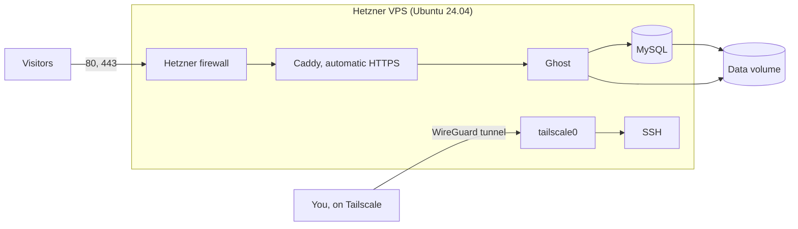

# Ghost on Hetzner with no public SSH

One command provisions a Hetzner VPS and deploys a Ghost blog with HTTPS. SSH is not reachable
from the internet at all: administration goes through a Tailscale tunnel.



| Part | Choice |
|---|---|
| Provisioning | OpenTofu, so reruns only change what differs |
| Server setup | cloud-init, which needs no SSH during deployment |
| Application | Ghost, MySQL and Caddy in Docker Compose, with pinned versions |
| Storage | A Hetzner volume holds all data, secrets and the Tailscale identity |
| SSH access | Tailscale, with two independent blocks on public port 22 |

## Prerequisites

- A Hetzner Cloud project and a Tailscale account (the free plan works).
- On your machine: `brew install opentofu jq`, plus the Tailscale app, logged in. The scripts also
  use `dig`, `openssl`, `curl` and `ssh`, which macOS includes.
- An SSH key pair, and a domain if you want one.

## Credentials

Copy the template. `.env` is ignored by Git, so your secrets stay on your machine.

```bash
cp .env.example .env
```

| Variable | Where to get it |
|---|---|
| `HCLOUD_TOKEN` | Hetzner Console → your project → Security → API tokens, with Read & Write |
| `TAILSCALE_AUTH_KEY` | Tailscale admin console → Settings → Keys → Generate auth key |
| `ACME_EMAIL` | Your email, for Let's Encrypt notices |
| `GHOST_DOMAIN` | Your domain, or leave it empty for a quick trial |
| `SSH_PUBLIC_KEY_FILE` | Defaults to `~/.ssh/id_ed25519.pub` |
| `GHOST_OWNER_EMAIL`, `GHOST_TITLE` | Optional. The owner's login email (default `ACME_EMAIL`) and the blog title |

**Avoid a lockout.** Tailscale node keys expire after 180 days by default, and this server has no
other way in. Either generate the auth key with a tag, which turns expiry off, or turn off key
expiry for the node in the admin console right after deploying. If you do get locked out, the
Hetzner web console still works.

## Domain and DNS

Use a domain you control. The public IP is reserved separately from the server, so it stays the
same across rebuilds and you set DNS only once:

1. Run `./deploy.sh`. It prints the record to create and waits for it.
2. Create the `A` record for your domain, pointing to that IP.
3. Caddy then gets the certificate by itself.

If `GHOST_DOMAIN` is empty, the blog uses `<ip>.sslip.io`, which needs no DNS setup. That is handy
for a trial, but `sslip.io` is not on the Public Suffix List, so every user of it shares Let's
Encrypt's rate limits. Caddy falls back to a second certificate authority (ZeroSSL) if that happens,
but use your own domain for anything lasting.

## Deploy

```bash
./deploy.sh --plan    # show real prices and the plan; changes nothing
./deploy.sh           # the same, then ask before creating anything
```

Prices come live from the Hetzner API before anything is created. If the server type isn't sold in
your location, the script stops and asks you to change it. It finishes by running `verify.sh`.

The deploy also creates the Ghost owner account straight away, because Ghost gives the blog to
whoever completes setup first. The generated password is saved in `.owner-password`, which Git
ignores. Log in at `https://<your-domain>/ghost` and change it. Rerunning reuses the same file.

Running `./deploy.sh` again is safe. With no changes it does nothing. Changing the stack or domain
rebuilds the server, which causes a few minutes of downtime and keeps all data. A new
`TAILSCALE_AUTH_KEY` alone changes nothing.

## Tunnel access

```bash
tailscale status                # find the node, named "ghost" by default
ssh root@<tailscale-ip>         # or ssh root@ghost with MagicDNS
```

On the server, `ghost-compose` wraps Docker Compose, for example `ghost-compose logs -f ghost`.

Public port 22 is blocked twice: the Hetzner firewall allows only 80 and 443, and the host firewall
allows SSH only on `tailscale0`. SSH accepts keys only.

## Verify

```bash
./verify.sh
```

It checks that the blog is served over trusted HTTPS, HTTP redirects, the firewall has only the two
web rules, and ports 22, 2368 and 3306 are closed from the internet. It also checks that SSH works
through the tunnel, the volume is mounted, and all containers and the backup timer are running.

## Troubleshooting

- **`verify.sh` says the server is not in your tailnet.** Check that Tailscale is running on your
  machine. If the node never joined, the auth key was probably invalid, expired or already used.
  Put a new one in `.env`, then run `./destroy.sh` followed by `./deploy.sh`. That recreates only
  the server, keeps your data and IP, and joins the tailnet with the new key.
- **The blog does not come up.** Through the tunnel, run `tail -f /var/log/ghost-bootstrap.log`
  and `ghost-compose ps`. The setup script is safe to run again: `/opt/ghost/bootstrap.sh`.
- **No certificate yet.** With your own domain, check that the `A` record points to the printed
  IP. Caddy retries by itself, so `ghost-compose logs caddy` shows the reason.
- **No way in at all.** In the Hetzner Console, open the server and reset its root password, then
  log in on the web console. That is a last resort, and the steps above should make it unnecessary.

## Backups

The server backs up the database and content every night to the volume, and keeps the last 7. A
copy on the same volume does not protect against losing the volume, and Hetzner's own server
backups don't include volumes. So keep a copy elsewhere:

```bash
./backup.sh     # creates a backup and copies it to backups/ through the tunnel
```

To restore, copy an archive to the server and run `ghost-restore`:

```bash
scp backups/ghost-<timestamp>.tar.gz root@<tailscale-ip>:/tmp/
ssh root@<tailscale-ip> ghost-restore /tmp/ghost-<timestamp>.tar.gz
```

## Cleanup

```bash
./destroy.sh                # remove the server; keep the volume and IP (still billed)
./destroy.sh --delete-data  # remove everything, after you type the server name
```

After a full cleanup, remove the node from the Tailscale admin console too.

## Secrets

- `.env` and the OpenTofu state are ignored by Git. The state contains the Tailscale auth key, so
  treat it as a secret.
- Database passwords are generated on the server and stored only on the volume.
- The auth key is deleted from the disk after use, but it remains in the server's Hetzner metadata.
  A one-off key with a short expiry makes that harmless.

## Limitations

- State is local to one machine. A team would need a shared, encrypted backend.
- No mail server is configured, so Ghost can't send newsletters or staff invitations. Login codes by
  email are turned off for the same reason. Add SMTP settings to `stack/compose.yml` if you need mail.
- One server: rebuilds and upgrades mean a few minutes of downtime.

## Testing

```bash
tests/test-local.sh
```

This needs Docker and jq, with no cloud account and no cost. It checks the scripts, OpenTofu config
and cloud-init schema, and runs the real `sshd` and `ufw` with this project's settings to confirm
that SSH is limited to the tunnel. It runs the server setup script against stubbed system
commands, twice, including a failed first start. It also runs real Ghost, MySQL and Caddy
containers to test HTTPS, owner creation, persistence, and backup and restore. CI runs it for
changes in this folder.
