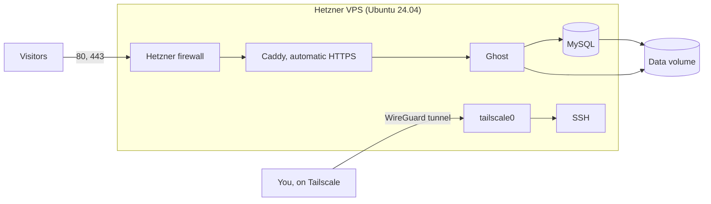

# Ghost on Hetzner with no public SSH: the infrastructure

This folder provisions the server and deploys the blog. The [root README](../README.md) gives the
overview.



| Part | Choice |
|---|---|
| Provisioning | OpenTofu, so reruns only change what differs |
| Server setup | cloud-init, which needs no SSH during deployment |
| Application | Ghost, MySQL and Caddy in Docker Compose, with pinned versions |
| Storage | A Hetzner volume holds all data, secrets and the Tailscale identity |
| SSH access | Tailscale, with two independent blocks on public port 22 |

## Prerequisites

- A Hetzner Cloud project and a Tailscale account (the free plan works).
- On your machine: `brew install opentofu jq`, plus the Tailscale app, logged in. The scripts also
  use `dig`, `openssl`, `curl` and `ssh`, which macOS includes.
- An SSH key pair, and a domain if you want one.

## Credentials

Copy the template. `.env` is ignored by Git, so your secrets stay on your machine.

```bash
cp .env.example .env
```

| Variable | Where to get it |
|---|---|
| `HCLOUD_TOKEN` | Hetzner Console → your project → Security → API tokens, with Read & Write |
| `TAILSCALE_AUTH_KEY` | Tailscale admin console → Settings → Keys → Generate auth key, one-off |
| `ACME_EMAIL` | Your email, for Let's Encrypt notices |
| `GHOST_DOMAIN` | Your domain, or leave it empty for a quick trial |
| `GHOST_OWNER_EMAIL`, `GHOST_TITLE` | Optional. The owner's login email (default `ACME_EMAIL`) and the blog title |
| `SSH_PUBLIC_KEY_FILE` | Defaults to `~/.ssh/id_ed25519.pub` |

**Avoid a lockout.** Tailscale node keys expire after 180 days by default, and this server has no
other way in. Either generate the auth key with a tag, which turns expiry off, or turn off key
expiry for the node in the admin console right after deploying. If you do get locked out, the
Hetzner web console still works.

## Domain and DNS

Use a domain you control. The public IP is reserved separately from the server, so it stays the
same across rebuilds and you set DNS only once:

1. Run `./deploy.sh`. It prints the record to create and waits for it.
2. Create the `A` record for your domain, pointing to that IP.
3. Caddy then gets the certificate by itself.

If `GHOST_DOMAIN` is empty, the blog uses `<ip>.sslip.io`, which needs no DNS setup. That is handy
for a trial, but `sslip.io` is not on the Public Suffix List, so every user of it shares Let's
Encrypt's rate limits. Caddy falls back to a second certificate authority (ZeroSSL) if that happens,
but use your own domain for anything lasting.

## Deploy

```bash
./deploy.sh --plan    # show real prices and the plan; changes nothing
./deploy.sh           # the same, then ask before creating anything
```

Before anything is created, the script checks that Tailscale is running on your machine, that the
Hetzner token works, and that no resources from an earlier deployment are left in the project
without their state file. Prices come live from the Hetzner API. If the server type isn't sold in
your location, the script stops and asks you to change it.

**The owner account is created before the blog is public.** Ghost gives the blog to whoever
completes its setup first. So the server starts only the database and Ghost, creates the owner from
inside the stack, and starts Caddy last. Until then, nothing answers on ports 80 and 443, and the
deploy waits for the blog to answer before it reports success. The generated password is saved to
`infra/.owner-password` (ignored by Git). Log in at `https://<your-domain>/ghost` and change it.

Running `./deploy.sh` again is safe. With no changes it does nothing. Changing the stack or domain
rebuilds the server, which causes a few minutes of downtime and keeps all data. A new
`TAILSCALE_AUTH_KEY` alone changes nothing.

## Tunnel access

```bash
tailscale status                # find the node, named "ghost" by default
ssh root@<tailscale-ip>         # or ssh root@ghost with MagicDNS
```

On the server, `ghost-compose` wraps Docker Compose, for example `ghost-compose logs -f ghost`.

Public port 22 is blocked twice: the Hetzner firewall allows only 80 and 443, and the host firewall
allows SSH only on `tailscale0`. SSH accepts keys only.

## Public routes

Everything on the public side, with the status each route returns anonymously (checked against the
real Ghost and Caddy images by `tests/test-local.sh`):

| Route | Status | Why it is reachable |
|---|---|---|
| `https://<domain>/` and posts | 200 | The blog |
| `/ghost/` | 200 | Ghost's admin login page, the normal way to log in |
| `/ghost/api/admin/users/` | 403 | The admin API refuses anonymous requests |
| `/ghost/api/admin/site/` | 200 | Ghost's public site information: the blog title and the Ghost version. It is open in Ghost by design, so the version is visible to anyone. |
| `/ghost/api/admin/authentication/setup/` | 200 | Reports whether the owner exists. Once it does, it accepts no new owner. |
| `/rss/`, `/sitemap.xml`, `/robots.txt` | 200 | Standard blog endpoints |
| HTTP on port 80 | 308 | Redirects to HTTPS |
| Any other port (22, 2368, 3306, 2019, …) | closed | The Hetzner firewall allows only 80 and 443 |

Things that are **not** reachable from the internet: Ghost itself on port 2368, MySQL on 3306,
Caddy's admin API on 2019, and SSH. Only Caddy publishes a port from the stack. Docker publishes
ports through its own firewall rules, which bypass `ufw`, so a new published port would be exposed
even with `ufw` in place. The test fails if any other service publishes a port.

The admin login at `/ghost/` is public on purpose, so the owner can reach it from any browser. If
you want it only through the tunnel, Caddy can restrict `/ghost*` to Tailscale addresses. That is a
one-line change, but it also makes the admin unreachable from other devices.

## Verify

```bash
./verify.sh
```

It checks, from the internet: that the blog answers over HTTPS with a trusted certificate, that HTTP
redirects, that HTTPS sends `Strict-Transport-Security`, that the admin API refuses anonymous
requests, that the owner account exists, that the Hetzner firewall allows only 80 and 443 and is
applied to the server, and that ports 22, 2368 and 3306 are closed. Through the tunnel, it checks
that SSH works, that password login is off, that the host firewall limits SSH to `tailscale0`, that
the volume is mounted, that the containers are running and that the backup timer is active.

## When the server can be deleted

The server is the only thing that can be removed cheaply and is easy to remove by mistake, so each
path to deletion has a guard:

| Path | What happens |
|---|---|
| `./destroy.sh` | Stops Ghost cleanly, lifts delete protection on the server, and removes the server and firewall. The volume and IP stay and keep billing. |
| `./destroy.sh --delete-data` | Asks you to type the server name, then removes everything, including backups on the volume. |
| `./deploy.sh` with a changed setting that forces a new server (`SERVER_NAME`, `LOCATION`, or the stack itself) | The plan shows that the server is replaced. You must type `replace server`. `--yes` refuses it. |
| Any plan that would delete the volume or the IP | Refused before anything changes. |
| Deleting the server in the Hetzner console | Blocked. The server has Hetzner delete protection. |
| Deleting the Hetzner resources while the local state file is missing | Refused. The deploy finds resources with the same names and stops, because creating new ones would double the cost. |
| Losing the Tailscale key | Not a deletion. The server keeps running, but you can't reach it. Use the Hetzner web console. |

The Tailscale and Hetzner state would be the next thing to protect. `terraform.tfstate` is local, is
ignored by Git, and contains the Tailscale key. Back it up somewhere safe; without it, the deploy
refuses to create anything that already exists.

## Backups

The server backs up the database and content every night to the volume, and keeps the last 7. A
copy on the same volume does not protect against losing the volume, and Hetzner's own server
backups don't include volumes. So keep a copy elsewhere:

```bash
./backup.sh     # creates a backup and copies it to backups/ through the tunnel
```

To restore, copy an archive to the server and run `ghost-restore`:

```bash
scp backups/ghost-<timestamp>.tar.gz root@<tailscale-ip>:/tmp/
ssh root@<tailscale-ip> ghost-restore /tmp/ghost-<timestamp>.tar.gz
```

## Cleanup

```bash
./destroy.sh                # remove the server; keep the volume and IP (still billed)
./destroy.sh --delete-data  # remove everything, after you type the server name
```

After a full cleanup, remove the node from the Tailscale admin console too.

## Troubleshooting

- **`verify.sh` says the server is not in your tailnet.** Check that Tailscale is running on your
  machine. If the node never joined, the auth key was probably invalid, expired or already used.
  Put a new one in `.env`, then run `./destroy.sh` followed by `./deploy.sh`. That recreates only
  the server, keeps your data and IP, and joins the tailnet with the new key.
- **The blog does not come up.** Through the tunnel, run `tail -f /var/log/ghost-bootstrap.log`
  and `ghost-compose ps`. The setup script is safe to run again: `/opt/ghost/bootstrap.sh`.
- **No certificate yet.** With your own domain, check that the `A` record points to the printed
  IP. Caddy retries by itself, so `ghost-compose logs caddy` shows the reason.
- **The owner password file is missing.** Run `./deploy.sh` again once the tunnel is up. It only
  fetches the password; it creates nothing.
- **No way in at all.** In the Hetzner Console, open the server and reset its root password, then
  log in on the web console. That is a last resort, and the steps above should make it unnecessary.

## Secrets

- `.env`, the OpenTofu state, `.owner-password` and backups are ignored by Git. The state contains
  the Tailscale auth key, so treat it as a secret.
- Database passwords and the owner password are generated on the server and stored only on the
  volume, in `secrets/` with mode 600. `.owner-password` on your machine is a copy of the owner one.
- The Tailscale auth key is deleted from the disk after use, but it remains in the server's Hetzner
  metadata. A one-off key with a short expiry makes that harmless.
- The owner password is passed to Ghost's setup as a command argument, so it is briefly visible in
  the process list on the server. Only root can see it, and the window is a few seconds.

## Limitations

- State is local to one machine. A team would need a shared, encrypted backend.
- No mail server is configured, so Ghost can't send newsletters or staff invitations. Login codes by
  email are turned off for the same reason. Add SMTP settings to `stack/compose.yml` if you need mail.
- One server: rebuilds and upgrades mean a few minutes of downtime.

## Testing

```bash
tests/test-local.sh
```

This needs Docker and jq, with no cloud account and no cost. It checks:

- ShellCheck, OpenTofu format, validation and a full plan, and the cloud-init schema.
- The deletion guards, run on plan files of each shape: a protection-only change is allowed, a
  server type change or replacement is refused, and a volume or IP deletion is detected.
- The real `sshd` and `ufw` with this project's settings, so SSH is limited to keys and the tunnel.
- The first-boot script, run twice against stubbed system commands. It covers a failed start, a
  rebuild with a spent auth key, and that Caddy starts only after the owner exists.
- Real Ghost, MySQL and Caddy containers: the blog is unreachable before the owner exists, HTTPS and
  its headers work afterwards, the public routes behave as listed above, only Caddy publishes ports,
  running the owner setup again creates no second owner, data survives restarts, and a backup
  restores onto an empty server with its owner.

CI runs it for changes in this folder.

**Not tested here:** anything that needs a real Hetzner account or a real Tailscale network. That
includes cloud-init timing on Ubuntu, the volume attaching, Tailscale joining, the live checks in
`verify.sh`, and the Hetzner API behaviour the deletion guards depend on.
